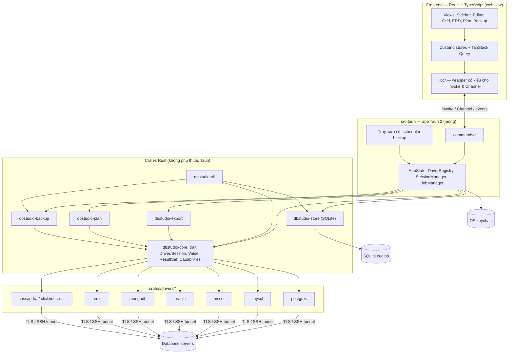

# DBStudio — Kiến trúc & công nghệ

> Trạng thái: bản nháp v0.1 (Giai đoạn 0). Mã yêu cầu tham chiếu [requirements.md](requirements.md); thứ tự xây dựng xem [roadmap.md](roadmap.md).

## 1. Nguyên tắc

1. **Core không phụ thuộc Tauri.** `dbstudio-core` và các crate driver/export/plan/backup chỉ phụ thuộc Rust thuần + tokio, để tái dùng cho CLI headless (BACKUP-15) và test không cần cửa sổ.
2. **`src-tauri` mỏng.** Chỉ chứa command IPC, quản lý state, cửa sổ, tray, lịch chạy. Không có logic SQL/dialect trong `src-tauri`.
3. **Capability-driven UI.** Mỗi driver khai báo `Capabilities`; frontend bật/tắt tính năng theo đó, không `if (kind === 'redis')` rải rác (NFR-EXT-02).
4. **Secret không bao giờ rời Rust.** Mật khẩu/passphrase đọc từ keychain ngay trước khi kết nối, không trả về frontend, không vào log, không vào SQLite (NFR-SEC-01).
5. **An toàn được thực thi ở backend.** Read-only, xác nhận lệnh phá huỷ, giới hạn dòng được kiểm tra ở Rust; UI chỉ hiển thị (NFR-SEC-03).
6. **Stream, không gom.** Kết quả query, export, backup đi theo lô; không nạp toàn bộ vào RAM (NFR-PERF-02).
7. **Mọi thao tác dài huỷ được** qua id tác vụ (query id / job id).

## 2. Sơ đồ tổng quan



## 3. Cấu trúc repository

```
dbstudio/
├── Cargo.toml                 # workspace
├── package.json, pnpm-lock.yaml, vite.config.ts, tsconfig.json
├── src/                       # frontend React
│   ├── app/                   # layout, router, providers
│   ├── features/              # connections, explorer, editor, grid, erd, plan, export, backup, settings
│   ├── components/            # UI dùng chung
│   ├── lib/                   # ipc.ts (wrapper invoke), types.ts (kiểu khớp Rust), mock.ts (dữ liệu giả khi chạy ngoài Tauri)
│   ├── stores/                # Zustand
│   └── locales/               # vi.json, en.json
├── src-tauri/                 # app Tauri (crate binary)
│   ├── src/{main.rs, lib.rs, commands/, state.rs, tray.rs}
│   ├── capabilities/          # quyền Tauri tối thiểu
│   └── tauri.conf.json
├── crates/
│   ├── dbstudio-core/         # GĐ0
│   ├── dbstudio-store/        # GĐ1
│   ├── drivers/{postgres,mysql}/   # GĐ1; mssql, oracle (GĐ3); mongodb, redis (GĐ4); ...
│   ├── dbstudio-export/       # GĐ5
│   ├── dbstudio-plan/         # GĐ7
│   ├── dbstudio-backup/       # GĐ8
│   └── dbstudio-cli/          # GĐ8+
└── docs/
```

## 4. `dbstudio-core` — mô hình miền

Các kiểu chính (tên là hợp đồng; chi tiết trường có thể tinh chỉnh khi hiện thực):

| Kiểu | Vai trò |
|---|---|
| `DbKind` | Enum loại DB: `Postgres`, `MySql`, `SqlServer`, `Oracle`, `MongoDb`, `Redis`, `Cassandra`, `ScyllaDb`, `ClickHouse`, ... NewSQL dùng lại driver theo giao thức, phân biệt bằng `server_info`. |
| `Capabilities` | Tập cờ: `sql`, `transactions`, `explain`, `explain_analyze`, `erd`, `ddl`, `edit_rows`, `cancel`, `multiple_result_sets`, `schemas`, `document_view`, `key_value_view`, `native_backup`, ... Serialize sang frontend. |
| `DriverDescriptor` | Metadata driver: `kind`, tên hiển thị, port mặc định, `Capabilities`, schema form cấu hình (danh sách trường riêng của driver), dialect editor. |
| `ConnectionConfig` | Cấu hình không chứa secret: host, port, database, user, TLS, SSH, tuỳ chọn riêng (`serde_json::Value`), `secret_ref` (khoá tra keychain). Secret truyền riêng qua `Secret` (bọc `secrecy`-style, không `Debug`/`Serialize`). |
| `Driver` (trait) | Factory: `descriptor()`, `connect(config, secrets) -> Box<dyn Session>`. |
| `Session` (trait) | Kết nối đang mở: `ping`, `server_info`, `execute(request, sink)`, `cancel(query_id)`, `list_children(path)`, `close`. Các năng lực tuỳ chọn (DDL, explain, edit) là trait mở rộng, gọi qua `as_ddl()`/`as_explain()`... trả `Option`. |
| `ObjectPath` / `ObjectNode` | Định danh và nút cây đối tượng (BROWSE-01): loại nút, tên, có con hay không, thuộc tính hiển thị. |
| `Value` | Giá trị chung: `Null`, `Bool`, `Int(i64)`, `Float(f64)`, `Text`, `Bytes`, `Json`, `DateTime`/`Date`/`Time` (chuỗi ISO 8601 + tz), `Uuid`, `Array`, `Document`. **`BigInt`/`Decimal` truyền dạng chuỗi** để JS không mất độ chính xác (DATA-09); `Int` vượt ±2^53 cũng chuyển chuỗi khi serialize. |
| `ResultSet` | `columns: Vec<ColumnMeta>` (tên, kiểu gốc, kiểu chung, nullable, thuộc bảng/khoá nếu biết) + các lô `rows`. Kèm `rows_affected`, `notices`, `elapsed`. |
| `QueryRequest` | `query_id`, câu lệnh, tham số, `row_limit`, `batch_size`, chế độ transaction. |
| `DriverRegistry` | Đăng ký driver theo `DbKind`; `src-tauri` và CLI khởi tạo registry với các driver được bật qua cargo feature. |
| `Error` | Lỗi có phân loại: `Connection`, `Auth`, `Tls`, `Timeout`, `Cancelled`, `Syntax { position }`, `Permission`, `ReadOnlyViolation`, `Unsupported`, `Driver(String)`. |

Phác hoạ trait (minh hoạ, không phải code cuối):

```rust
#[async_trait]
pub trait Session: Send + Sync {
    async fn ping(&self) -> Result<()>;
    async fn server_info(&self) -> Result<ServerInfo>;
    async fn execute(&self, req: QueryRequest, sink: &mut dyn ResultSink) -> Result<ExecSummary>;
    async fn cancel(&self, query_id: QueryId) -> Result<()>;
    async fn list_children(&self, path: &ObjectPath) -> Result<Vec<ObjectNode>>;
    async fn close(self: Box<Self>) -> Result<()>;
    fn as_ddl(&self) -> Option<&dyn DdlProvider> { None }
    fn as_explain(&self) -> Option<&dyn ExplainProvider> { None }
}
```

`ResultSink` nhận `on_columns`, `on_rows(batch)`, `on_notice`, `on_result_end` — `src-tauri` hiện thực sink bằng Tauri Channel, CLI/export hiện thực bằng writer file.

## 5. Driver

| DB | Crate | Ghi chú |
|---|---|---|
| PostgreSQL (+ CockroachDB, YugabyteDB) | `tokio-postgres` + `tokio-postgres-rustls` | Kiểm soát giao thức tốt hơn `sqlx` cho query động: simple query nhiều câu lệnh, cancel token, NOTICE, kiểu không biết trước. |
| MySQL/MariaDB (+ TiDB) | `mysql_async` (feature rustls) | Multi-statement, `KILL QUERY` qua kết nối phụ để huỷ. |
| MSSQL | `tiberius` | TDS thuần Rust; nhiều result set, PRINT/info message. Huỷ qua attention packet. Xác thực Windows hạn chế ngoài Windows (câu hỏi mở 6). |
| Oracle | `oracle` (ODPI-C) | **Cần Oracle Instant Client** khi chạy → rủi ro đóng gói. Nạp động, driver báo `Unavailable` kèm hướng dẫn nếu thiếu. Đánh giá phương án thuần Rust ở GĐ3. |
| MongoDB | `mongodb` (chính thức) | BSON ↔ `Value::Document`, Extended JSON cho UI. |
| Redis / Valkey | `redis` (redis-rs, tokio) | `SCAN` để duyệt key; cluster là Should về sau. |
| Cassandra / ScyllaDB | `scylla` | CQL, paging native, tracing cho PLAN. |
| ClickHouse | `clickhouse` (HTTP) | Có thể cần HTTP thô cho query động/định dạng tuỳ ý — đánh giá ở GĐ10. |

Mỗi driver là một crate riêng trong `crates/drivers/<tên>`, bật/tắt qua cargo feature ở `src-tauri` để giảm thời gian build khi phát triển.

## 6. Thư viện Rust khác

| Mục đích | Crate |
|---|---|
| Async runtime | `tokio` |
| Secret | `keyring` |
| Lưu trữ cục bộ | `rusqlite` (feature `bundled`) + migration có phiên bản (NFR-REL-02) |
| SSH tunnel | `russh` (+ `russh-keys`) — forward cổng local → DB |
| TLS | `rustls` (+ `rustls-native-certs` để dùng kho chứng thư hệ thống) |
| Phân tích SQL | `sqlparser` — tách câu lệnh, phân loại đọc/ghi/phá huỷ (CONN-10/11), tìm câu lệnh tại con trỏ. Fallback tách thủ công khi parser không hiểu dialect (PL/SQL block, T-SQL `GO`). |
| XLSX | `rust_xlsxwriter` (ghi), `calamine` (đọc, cho IMPORT) |
| CSV / JSON | `csv`, `serde_json` |
| Nén / mã hoá | `flate2`, `zstd`, `zip`; `aes-gcm` + `argon2` (BACKUP-05) |
| Lịch | `cron` (parse biểu thức) + vòng lặp tokio trong tiến trình app |
| Log | `tracing` + `tracing-appender` (file xoay vòng), lớp lọc che secret |
| Kiểu cho TS | GĐ0 viết tay `src/lib/types.ts` khớp struct Rust (`tauri-specta` 2.x mới có bản rc). Chuyển sang sinh tự động (`tauri-specta` hoặc `ts-rs`) khi có bản ổn định — xem mục 14. |

Plugin Tauri dự kiến: `dialog`, `fs` (giới hạn phạm vi), `notification`, `autostart`, `updater`, `window-state`, `single-instance`, `log`.

## 7. Frontend

| Mục đích | Lựa chọn |
|---|---|
| Nền tảng | React 19 + TypeScript (strict) + Vite, pnpm |
| Style | Tailwind CSS v4; biến CSS cho theme sáng/tối |
| State | Zustand (UI state: tab, layout, kết nối đang mở) + TanStack Query (cache dữ liệu lấy qua IPC: cây đối tượng, metadata) |
| Editor | CodeMirror 6 + `@codemirror/lang-sql` (dialect PostgreSQL, MySQL, MSSQL, PLSQL, Cassandra có sẵn; autocomplete theo schema). Nhẹ hơn Monaco, hợp webview. |
| Lưới | TanStack Table + TanStack Virtual. Benchmark ở GĐ1 (1 triệu dòng, 3 webview); nếu không đạt NFR-PERF-03 → chuyển canvas grid (vd. Glide Data Grid). |
| Sơ đồ | React Flow (`@xyflow/react`) + `elkjs` (layout) cho ERD và plan; xuất SVG/PNG qua `html-to-image`, PDF qua thư viện tạo PDF (chốt ở GĐ6). |
| i18n | i18next + react-i18next; khoá dịch theo feature; mặc định theo ngôn ngữ hệ thống, fallback en, lựa chọn lưu ở `localStorage`. |
| Test | Vitest + Testing Library; E2E là Could (WebdriverIO + tauri-driver). |

## 8. IPC

- **Command có kiểu**: mỗi command Tauri nhận/trả struct serde; kiểu TS tương ứng nằm ở `src/lib/types.ts` (mục 6), frontend chỉ gọi qua `src/lib/ipc.ts`.
- **Stream kết quả**: `execute_query(req, channel: Channel<QueryEvent>)` trả về ngay `query_id`; Rust đẩy các sự kiện `Columns`, `Rows(batch)`, `Notice`, `ResultEnd`, `Done`, `Error` qua Channel. Frontend ghép lô vào store của lưới.
- **Huỷ**: `cancel_query(query_id)` → `Session::cancel`. Tương tự `cancel_job(job_id)` cho export/backup.
- **Tác vụ nền**: `JobManager` trong `AppState` giữ job export/backup/restore; tiến độ phát qua event toàn cục `job://progress`.
- **Phiên**: `SessionManager` ánh xạ `session_id` → `Box<dyn Session>`; mỗi tab editor có thể dùng phiên riêng (để transaction thủ công không lẫn nhau), cây đối tượng dùng một phiên metadata riêng.
- **Lỗi**: `Error` serialize thành `{ kind, message, position? }`; UI dịch `kind` qua i18n.

## 9. Lưu trữ cục bộ

- SQLite trong thư mục dữ liệu app (`app_data_dir`): bảng `connections`, `connection_groups`, `query_history`, `saved_queries`, `erd_layouts`, `backup_jobs`, `backup_runs`, `settings`.
- Không cột nào chứa secret; `connections.secret_ref` trỏ tới entry keychain (service `dbstudio`, account = id kết nối).
- Trạng thái UI nhẹ (tab đang mở, kích thước panel) có thể lưu ở SQLite hoặc `localStorage` — không lưu nội dung nhạy cảm.

## 10. Bảo mật

| Chủ đề | Cách làm |
|---|---|
| Secret | Keychain qua `keyring`; kiểu `Secret` không `Debug`/`Serialize`; lớp `tracing` che chuỗi giống connection string. |
| Read-only / phá huỷ | `sqlparser` phân loại câu lệnh trước khi gửi; với prod, command trả `ConfirmationRequired { statements }`, UI hỏi, gọi lại kèm token xác nhận dùng một lần. Không hiểu câu lệnh → coi là ghi. |
| Tauri | `capabilities/` chỉ cấp quyền cần dùng cho cửa sổ chính; `fs` giới hạn phạm vi; không bật `shell` trừ khi gọi tool native (GĐ8, chỉ cho phép đường dẫn đã cấu hình). |
| CSP | `default-src 'self'`; không script inline/remote; `connect-src` chỉ `ipc:` và `tauri:`. |
| Telemetry | Không có. Kiểm tra cập nhật là kết nối mạng duy nhất ngoài DB và có thể tắt. |

## 11. Backup tự động & chạy nền

- Scheduler chạy trong tiến trình app (tokio task), đọc `backup_jobs` từ SQLite, tính lần chạy kế tiếp bằng `cron`.
- Đóng cửa sổ khi có lịch → ẩn xuống tray (cấu hình được); `tauri-plugin-autostart` cho khởi động cùng OS; `single-instance` để không chạy 2 scheduler.
- Lần chạy lỡ: khi khởi động, so `last_run` với lịch → chạy bù một lần hoặc bỏ qua (BACKUP-12).
- `dbstudio-cli` dùng lại `dbstudio-backup` + `dbstudio-store`, đọc secret từ cùng keychain → gắn vào cron/launchd/Task Scheduler khi cần chạy không có GUI.

## 12. Phân tích plan

`dbstudio-plan` định nghĩa `PlanNode { op, object, est_cost, est_rows, actual_rows, actual_time_ms, loops, children, raw }` và một parser cho mỗi định dạng nguồn (JSON PostgreSQL, JSON MySQL, XML SHOWPLAN, bảng `PLAN_TABLE`, explain MongoDB, ...). Quy tắc cảnh báo (PLAN-04) chạy trên cây chuẩn hoá nên dùng chung cho mọi DB. Parser là hàm thuần → unit test bằng file plan mẫu.

## 13. Kiểm thử & CI

- Unit test trong từng crate; parser plan và export dùng fixture file.
- Integration test driver: `docker compose` (hoặc `testcontainers`) dựng PostgreSQL, MySQL, MariaDB, MSSQL, Oracle Free, MongoDB, Redis; chạy theo feature/biến môi trường để dev có thể bỏ qua.
- CI (GitHub Actions): matrix Windows/macOS/Linux cho build + lint + unit test; job Linux riêng cho integration test có Docker; job release ở GĐ9.

## 14. Quyết định cần chốt khi tới giai đoạn

| Quyết định | Khi nào |
|---|---|
| Công cụ sinh kiểu TS (`tauri-specta` vs `ts-rs`) | GĐ0: tạm viết tay vì `tauri-specta` 2.x chưa có bản ổn định. Xét lại ở GĐ1 khi số command tăng. |
| Giữ TanStack Virtual hay chuyển canvas grid | GĐ1 (sau benchmark) |
| Oracle: `oracle` + Instant Client hay phương án thuần Rust | GĐ3 |
| Định dạng file backup tích hợp (SQL thuần + manifest hay định dạng riêng) | GĐ8 |
| Kênh auto-update và hạ tầng ký số | GĐ9 |
