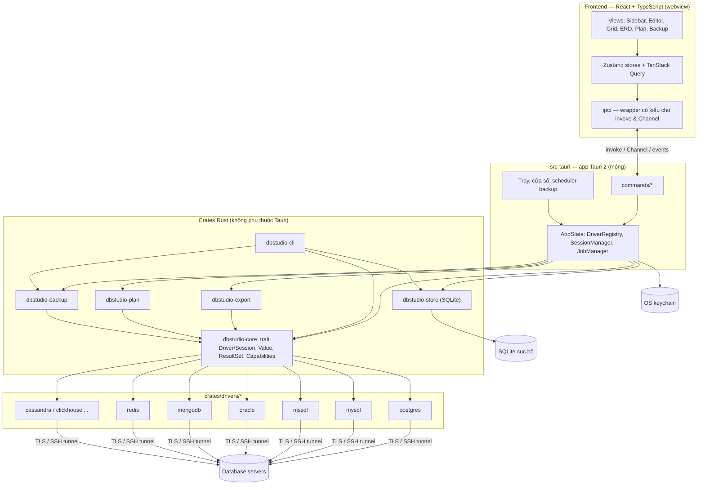

# DBStudio — Kiến trúc & công nghệ

> Trạng thái: v0.2 (cập nhật sau khi hiện thực Giai đoạn 1). Các mục 3–5, 8–10, 13–15 mô tả hiện thực thật; mục nào còn là dự kiến thì ghi rõ. Mã yêu cầu tham chiếu [requirements.md](requirements.md); thứ tự xây dựng xem [roadmap.md](roadmap.md).

## 1. Nguyên tắc

1. **Core không phụ thuộc Tauri.** `dbstudio-core` và các crate driver/export/plan/backup chỉ phụ thuộc Rust thuần + tokio, để tái dùng cho CLI headless (BACKUP-15) và test không cần cửa sổ.
2. **`src-tauri` mỏng.** Chỉ chứa command IPC, quản lý state, cửa sổ, tray, lịch chạy. Không có logic SQL/dialect trong `src-tauri`.
3. **Capability-driven UI.** Mỗi driver khai báo `Capabilities`; frontend bật/tắt tính năng theo đó, không `if (kind === 'redis')` rải rác (NFR-EXT-02).
4. **Secret không bao giờ rời Rust.** Mật khẩu/passphrase đọc từ keychain ngay trước khi kết nối, không trả về frontend, không vào log, không vào SQLite (NFR-SEC-01).
5. **An toàn được thực thi ở backend.** Read-only, xác nhận lệnh phá huỷ, giới hạn dòng được kiểm tra ở Rust; UI chỉ hiển thị (NFR-SEC-03).
6. **Stream, không gom.** Kết quả query, export, backup đi theo lô; không nạp toàn bộ vào RAM (NFR-PERF-02).
7. **Mọi thao tác dài huỷ được** qua id tác vụ (query id / job id).

## 2. Sơ đồ tổng quan



## 3. Cấu trúc repository

Cấu trúc thực tế sau GĐ1 (mục đánh dấu *dự kiến* chưa tồn tại):

```
dbstudio/
├── Cargo.toml                 # workspace: src-tauri, crates/dbstudio-*, crates/drivers/*
├── package.json, pnpm-lock.yaml, vite.config.ts, tsconfig.json
├── src/                       # frontend React
│   ├── app/                   # App, StatusBar, providers, tabRegistry (không dùng router)
│   ├── features/
│   │   ├── connections/       # thanh bên kết nối, dialog kết nối/nhóm/mật khẩu, cảnh báo TLS
│   │   ├── explorer/          # cây đối tượng ảo hoá
│   │   ├── data/              # tab bảng: lưới, bộ lọc, trình xem ô, tab Cấu trúc, DDL
│   │   ├── tabs/, welcome/
│   │   └── (dự kiến) editor, erd, plan, export, backup, settings
│   ├── components/ui/         # UI dùng chung
│   ├── lib/                   # ipc.ts (wrapper invoke/Channel), types.ts (kiểu viết tay khớp Rust),
│   │                          # objectPath.ts, i18n.ts, dialog.ts, mock/ (IPC giả trong bộ nhớ khi chạy ngoài Tauri)
│   ├── stores/                # Zustand: sessions, tabs, theme
│   ├── locales/{vi,en}/       # common, connections, explorer, data (.json); test quét khoá
│   └── test/                  # setup Vitest
├── src-tauri/                 # app Tauri (crate binary)
│   ├── src/{main.rs, lib.rs, state.rs, session.rs (SessionManager), sink.rs (EventSink),
│   │        logging.rs, commands/{app,connections,sessions,browse}.rs, tests.rs, it.rs}
│   ├── capabilities/default.json   # core:default + dialog open/save
│   └── tauri.conf.json
├── crates/
│   ├── dbstudio-core/         # GĐ0, mở rộng ở GĐ1
│   ├── dbstudio-store/        # GĐ1: SQLite + keychain + import/export
│   ├── drivers/{postgres,mysql}/   # GĐ1 (crate dbstudio-driver-postgres/-mysql); mssql, oracle (GĐ3); mongodb, redis (GĐ4); ...
│   └── (dự kiến) dbstudio-export (GĐ5), dbstudio-plan (GĐ7), dbstudio-backup (GĐ8), dbstudio-cli (GĐ8+)
├── docker/                    # compose.test.yml + gen-certs.sh (DB cho integration test)
├── .github/workflows/ci.yml
└── docs/
```

Chưa có `tray.rs` (GĐ8). Driver bật/tắt qua cargo feature `postgres`, `mysql` của `src-tauri`.

## 4. `dbstudio-core` — mô hình miền

Các kiểu chính như đã hiện thực ở GĐ1 (nguồn sự thật: doc comment trong `crates/dbstudio-core/src/`). Mọi kiểu đi qua IPC serialize camelCase.

| Kiểu | Vai trò |
|---|---|
| `DbKind` | Enum loại DB: `Postgres`, `MySql`, `SqlServer`, `Oracle`, `MongoDb`, `Redis`, `Cassandra`, `ScyllaDb`, `ClickHouse`, ... NewSQL dùng lại driver theo giao thức, phân biệt bằng `server_info`. |
| `Capabilities` | Tập cờ bool: `sql`, `transactions`, `schemas`, `multiple_databases`, `explain`, `explain_analyze`, `foreign_keys`, `cancel_query`, `logical_backup`, `data_editing`, `stored_routines`, `triggers`, `views`, `sequences`. Thêm cờ khi giai đoạn sau cần (document/key-value view...). |
| `DriverDescriptor` | `kind`, `Capabilities`, `DriverStatus` (`Available` / `Planned` kèm giai đoạn dự kiến). `DriverRegistry` trộn driver đã đăng ký với descriptor `Planned` để UI luôn liệt kê đủ 9 hệ. Schema form cấu hình theo driver và dialect editor chưa có (form hiện cấu hình ở frontend, `src/features/connections/kindConfig.ts`). |
| `ConnectionConfig` | Không chứa secret: `id`, `name`, `kind`, `host`, `port`, `database`, `username`, `tls: TlsConfig { mode, ca_cert_path, client_cert_path, client_key_path }`, `connect_timeout_ms`, `read_only`, `environment`, `options: BTreeMap<String,String>`. Không có `secret_ref`: secret tra keychain theo `id` của kết nối (mục 9). `TlsMode`: `disable`/`prefer` (mặc định)/`require`/`verifyCa`/`verifyFull`. SSH chưa có (GĐ3). |
| `Secret` | Bọc chuỗi bí mật; `Debug` in `***`, chỉ `Deserialize` (không `Serialize`) để nhận mật khẩu từ dialog nhưng không bao giờ gửi ngược ra frontend. Đi riêng khỏi config: `Driver::connect(&config, Option<&Secret>)`. |
| `Driver` (trait) | `descriptor()`, `connect(config, secret) -> Box<dyn Session>`. |
| `Session` (trait) | Một session đại diện cho **cả server**: driver tự quản lý kết nối bên trong (kể cả nhiều database), mọi method gọi đồng thời được. Bắt buộc: `ping`, `server_info`, `execute(req, sink)`, `list_children(path)`, `close`. Có mặc định trả `Unsupported`: `cancel(query_id)`, `object_ddl(path)`, `table_details(path)`, `fetch_table(req, sink)`, `count_table(req)`. Thiết kế `as_ddl()`/`as_explain()` trả `Option` ở bản nháp v0.1 **không dùng**; năng lực tuỳ chọn là method mặc định + cờ `Capabilities`. |
| `ObjectPath` / `ObjectNode` | `ObjectPath { segments: [{ kind, name }] }`; `ObjectNode { path, kind, name, has_children, detail }`. Xem hợp đồng đường dẫn bên dưới. |
| `Value` | Tagged `{ "t": tag, "v": payload }`: `null`, `bool`, `int`/`uInt` (số JSON khi trong ±(2^53−1), ngoài khoảng đó là **chuỗi**), `float` (`NaN`/`Infinity` dạng chuỗi), `decimal`/`text`/`date`/`time`/`dateTime`/`timestamp`/`uuid` (chuỗi), `bytes` (base64), `json` (**văn bản JSON gốc** do DB trả về), `array`, `document` (DATA-09). |
| `ColumnMeta` / `QueryEvent` | `ColumnMeta { name, type_name, value_kind, nullable? }`. `QueryEvent` là sự kiện stream: `columns`, `rows`, `message`, `statementEnd { end: { outcome: rows/affected/done, elapsed_ms } }`. |
| `QueryRequest` | `text`, `query_id`, `max_rows`, `timeout_ms`, `batch_size`, `database`. Chưa có tham số và chế độ transaction (GĐ2). |
| `TableDataRequest` / `TableCountRequest` | Đọc bảng có cấu trúc: `table`, `filters: [ColumnFilter { column, op, values }]` (AND), `raw_where`, `sort: [SortKey]`, `offset`, `limit`, `batch_size`; `query_id` để huỷ (với count là tuỳ chọn). |
| `TableDetails` | Cột, index, foreign key, thống kê ước tính (BROWSE-08). |
| `Error` | `Connection`, `Authentication`, `Query { message, position }`, `Unsupported`, `Cancelled`, `Timeout`, `Tls`, `NotFound`, `Storage`, `Io`, `Other`. Chưa có `ReadOnlyViolation`/`Permission` (thêm ở GĐ2 khi có phân loại câu lệnh). |

Hợp đồng đã chốt ở GĐ1 (driver mới phải tuân theo):

- **Đường dẫn phản ánh đúng cây, kể cả đoạn `Folder`.** Path của một nút = path cha (path đã truyền vào `list_children`) + đoạn của chính nút, vd. `[Database db, Folder tables, Table t, Folder columns, Column c]`. Tên đoạn Folder là khoá cố định (`folder::TABLES = "tables"`, ...) để UI dịch, không bao giờ bản địa hoá. Driver phải chấp nhận path **có hoặc không có** đoạn Folder ở mọi method. Frontend chỉ dùng lại `path` mà backend trả về, không tự dựng.
- **`Value::Json` mang văn bản gốc**: thứ tự khoá và chữ số giữ nguyên; frontend parse bằng `lossless-json` để không mất độ chính xác số lớn.
- **`fetch_table` luôn thêm khoá chính** (không có thì một unique `NOT NULL`) vào cuối `ORDER BY`, kể cả khi `sort` rỗng, để phân trang OFFSET xác định. Bảng/view không có khoá như vậy thì thứ tự giữa các trang không được đảm bảo.
- **Ngữ nghĩa bộ lọc** (`FilterOp`): `contains`/`notContains`/`startsWith`/`endsWith` không phân biệt hoa thường, so trên dạng text của cột, `%`/`_` người dùng gõ là ký tự thường; phân biệt dấu và so sánh `=`/`<>`/thứ tự trên chuỗi theo collation của DB nên có thể khác nhau giữa các DB; `notContains` theo `NOT LIKE` (loại cả dòng NULL); `in` rỗng không khớp dòng nào.
- **`raw_where`** là phần thân WHERE người dùng gõ, được tin cậy (không escape) nhưng phải là **một biểu thức duy nhất**; driver phải chặn việc chèn thêm câu lệnh (mục 5).
- Lỗi `Query` từ `fetch_table`/`count_table` có `position: None` (SQL do app sinh). Với `execute`, `position` là offset ký tự (từ 0) trong **toàn bộ** `req.text`.
- **`cancel`**: id lạ hoặc đã xong trả `Ok(())`. `count_table` huỷ được khi có `query_id`.
- **`Error` sang frontend** dạng `{ kind, message }` (+ `position` khi có, + `capability` với `Unsupported`); `message` **không kèm tiền tố tiếng Anh** của `Display` ("connection error: ..."), UI tự dịch `kind`.

`ResultSink` nhận `on_columns`, `on_rows(batch)`, `on_message`, `on_statement_end`; trả `Err` để yêu cầu driver dừng. `src-tauri` hiện thực bằng `EventSink` (đẩy `QueryEvent` qua Tauri Channel); `CollectingSink`/`execute_collect` gom kết quả nhỏ cho test.

## 5. Driver

| DB | Crate | Ghi chú |
|---|---|---|
| PostgreSQL (+ CockroachDB, YugabyteDB) | `tokio-postgres` + `tokio-postgres-rustls` (rustls/`ring`) | **Đã hiện thực ở GĐ1**, chi tiết bên dưới. Kiểm soát giao thức tốt hơn `sqlx` cho query động: simple query nhiều câu lệnh, cancel token, NOTICE, kiểu không biết trước. |
| MySQL/MariaDB (+ TiDB) | `mysql_async` 0.37 (feature `default-rustls-ring`) | **Đã hiện thực ở GĐ1**, chi tiết bên dưới. `KILL QUERY` qua kết nối riêng để huỷ. |
| MSSQL | `tiberius` | TDS thuần Rust; nhiều result set, PRINT/info message. Huỷ qua attention packet. Xác thực Windows hạn chế ngoài Windows (câu hỏi mở 6). |
| Oracle | `oracle` (ODPI-C) | **Cần Oracle Instant Client** khi chạy → rủi ro đóng gói. Nạp động, driver báo `Unavailable` kèm hướng dẫn nếu thiếu. Đánh giá phương án thuần Rust ở GĐ3. |
| MongoDB | `mongodb` (chính thức) | BSON ↔ `Value::Document`, Extended JSON cho UI. |
| Redis / Valkey | `redis` (redis-rs, tokio) | `SCAN` để duyệt key; cluster là Should về sau. |
| Cassandra / ScyllaDB | `scylla` | CQL, paging native, tracing cho PLAN. |
| ClickHouse | `clickhouse` (HTTP) | Có thể cần HTTP thô cho query động/định dạng tuỳ ý — đánh giá ở GĐ10. |

Mỗi driver là một crate riêng trong `crates/drivers/<tên>`, bật/tắt qua cargo feature ở `src-tauri` để giảm thời gian build khi phát triển.

### 5.1 Lựa chọn hiện thực của hai driver GĐ1

| Chủ đề | PostgreSQL (`crates/drivers/postgres`) | MySQL/MariaDB (`crates/drivers/mysql`) |
|---|---|---|
| Phiên bản đã test | 16.15 (TLS), 12.22 | MySQL 8.4.11 (TLS), MariaDB 10.6.28. Truy vấn metadata tránh tính năng chỉ có ở 8.x nhưng **chưa test 5.7** và MariaDB 10.4. |
| Kết nối / pool | Pool lười theo **từng database**: tối đa 4 kết nối dữ liệu + 2 kết nối dành riêng cho truy vấn catalog (cây, DDL, chi tiết, ping) để đọc dữ liệu chậm không chặn duyệt cây. Option `application_name` được dùng. | Một pool `mysql_async`: `pool_max` 1–32 (mặc định 8) qua `options`; option `init_command` chạy trên mỗi kết nối mới (bị loại khi nhập profile, mục 9). |
| Giải mã giá trị | Định dạng **text** của server (simple query) + kiểu cột lấy từ `prepare`. Không mất mát (numeric, int8, NaN); kiểu không có bộ giải mã riêng (enum, range, inet, composite, extension...) giữ nguyên text nên không cột nào làm query lỗi. Session đặt `TimeZone=UTC`, `DateStyle=ISO`, `extra_float_digits=3`, `bytea_output=hex`. | Giao thức **text** (`query_iter`), giải mã theo kiểu cột. `json` của MySQL → `Value::Json` (về text nếu không parse được); `json` của MariaDB là alias `longtext` → `Value::Text`. |
| Stream | Server-side cursor (`DECLARE ... NO SCROLL CURSOR` + `FETCH FORWARD n`) theo lô (mặc định 1.000 dòng). | `query_iter` đọc từng dòng từ socket, đẩy theo lô (mặc định 1.000) → bộ nhớ chặn theo kích thước lô. |
| Huỷ | Cancel request của giao thức (`CancelToken`, đi qua TLS nếu có). Một "cổng" tuần tự hoá giữa gửi cancel và kết thúc request; kết nối đã/đang bị cancel không trả về pool, nên cancel muộn không trúng câu lệnh sau. | `KILL QUERY <id>` qua một kết nối ngắn hạn riêng (không lấy từ pool); sau khi kill, xả phần dữ liệu còn lại rồi mới trả kết nối về pool (quá thời gian thì đóng). Mutex theo câu lệnh đảm bảo `KILL` muộn không trúng câu sau. |
| Đọc bảng (`fetch_table`/`count_table`) | Trong transaction `BEGIN READ ONLY`. | Trong `START TRANSACTION READ ONLY`. |
| `raw_where` | Câu SELECT được `prepare` trước (extended protocol từ chối nhiều câu lệnh), chỉ khi qua bước này mới `DECLARE` cursor bằng simple query; `count_table` chạy bằng extended protocol. Raw được bọc ngoặc + xuống dòng để `-- comment` cuối không nuốt phần sau. Lớp phụ: transaction READ ONLY. | **Hai lớp**: lexer từ chối `;` và ngoặc không cân (ngoài chuỗi/comment), sau đó `COM_STMT_PREPARE` để server xác nhận đó là một câu lệnh. Bổ sung sau khi review tái hiện được việc xoá dữ liệu qua `raw_where`. |
| DDL | Dựng từ catalog (`ddl.rs`). | `SHOW CREATE ...`. |
| Cây | Gốc: các database + nhóm roles. Database → Folder schemas → schema → nhóm tables/views/materialized views/functions/procedures/sequences; bảng → columns/indexes/triggers. | Gốc: các database + nhóm user (chỉ khi tài khoản đủ quyền đọc). Database → nhóm tables/views/sequences (khi server có, vd. MariaDB)/functions/procedures; bảng → columns/indexes/triggers. |
| Read-only (CONN-10, mức driver) | Tham số khởi động `default_transaction_read_only=on`. | `SET SESSION TRANSACTION READ ONLY` khi mở kết nối. |
| Tách câu lệnh (`execute`) | Bộ tách riêng (`sql.rs`) hiểu chuỗi, định danh có ngoặc, dollar-quote, comment và thân `BEGIN ATOMIC`. `execute` sẽ được dùng nhiều ở GĐ2. | Chạy qua giao thức text (`query_iter`); `execute` sẽ được dùng nhiều ở GĐ2. |
| TLS | rustls/`ring`; khi không có file CA dùng **kho chứng thư của OS** (`rustls-native-certs`). | rustls/`ring` qua `mysql_async`; khi không có file CA dùng **bộ CA gốc đóng sẵn `webpki-roots`**, không dùng kho của OS. |

Ngữ nghĩa TLS chung cho cả hai: `disable` không mã hoá; `prefer` thử TLS **không kiểm chứng thư** và rơi về kết nối không mã hoá (kể cả khi bắt tay lỗi); `require` mã hoá nhưng **không kiểm chứng thư kể cả khi đã cấu hình CA** (giống libpq); `verify-ca` kiểm chuỗi chứng thư; `verify-full` kiểm chuỗi + tên host. Chỉ `verify-ca`/`verify-full` chống được tấn công chặn giữa. Hạn chế riêng của MySQL xem mục 15.

## 6. Thư viện Rust khác

| Mục đích | Crate |
|---|---|
| Async runtime | `tokio` |
| Secret | `keyring` |
| Lưu trữ cục bộ | `rusqlite` (feature `bundled`) + migration có phiên bản (NFR-REL-02) |
| SSH tunnel | `russh` (+ `russh-keys`) — forward cổng local → DB |
| TLS | `rustls` với provider `ring` (không OpenSSL). `rustls-native-certs` (kho chứng thư hệ thống) hiện chỉ driver PostgreSQL dùng; MySQL dùng `webpki-roots` qua `mysql_async` (mục 15) |
| Phân tích SQL | `sqlparser` — tách câu lệnh, phân loại đọc/ghi/phá huỷ (CONN-10/11), tìm câu lệnh tại con trỏ. Fallback tách thủ công khi parser không hiểu dialect (PL/SQL block, T-SQL `GO`). |
| XLSX | `rust_xlsxwriter` (ghi), `calamine` (đọc, cho IMPORT) |
| CSV / JSON | `csv`, `serde_json` |
| Nén / mã hoá | `flate2`, `zstd`, `zip`; `aes-gcm` + `argon2` (BACKUP-05) |
| Lịch | `cron` (parse biểu thức) + vòng lặp tokio trong tiến trình app |
| Log | `tracing` + `tracing-appender` (file xoay vòng), lớp lọc che secret |
| Kiểu cho TS | Viết tay `src/lib/types.ts` khớp struct Rust (`tauri-specta` 2.x mới có bản rc); GĐ1 tiếp tục viết tay — xem mục 14. |

Plugin Tauri dự kiến: `dialog`, `fs` (giới hạn phạm vi), `notification`, `autostart`, `updater`, `window-state`, `single-instance`, `log`.

## 7. Frontend

| Mục đích | Lựa chọn |
|---|---|
| Nền tảng | React 19 + TypeScript (strict) + Vite, pnpm |
| Style | Tailwind CSS v4; biến CSS cho theme sáng/tối |
| State | Zustand (UI state: tab, layout, kết nối đang mở) + TanStack Query (cache dữ liệu lấy qua IPC: cây đối tượng, metadata) |
| Editor | CodeMirror 6 + `@codemirror/lang-sql` (dialect PostgreSQL, MySQL, MSSQL, PLSQL, Cassandra có sẵn; autocomplete theo schema). Nhẹ hơn Monaco, hợp webview. |
| Lưới | GĐ1: lưới tự viết trên TanStack Virtual (ảo hoá cả dòng và cột; thanh cuộn co tỉ lệ khi chiều cao vượt 8.000.000 px, tức khoảng 333.000 dòng). `@tanstack/react-table` có trong `package.json` nhưng lưới **không dùng**. Benchmark 1 triệu dòng trên 3 webview **chưa làm**; nếu không đạt NFR-PERF-03 → chuyển canvas grid (vd. Glide Data Grid) — quyết định còn mở (mục 14). |
| Sơ đồ | React Flow (`@xyflow/react`) + `elkjs` (layout) cho ERD và plan; xuất SVG/PNG qua `html-to-image`, PDF qua thư viện tạo PDF (chốt ở GĐ6). |
| i18n | i18next + react-i18next; khoá dịch theo feature; mặc định theo ngôn ngữ hệ thống, fallback en, lựa chọn lưu ở `localStorage`. |
| Test | Vitest + Testing Library; E2E là Could (WebdriverIO + tauri-driver). |

## 8. IPC

- **Command có kiểu**: mỗi command Tauri nhận/trả struct serde; kiểu TS tương ứng viết tay ở `src/lib/types.ts` (review GĐ1 đã đối chiếu từng kiểu với serde, không thấy lệch), frontend chỉ gọi qua `src/lib/ipc.ts`. Ngoài Tauri (trình duyệt thường), `ipc.ts` chuyển sang mock IPC trong bộ nhớ (`src/lib/mock/`) để chạy và test giao diện.
- **Danh sách command (GĐ1)**, ở `src-tauri/src/commands/`:
  - `app`: `app_info`, `list_drivers` (từ GĐ0), `log_dir`.
  - `connections`: `connections_list`, `connection_save`, `connection_delete`, `connection_duplicate` (sao cả secret đã lưu), `group_save`, `group_delete`, `connection_test`, `connections_export`, `connections_import`.
  - `sessions`: `session_open`, `session_close`, `object_children`, `object_ddl`, `query_cancel`.
  - `browse`: `table_details`, `table_fetch`, `table_count`.
  - Phần lõi mỗi command là hàm `*_impl` không phụ thuộc kiểu Tauri, để test lớp lệnh không cần cửa sổ (`tests.rs`, `it.rs`).
- **Stream kết quả (`table_fetch`)**: frontend tự sinh `query_id` trong `TableDataRequest` và truyền một `Channel<QueryEvent>`; command chạy `Session::fetch_table` với `EventSink` (mỗi callback của sink → một `QueryEvent` gửi qua Channel; Channel đã đóng → sink trả `Cancelled`, driver dừng đọc) và **resolve khi fetch xong** với `ExecSummary`. Driver luôn gửi `statementEnd` sau lô `rows` cuối.
  - **Lưu ý thứ tự sự kiện:** Tauri gửi payload Channel lớn (≥ 8 KB) qua một vòng IPC riêng, nên sự kiện `rows` có thể tới **sau** khi promise `invoke` đã resolve. Vì vậy `ipc.tableFetch` chỉ kết thúc khi đã có **cả** kết quả `invoke` **và** sự kiện `statementEnd` (Channel giữ thứ tự, nên nhận `statementEnd` nghĩa là đã nhận đủ dòng); chờ tối đa `STATEMENT_END_TIMEOUT_MS` (5 s) sau khi `invoke` resolve, quá hạn thì vẫn resolve và ghi cảnh báo console. Sự kiện tới sau khi lời gọi đã kết thúc bị bỏ. Command stream khác (GĐ2 `execute`) phải theo cùng quy tắc.
  - Lưới tải theo trang tăng dần 1.000 → 5.000 → 20.000 dòng (lô stream 1.000 dòng), dừng ở trần 1.000.000 dòng hoặc 20.000.000 ô (hằng số trong `src/features/data/gridModel.ts`) và báo cho người dùng.
- **Huỷ**: `query_cancel(session_id, query_id)` → `Session::cancel` (dùng cho cả `table_fetch` và `table_count`). Dự kiến `cancel_job(job_id)` cho export/backup.
- **Tác vụ nền** *(dự kiến, GĐ5)*: `JobManager` trong `AppState` giữ job export/backup/restore; tiến độ phát qua event toàn cục `job://progress`.
- **Phiên**: `SessionManager` (`src-tauri/src/session.rs`, Rust thuần) ánh xạ `session_id` → `Arc<dyn Session>`, mở kết nối có timeout (mặc định 15 s nếu profile không đặt) và đóng hết khi app thoát. Vì một `Session` đại diện cho cả server và tự có pool (mục 4–5), frontend hiện giữ **tối đa một session cho mỗi kết nối**, dùng chung cho cây và các tab bảng. Phiên riêng cho từng tab editor (transaction thủ công) sẽ xét ở GĐ2.
- **Lỗi**: `Error` serialize thành `{ kind, message, position?, capability? }`, `message` không có tiền tố tiếng Anh; UI dịch `kind` qua i18n.

## 9. Lưu trữ cục bộ

Crate `dbstudio-store` (không phụ thuộc Tauri): `Store` (SQLite), `SecretStore` (keychain), `ConnectionService` (kết hợp hai lớp + import/export).

- **SQLite**: file `dbstudio.sqlite` trong `app_data_dir`, `rusqlite` feature `bundled`, `journal_mode=WAL`, bật `foreign_keys`. Migration là danh sách câu lệnh chỉ được nối thêm, phiên bản lưu ở `PRAGMA user_version`, mỗi bước chạy trong một transaction (NFR-REL-02). GĐ1 có bảng `connection_groups` (nhóm lồng nhau qua `parent_id`) và `connections`. Các bảng `query_history`, `saved_queries`, `erd_layouts`, `backup_jobs`, `backup_runs`, `settings` sẽ thêm bằng migration ở giai đoạn tương ứng.
- **Secret**: không cột nào chứa secret (chỉ cờ `save_password`, `has_password`). Mật khẩu nằm trong OS keychain qua `keyring`: service `dev.dbstudio.desktop` (trùng bundle identifier), account = id kết nối. Lỗi keychain trả `Error::Storage`; **không có phương án dự phòng plaintext**. Khi không lưu mật khẩu (CONN-08), UI hỏi mỗi lần mở session và mật khẩu chỉ đi vào bộ nhớ Rust cho lần kết nối đó. Test dùng `MemorySecretStore`; `KeyringSecretStore` (keychain thật) **chưa được chạy lần nào** tính tới hết GĐ1.
- **Export profile** (CONN-09): JSON `{ format: "dbstudio-connections", version: 1, ... }`, không kèm secret; chỉ ghi ra đường dẫn có đuôi `.json`, ghi qua file tạm rồi đổi tên.
- **Import profile**: file tối đa 5 MB (tối đa 5.000 profile, 2.000 nhóm); `options` chỉ giữ khoá trong danh sách cho phép `application_name`, `pool_max` (loại `init_command` và mọi khoá khác — file nhập là dữ liệu không tin cậy); màu phải là `#hex` hợp lệ, sai thì bỏ; độ dài trường bị giới hạn. Kết quả báo số option bị loại và số màu bị đặt lại.
- Trạng thái UI nhẹ: ngôn ngữ và theme lưu ở `localStorage`; tab đang mở chưa được khôi phục (QUERY-01, GĐ2). Không lưu nội dung nhạy cảm ở `localStorage`.

## 10. Bảo mật

| Chủ đề | Cách làm |
|---|---|
| Secret | Keychain qua `keyring` (mục 9); kiểu `Secret` có `Debug` che giá trị và không `Serialize`. Mật khẩu chỉ đi một chiều frontend → Rust (dialog nhập, `connection_save`/`connection_test` với `SecretChange`, `session_open`), không bao giờ trả ngược ra. **Chưa có** lớp `tracing` che chuỗi giống connection string như dự kiến; thay vào đó command chỉ log định danh (id kết nối/session/query), và log của thư viện driver/TLS (`tokio_postgres`, `mysql_async`, `mysql_common`, `rustls`, ...) bị giữ ở mức `info` vì ở `debug` chúng có thể in SQL/tham số. Chưa có test tự động "grep mật khẩu trong thư mục dữ liệu và log". |
| TLS | 5 chế độ, ngữ nghĩa ở mục 5.1. Mặc định của profile mới là `prefer` (giống libpq) — **không** chống tấn công chặn giữa; dialog kết nối cảnh báo khi chọn `disable`/`prefer`/`require` với host không phải loopback (`localhost`, `*.localhost`, `127.0.0.0/8`, `::1`). Có nên đổi mặc định hay không là câu hỏi mở (requirements §6, câu 8). |
| `raw_where` | Được coi là SQL người dùng tin cậy nhưng phải là một biểu thức; mỗi driver chặn nhiều câu lệnh (mục 5.1). Đọc bảng luôn trong transaction READ ONLY. |
| Read-only / phá huỷ | GĐ1: cờ `read_only` theo profile được áp ở mức session của driver (mục 5.1) — chưa phải chặn ở tầng ứng dụng. Dự kiến GĐ2: `sqlparser` phân loại câu lệnh trước khi gửi; với prod, command trả `ConfirmationRequired { statements }`, UI hỏi, gọi lại kèm token xác nhận dùng một lần. Không hiểu câu lệnh → coi là ghi. |
| Tauri | `capabilities/default.json` chỉ cấp `core:default`, `dialog:allow-open`, `dialog:allow-save` cho cửa sổ `main`; chưa dùng plugin `fs` (đọc/ghi file import/export làm ở Rust theo đường dẫn người dùng chọn qua dialog); không bật `shell` trừ khi gọi tool native (GĐ8, chỉ cho phép đường dẫn đã cấu hình). |
| CSP | Thực tế trong `tauri.conf.json`: `default-src 'self'; script-src 'self'; style-src 'self' 'unsafe-inline'; img-src 'self' data: blob:; font-src 'self' data:; connect-src 'self' ipc: http://ipc.localhost`. Không script inline/remote; `style-src 'unsafe-inline'` và `img-src data: blob:` (trình xem ảnh trong ô) là nới lỏng có chủ đích. |
| Telemetry | Không có. Kiểm tra cập nhật là kết nối mạng duy nhất ngoài DB và có thể tắt. |

**Log (APP-07)** — `src-tauri/src/logging.rs`: `tracing` + `tracing-appender`, file xoay vòng theo ngày `dbstudio.*.log` trong `app_log_dir`, giữ 7 file; console chỉ bật ở bản debug. Mức mặc định `debug` (bản debug) / `info` (bản release), các crate ồn kể trên giữ ở `info`; `RUST_LOG` ghi đè được. Thư mục log không dùng được thì chỉ còn console. Command `log_dir` trả đường dẫn thư mục log; nút "mở thư mục log" và chọn mức log trong UI chưa có.

## 11. Backup tự động & chạy nền

- Scheduler chạy trong tiến trình app (tokio task), đọc `backup_jobs` từ SQLite, tính lần chạy kế tiếp bằng `cron`.
- Đóng cửa sổ khi có lịch → ẩn xuống tray (cấu hình được); `tauri-plugin-autostart` cho khởi động cùng OS; `single-instance` để không chạy 2 scheduler.
- Lần chạy lỡ: khi khởi động, so `last_run` với lịch → chạy bù một lần hoặc bỏ qua (BACKUP-12).
- `dbstudio-cli` dùng lại `dbstudio-backup` + `dbstudio-store`, đọc secret từ cùng keychain → gắn vào cron/launchd/Task Scheduler khi cần chạy không có GUI.

## 12. Phân tích plan

`dbstudio-plan` định nghĩa `PlanNode { op, object, est_cost, est_rows, actual_rows, actual_time_ms, loops, children, raw }` và một parser cho mỗi định dạng nguồn (JSON PostgreSQL, JSON MySQL, XML SHOWPLAN, bảng `PLAN_TABLE`, explain MongoDB, ...). Quy tắc cảnh báo (PLAN-04) chạy trên cây chuẩn hoá nên dùng chung cho mọi DB. Parser là hàm thuần → unit test bằng file plan mẫu.

## 13. Kiểm thử & CI

- **Unit test** trong từng crate (core, store, driver: sinh SQL, lexer, giải mã giá trị, TLS...); parser plan và export dùng fixture file (dự kiến).
- **Integration test driver** dùng `docker compose` (chọn compose thay vì `testcontainers`): `docker/compose.test.yml` dựng `pg16` (PostgreSQL 16, TLS, `127.0.0.1:54316`), `pg12` (`:54312`), `mysql8` (image `mysql:8`, TLS, `:33068`), `mariadb` (10.6, `:33106`); chứng thư thử (CA, server, một CA khác để thử sai CA) sinh bằng `docker/gen-certs.sh`. Test chỉ chạy khi `DBSTUDIO_IT=1`, nên `cargo test` thường không cần Docker. Vị trí: `crates/drivers/postgres/tests/`, `crates/drivers/mysql/tests/`, và test đầu-cuối ở lớp command `src-tauri/src/it.rs` (kiểm tra kết nối kể cả TLS `verify-full`/sai CA/sai mật khẩu, lưu profile, mở session bằng mật khẩu lưu và nhập tay, duyệt cây chỉ bằng `path` backend trả về, đọc bảng, huỷ, xoá kết nối) với kho secret giả trong bộ nhớ.
- **Frontend**: Vitest + Testing Library (217 test tính tới GĐ1), gồm test quét khoá dịch vi/en (`src/locales/*.test.ts`). Giao diện được kiểm tra tay trong Chromium với mock IPC; chưa có E2E trên app Tauri.
- **Kết quả GĐ1** (cục bộ, macOS): 229 test Rust, chạy 2 lượt liên tiếp với DB thật không flaky; clippy `-D warnings` và `cargo fmt --check` sạch.
- **CI** (`.github/workflows/ci.yml`): job `check` matrix ubuntu/macos/windows (pnpm lint/test/build, `cargo fmt --check`, `cargo clippy -D warnings`, `cargo test`); job `integration` trên ubuntu dựng compose rồi chạy `DBSTUDIO_IT=1 cargo test --workspace`. **Workflow chưa chạy lần nào trên GitHub** (repo chưa có remote). Job release ở GĐ9.

## 14. Quyết định

### 14.1 Đã chốt ở GĐ1

| Quyết định | Lý do / hệ quả |
|---|---|
| Cả hai driver dùng **giao thức text** để lấy giá trị (PostgreSQL text format, MySQL text protocol) | Không mất mát với mọi kiểu, kiểu lạ rơi về text thay vì làm query lỗi. Đổi lại phải tự giải mã theo kiểu cột. |
| **Stream bằng cursor/đọc từng dòng** theo lô (PostgreSQL server-side cursor, MySQL `query_iter`) | Bộ nhớ chặn theo kích thước lô; sink dừng giữa chừng không để kết nối ở trạng thái đọc dở. |
| `ObjectPath` **gồm cả đoạn Folder**, driver chấp nhận cả hai dạng | Path của nút = path cha + đoạn của nút; frontend không phải tự dựng path. |
| `Value::Json` là **văn bản JSON gốc**, frontend parse bằng `lossless-json` | Giữ thứ tự khoá và chữ số. |
| Phân trang OFFSET + **luôn thêm khoá chính/unique NOT NULL vào cuối ORDER BY** | Trang xác định; keyset vẫn mở (14.2). |
| **Kiểu TS tiếp tục viết tay** (`src/lib/types.ts`) | `tauri-specta` 2.x vẫn là rc; 20 command vẫn quản lý được bằng tay + review đối chiếu serde. Xét lại khi có bản ổn định hoặc khi số command tăng mạnh ở GĐ2. |
| Integration test bằng `docker compose` + `DBSTUDIO_IT=1` (không dùng `testcontainers`) | Một file compose dùng chung cho dev và CI. |

### 14.2 Còn mở

| Quyết định | Khi nào / ghi chú |
|---|---|
| Giữ TanStack Virtual hay chuyển canvas grid | Cần benchmark 1 triệu dòng với bảng thật trên WKWebView, WebView2, WebKitGTK (chưa làm). Tạm giữ TanStack Virtual. Nên chốt trước khi thêm chế độ sửa vào lưới ở GĐ2; hạn chót GĐ9. |
| Phân trang keyset/cursor thay OFFSET | OFFSET đã xác định nhờ khoá chính nhưng offset sâu chậm dần. Chưa gắn giai đoạn. |
| Chế độ TLS mặc định cho profile mới (`prefer` hiện tại, hay `verify-full` / `require` cho localhost) | Chờ chủ dự án (requirements §6, câu 8). |
| Oracle: `oracle` + Instant Client hay phương án thuần Rust | GĐ3 |
| Định dạng file backup tích hợp (SQL thuần + manifest hay định dạng riêng) | GĐ8 |
| Kênh auto-update và hạ tầng ký số | GĐ9 |

## 15. Hạn chế đã biết (sau GĐ1)

**TLS / xác thực**
- MySQL `verify-ca` hiện kiểm cả tên host như `verify-full` (chặt hơn, không lỏng hơn): `mysql_async` 0.37.1 nhận diện lỗi sai tên host bằng cách so chuỗi lỗi cũ của rustls mà rustls 0.23 không còn sinh, và không cho thay verifier. Host không có trong chứng thư thì báo lỗi rõ ràng.
- MySQL không đăng nhập được tài khoản dùng plugin `sha256_password` (cần đổi sang `caching_sha2_password` hoặc `mysql_native_password`).
- MySQL khi không có file CA dùng bộ CA gốc đóng sẵn (`webpki-roots`), không dùng kho chứng thư của OS; PostgreSQL dùng kho của OS. CA nội bộ được cài vào OS sẽ không được MySQL tin nếu không chỉ định file CA.
- `require` không kiểm chứng thư kể cả khi đã cấu hình CA (cả hai driver, giống libpq). `prefer` rơi về không mã hoá. Cả hai chế độ đều không chống được tấn công chặn giữa (UI chỉ cảnh báo).
- Không có TLS, `caching_sha2_password` của MySQL có thể xin khoá công khai RSA của server qua chính kênh chưa xác thực.

**Giá trị**
- Cột `json` của MariaDB về dạng text (MariaDB coi `json` là `longtext`).
- JSON của MySQL bị server chuẩn hoá lại văn bản (thứ tự khoá, khoảng trắng) trước khi gửi — "văn bản gốc" ở đây là văn bản server trả về.
- `timestamptz` hiển thị theo UTC; chưa có tuỳ chọn múi giờ người dùng. `infinity`, ngày BC hoặc năm 5 chữ số của PostgreSQL trả dạng text.

**Duyệt dữ liệu / hiệu năng**
- Phân trang OFFSET: offset sâu chậm dần; bảng/view không có PK hoặc unique NOT NULL thì thứ tự giữa các trang không đảm bảo.
- Trần tải trong lưới là hằng số (1.000.000 dòng hoặc 20.000.000 ô), chưa cấu hình được (NFR-PERF-03).
- Lưới mới thử tới 466.000 dòng với mock trong Chromium; chưa đo với bảng thật, chưa đo trên webview của Tauri.

**Nền tảng / kiểm chứng**
- Windows và Linux chưa được build/chạy lần nào; CI chưa chạy trên GitHub.
- Keychain thật chưa được chạy (test dùng kho giả); chưa ai thao tác giao diện với DB thật bên trong cửa sổ Tauri.
- MySQL 5.7 (không có image arm64 để chạy cục bộ) và MariaDB 10.4 chưa test; image `mysql:8` trong compose là tag trôi (hiện ra 8.4.x).
