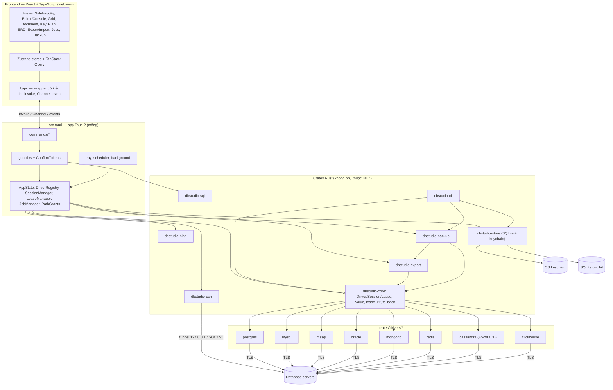
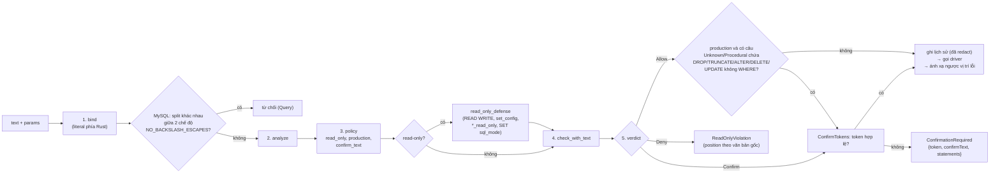
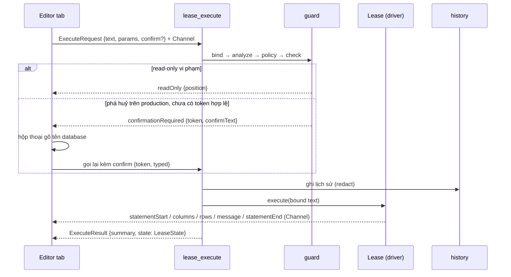

# DBStudio — Kiến trúc & công nghệ

> Trạng thái: v0.4 (cập nhật sau đợt "tồn đọng + GĐ9 driver mới" theo [design/backlog-gd9.md](design/backlog-gd9.md), phần backend; v0.3 là GĐ2–GĐ8 theo [design/phase2-8.md](design/phase2-8.md)). Mô tả hiện thực thật trên nhánh `feature/quandh/backlog`; chỗ nào còn là thiết kế thì ghi rõ. Phần UI của đợt tồn đọng + GĐ9 chưa làm (roadmap "Việc UI để lại"). Mã yêu cầu tham chiếu [requirements.md](requirements.md); thứ tự xây dựng xem [roadmap.md](roadmap.md). Chi tiết kiểu/serde của hợp đồng GĐ2–GĐ8 nằm ở tài liệu thiết kế, tài liệu này chỉ tóm tắt và ghi những chỗ hiện thực khác thiết kế.

## 1. Nguyên tắc

1. **Core không phụ thuộc Tauri.** `dbstudio-core` và các crate `sql`/`plan`/`export`/`backup`/`ssh`/`store`/driver chỉ phụ thuộc Rust thuần + tokio, để tái dùng cho CLI headless (BACKUP-15) và test không cần cửa sổ.
2. **`src-tauri` mỏng.** Command IPC, state, guard, lease, job, cửa sổ, tray, lịch chạy. Không có logic SQL/dialect trong `src-tauri` (guard gọi `dbstudio-sql`).
3. **Capability-driven UI.** Mỗi driver khai báo `Capabilities`; frontend bật/tắt tính năng theo đó (NFR-EXT-02).
4. **Secret không bao giờ rời Rust.** Mật khẩu/passphrase đọc từ keychain ngay trước khi kết nối, không trả về frontend, không vào log, không vào SQLite (NFR-SEC-01). URI dán vào (CONN-13) được parse ở Rust, mật khẩu trong URI bị bỏ.
5. **An toàn được thực thi ở backend.** Read-only, xác nhận lệnh phá huỷ, giới hạn dòng, quyền đọc/ghi file được kiểm ở Rust; UI chỉ hiển thị (NFR-SEC-03).
6. **Stream, không gom.** Kết quả query, export, import đi theo lô (NFR-PERF-02).
7. **Mọi thao tác dài huỷ được** qua `query_id` (query, explain, đọc bảng) hoặc `job_id` (export, import, xoá khoá theo pattern, backup).

## 2. Sơ đồ tổng quan



## 3. Cấu trúc repository

```
dbstudio/
├── Cargo.toml                 # workspace; [patch.crates-io] tiberius = vendor/tiberius-patch
├── package.json, vite.config.ts, tsconfig*.json, .prettierrc
├── src/                       # frontend React
│   ├── app/                   # App, StatusBar (+ slot jobs), tabRegistry
│   ├── features/
│   │   ├── connections/       # sidebar (kéo thả), dialog kết nối, SshSection, HostKeyDialog, UriPaste
│   │   ├── explorer/          # cây ảo hoá, cây phân trang (Redis), tìm phía server, menu ngữ cảnh
│   │   ├── data/              # lưới, bộ lọc, trình xem ô, sửa dữ liệu (pending changes, preview), copy định dạng
│   │   ├── editor/            # CM6, nhiều tab, kết quả nhiều tab, TxBar, params, autocomplete, lịch sử, saved, console Redis/Mongo
│   │   ├── safety/            # ConfirmDestructiveDialog, useGuardedCall
│   │   ├── document/          # MongoDB: bảng phẳng / tree / EJSON, sửa document
│   │   ├── keyvalue/          # Redis: viewer 6 kiểu + JSON, TTL, xoá theo pattern
│   │   ├── plan/, erd/        # sơ đồ xyflow + elk (worker), xuất SVG/PNG(/PDF cho ERD)
│   │   ├── export/, jobs/     # wizard export/import, preset, trung tâm job
│   │   ├── backup/            # job (CronBuilder), restore, lịch sử chạy, tool native, chạy nền
│   │   └── settings/, tabs/, welcome/
│   ├── lib/types/, lib/ipc/   # kiểu viết tay khớp Rust + wrapper invoke (types.ts, ipc.ts re-export)
│   ├── lib/mock/              # IPC giả khi chạy ngoài Tauri (catalog theo từng DB)
│   └── stores/, locales/{vi,en}/
├── src-tauri/src/
│   ├── lib.rs, state.rs, session.rs (SessionManager + tunnel), lease.rs (LeaseManager),
│   ├── guard.rs, history.rs, jobs.rs (JobManager), grants.rs (PathGrants), events.rs, host.rs,
│   ├── redact.rs, logging.rs, bridge.rs (dev), scheduler.rs, tray.rs, background.rs
│   └── commands/{app,connections,sessions,browse,editor,history,changes,plan,erd,files,
│                 export,jobs,backup,background,keyvalue,ssh,uri}.rs
├── crates/
│   ├── dbstudio-core, dbstudio-sql, dbstudio-plan, dbstudio-export, dbstudio-backup,
│   ├── dbstudio-cli, dbstudio-ssh, dbstudio-store
│   └── drivers/{postgres,mysql,mssql,oracle,mongodb,redis,cassandra,clickhouse}
├── vendor/tiberius-patch/     # bản vá tiberius 0.13.0 (DBSTUDIO-PATCH.md)
├── contract/fixtures/         # mẫu JSON dùng chung cho test hợp đồng Rust ↔ TS
├── docker/                    # compose.test.yml, gen-certs.sh, gen-ssh-keys.sh, oracle-it/
└── docs/
```

Driver bật/tắt qua cargo feature `postgres`, `mysql`, `mssql`, `oracle`, `mongodb`, `redis`, `cassandra`, `clickhouse` của `src-tauri` và `dbstudio-cli` (đều bật mặc định). CockroachDB/YugabyteDB đi cùng feature `postgres`, TiDB cùng `mysql` (flavor, mục 15.3). Workspace `rust-version = "1.94"` (yêu cầu của `scylla` 1.10).

## 4. `dbstudio-core` — mô hình miền

Nguồn sự thật: doc comment trong `crates/dbstudio-core/src/`. Mọi kiểu đi qua IPC serialize camelCase; mẫu JSON ở `contract/fixtures` (test `crates/dbstudio-core/tests/contract.rs` ↔ `src/lib/types/contract.test.ts`).

| Kiểu / module | Vai trò |
|---|---|
| `DbKind`, `Capabilities`, `DriverDescriptor` | 12 kind (thêm `cockroachdb`, `yugabytedb`, `tidb` ở hợp đồng v2). `Capabilities` thêm `table_sort`, `exact_count` (false với CQL, Redis) sau 15 cờ của GĐ2 (`leases`, `manual_transactions`, `query_params`, `explain_analyze_writes`, `document_store`, `key_value_store`, `ddl_generation`, `schema_model`, `schema_inference`, `table_stream`, `bulk_insert`, `native_backup`, `paged_tree`, `read_only_session`, `ssh_tunnel`). `DriverStatus::Unavailable { reason }` dùng cho Oracle thiếu Instant Client. Capabilities thật của server do `Session::capabilities()` trả (flavor, phiên bản) và được đưa vào `SessionInfo.descriptor`. |
| `ConnectionConfig` | Thêm `ssh: Option<SshConfig>`, `tls.server_name` (SNI/tên kiểm chứng khi đi qua tunnel) và `environment_label` (nhãn tuỳ chỉnh ≤ 32 ký tự; quy tắc an toàn vẫn theo `environment`). |
| `Value` | Như GĐ1, cộng `Document(Vec<(String, Value)>)` (giữ thứ tự khoá) và `Ext { type, text }` cho kiểu riêng (ObjectId, Int64 Mongo, `truncatedText` của LOB, `rowid`, `interval`...). |
| `Error` | Thêm `ReadOnlyViolation`, `ConfirmationRequired`, `Busy`, `Permission`, `DriverUnavailable`, `SshHostKey`, `Integrity`, `ChangeFailed`, `Invalid` (kind `invalid`: đầu vào sai của người gọi — tham số, setting ngoài khoảng, tên, file import sai cấu trúc; `Permission` chỉ cho từ chối quyền, `Storage("invalid data")` chỉ cho dữ liệu đã lưu bị hỏng). |
| `Session` (trait) | GĐ1 + method mặc định: `script_dialect`, `capabilities`, `scan_keys` (trang tên khoá cho export/backup Redis), `open_lease`, `list_children_page`, `search_objects`, `editability`, `preview_changes`, `apply_changes`, `explain`, `schema_model`, `generate_ddl`, `read_key`. `fallback.rs` cho driver cũ: phân trang cây, editability từ `table_details`, schema model qua `table_details`. |
| `Lease` (trait) + `lease_kit` | Mục 5; `Lease::script_dialect()` (mặc định `None`) trả dialect của **chính kết nối** khi khác session. |
| `script.rs` | `ScriptDialect` (thêm `Cql`, `ClickHouse`, `MySql { ansi_quotes }`), `ScriptAnalysis`, `StatementClass`, `DestructiveReason` (thêm `Write`, `KeywordScan`), tham số, `ConfirmationRequest/Grant`, `ExecuteRequest/Result`. |
| `edit.rs` | `Editability` (+ `notes: Vec<EditNote>`: `UpsertSemantics`, `ConditionalWrites`, `AsyncMutation`), `ChangeSet` (mục 8), `FieldOriginal`, `KeyChange::Put` + `PutMode`. |
| `keyvalue.rs` | `KeyReadRequest`, `KeyValuePage`, `KeyEntries`, `KeyScanRequest/Page`, `KeyData`, `KeyRecord` (một khoá đầy đủ + `expire_at_ms`, dùng cho export/import/backup Redis). |
| `plan.rs` | `ExplainRequest`, `RawPlan`, `PlanFormat` (12 định dạng: thêm `ClickHouseJson`, `CockroachText`, `TiDbRows`, `CqlTrace`). |
| `model.rs` | `SchemaModel`, `DdlItem`/`DdlSection`, `TableStreamRequest`, `BulkInsertRequest`. |
| `job.rs` | `JobInfo`, `JobProgress`, `JobEvent`, `CancelToken`, `JobReporter`. |
| `ssh.rs` | `SshConfig`, `SshAuth` (`password` / `privateKey` / `agent`). |
| `metadata.rs` | `TableDetails`; `IndexDetail` có thêm `partial` (index có điều kiện). `ObjectKind::Dictionary` (ClickHouse), folder `dictionaries`/`aggregates`, `DdlLanguage::Cql`. |

Hợp đồng đã chốt ở GĐ1 vẫn giữ nguyên: path phản ánh đúng cây kể cả đoạn `Folder` (driver chấp nhận có/không Folder); `Value::Json` là văn bản gốc; `fetch_table` luôn thêm khoá vào cuối `ORDER BY`; ngữ nghĩa `FilterOp`; `raw_where` là **một biểu thức**; `Error::Query.position` là char offset (Unicode scalar) trong toàn văn bản; `cancel` id lạ → `Ok(())`; lỗi sang frontend dạng `{ kind, message, ... }` không tiền tố.

## 5. Lease — kết nối riêng cho tab editor / console

Tab editor (và console Mongo/Redis) không mở session mới mà mượn một **lease**: một kết nối vật lý ngoài pool, cùng TLS/SSH/read-only của session (`Session::open_lease`). Session vẫn đại diện cả server + pool như GĐ1.

- `LeaseManager` (`src-tauri/src/lease.rs`): ánh xạ `lease_id` → lease, tối đa 32 lease/session; đóng session thì đóng mọi lease của nó trước; lease hỏng phát event `lease://state`.
- Ngữ nghĩa: một lô câu lệnh mỗi lúc (gọi song song → `Error::Busy`); auto-commit hoặc manual (transaction mở lười trước câu đầu tiên); `cancel(query_id)` chỉ trúng câu đang chạy; kết quả treo (`pending_result`) cho `fetch_more`; `close()` = huỷ (chờ ≤ 5 s) → rollback (≤ 5 s) → đóng socket, quá hạn thì `forced`.
- **`lease_kit`** (`crates/dbstudio-core/src/lease_kit.rs`): `ActorLease<B: LeaseBackend>` — một tokio task sở hữu kết nối, nhận lệnh qua `mpsc`, lo busy, khớp `query_id`, cache `LeaseState`, thứ tự close. Kết quả treo tự huỷ sau `pending_ttl` 10 phút (rủi ro R4); lease không nhận lệnh trong `idle_ttl` 8 giờ bị rollback + đóng; timeout → huỷ, quá `timeout_grace` thì `broken`. Backend còn có hook `refresh_context` (sau `USE`/`SET search_path`), `table_select` (export stream bảng ngay trên lease), `bulk_insert` (import trong transaction của lease) và `explain` (EXPLAIN trên lease, giữ transaction đang mở).
- Driver dùng `lease_kit`: **PostgreSQL (+ CockroachDB, YugabyteDB), MySQL/MariaDB (+ TiDB)**. **MSSQL, Oracle, MongoDB, Redis, Cassandra, ClickHouse tự hiện thực `Lease`** (MSSQL cần huỷ bằng attention của bản vá tiberius; Oracle chạy API đồng bộ trên thread riêng; Mongo dựa `ClientSession`; Redis một `MultiplexedConnection` riêng, huỷ bằng `CLIENT KILL ID` làm lease `broken`; Cassandra giữ keyspace/consistency/tracing trên pool session `scylla` theo keyspace, không transaction; ClickHouse là một HTTP session `session_id`, không transaction).
- **Dialect theo lease**: guard và kiểm tra EXPLAIN của một lease dùng `Lease::script_dialect()` (lùi về `Session::script_dialect()`), vì `sql_mode` (`ANSI_QUOTES`, `NO_BACKSLASH_ESCAPES`) là thiết lập của từng kết nối MySQL/TiDB: guard phải tách câu đúng như kết nối sẽ tách. MySQL đọc lại `@@sql_mode` khi mở lease và sau `refresh_context`.
- Đổi database của lease: PG mở kết nối mới tới DB đích (cùng TLS/SSH/read-only; có transaction hoặc kết quả treo → `Busy`), CockroachDB dùng `SET database` trên cùng kết nối.
- Read-only ở lease: PG và MySQL (không áp cho TiDB, mục 7.1) **đặt lại read-only trước mỗi request ngoài transaction** (`SET SESSION default_transaction_read_only = on` / `SET SESSION TRANSACTION READ ONLY`), nên một `SET` lọt qua trước đó cũng không giữ hiệu lực sang lệnh sau.

### 5.1 Keepalive, tự kết nối lại (CONN-12)

- **Keepalive lease** (`LeaseManager::keepalive_tick`, chu kỳ `keepaliveSecs`, mặc định 240 s, `0` = tắt): ping song song (≤ 8) mọi lease không đang chạy câu, không giữ kết quả treo và nhàn rỗi ≥ chu kỳ; ping có hạn giờ, lỗi → lease mất (`lease://state`). Ping keepalive **không** gia hạn `idle_ttl` và không huỷ kết quả treo (`lease_kit`); driver tự hiện thực giữ cùng ngữ nghĩa (ClickHouse ping trong `session_id`).
- **Theo dõi session** (`SessionManager::spawn_health`): ping từng session mỗi chu kỳ; `Connection`/`Tls` = mất kết nối, `Timeout` chỉ tính khi liên tiếp 3 lần. Event `session://state` (`Connected`/`Lost`/`Reconnecting{attempt}`/`Reconnected`/`GaveUp`, kèm `leasesBroken`).
- **Tự kết nối lại** khi `autoReconnect` (mặc định bật): backoff 1, 2, 4, 8, 16 s; kết nối lại = `Driver::connect` với config + secret (keychain đọc lại mỗi lần; mật khẩu người dùng gõ chỉ giữ trong bộ nhớ suốt đời session) + tunnel SSH mới, **giữ `session_id`**. Lease auto-commit nhàn rỗi được mở lại (giữ `lease_id`, database/schema); lease có transaction mở bị đánh dấu `broken`, từ chối lệnh, chờ `lease_reopen` (`transactionLost = true`). `session_reconnect` (thủ công) không bị backoff tự động đè.

## 6. `dbstudio-sql` — phân tích & phân loại câu lệnh (lớp bảo vệ chính)

Crate thuần Rust, không I/O, **không dùng `sqlparser`** (khác thiết kế): mọi phân tích chạy trên token của lexer riêng theo dialect, nên chuỗi/comment/định danh có ngoặc không đánh lừa được bộ phân loại. Module: `lexer`, `split` (+ `StreamSplitter` cho import file lớn), `params` (`find_params`, `bind` + `OffsetMap`), `classify` (`analyze`), `guard` (`Policy`, `Verdict`, `check_with_text`, `confirm_text_for`, `statement_databases`), `dialect` (quote/literal theo dialect, `literal_for_type` theo kiểu cột cho CQL/ClickHouse), `ddl` (`create_table` cho import bảng mới), `template` (sinh SELECT/INSERT/UPDATE/DELETE mẫu cho 8 dialect, command `script_generate`), `mongo_shell`, `redis_cli`, `vocabulary` (gợi ý editor), `redact`.

- **Tách câu**: PG giữ tương đương splitter GĐ1 (dollar-quote, `BEGIN ATOMIC`; có test vi sai); MySQL `;` + `DELIMITER`; **comment thực thi MySQL** `/*! ... */`, `/*!50000 ... */`, `/*M! ... */` được coi là code (để `/*!50000 DROP TABLE t */` không lọt); T-SQL: `split` trả một khoảng cho mỗi batch `GO [n]`, còn `analyze` chia câu **bên trong** batch theo `;` ngoài `BEGIN…END` **và theo từ khoá mở đầu câu** (T-SQL cho phép câu không có `;`), để guard xét từng câu; Oracle `;` cho SQL, khối PL/SQL kết thúc ở dòng `/`, lệnh SQL*Plus kết thúc ở cuối dòng; CQL `;`, khối `BEGIN [UNLOGGED|COUNTER] BATCH … APPLY BATCH` là một câu, **lệnh kiểu cqlsh** (`CONSISTENCY`, `SERIAL CONSISTENCY`, `TRACING`, `USE`, `DESCRIBE`…) kết thúc ở cuối dòng; ClickHouse `;` (comment khối lồng nhau, heredoc `$tag$`), `ALTER TABLE` được xét từng lệnh con; Mongo shell `;`/xuống dòng ngoài ngoặc; Redis mỗi dòng một lệnh.
- **Splitter chung là bắt buộc**: mọi driver tách câu bằng `dbstudio_sql::split` với **đúng dialect mà guard dùng** (của lease nếu có). Hai lỗ hổng phát hiện khi review đợt này là lý do: driver Cassandra từng có `split.rs` riêng (guard và driver có thể tách khác nhau → câu guard xét không phải câu driver chạy), và guard của lease TiDB/MySQL dùng dialect của session trong khi `sql_mode` của lease đã đổi (`ANSI_QUOTES`). Ngoại lệ duy nhất còn lại là splitter PL/SQL của Oracle (mục 15.2, có test vi sai).
- **Phân loại**: `Read`/`Write`/`Ddl`/`Transaction`/`Session`/`Procedural`/`Explain{analyze,writes}`/`Admin`/`Empty`/`Unknown`; `destructive` theo bảng phá huỷ (requirements §1.1). Không hiểu → `Unknown` (guard coi là ghi). `Procedural`/`Unknown`, hoặc khi lexer báo lỗi, vẫn quét từ khoá `DROP`/`TRUNCATE` (cả trong chuỗi/dollar body) để đánh dấu phá huỷ; `ALTER`/`DELETE`/`UPDATE` tìm thấy khi quét được ghi lý do `KeywordScan` (trước đây đoán `AlterDrop`/`DeleteWithoutWhere`).
- **Dialect mới**: CQL (Read: SELECT/DESCRIBE/LIST; Session: USE/CONSISTENCY/TRACING; phá huỷ: DROP, TRUNCATE) và ClickHouse (Write gồm `DELETE FROM`, lightweight `UPDATE`, mutation `ALTER TABLE … UPDATE/DELETE`; phá huỷ: DROP/DETACH, TRUNCATE, `ALTER … DROP/CLEAR/REPLACE PARTITION`, mutation `WHERE 1`, `CREATE OR REPLACE TABLE`). Từ khoá TiDB (`BATCH ON … <DML>` = Write, `FLASHBACK`, `ADMIN`, `SPLIT TABLE`) và CockroachDB (`UPSERT`, `SHOW RANGES`, `BACKUP`/`RESTORE`, `CANCEL`, `SET CLUSTER SETTING`). **Hàm bảng chạm tài nguyên ngoài** của ClickHouse (`file`, `url`, `s3`, `remote`, `mysql`, `postgresql`, `executable`…) và `crdb_internal.unsafe_*` làm câu thành `Admin` nên kết nối read-only chặn.
- **Redact**: trước khi ghi lịch sử, literal sau `PASSWORD`, `IDENTIFIED BY`, Redis `AUTH`/`CONFIG SET requirepass`/`ACL SETUSER`, Mongo `pwd:`/`db.auth(...)` bị thay bằng `'***'`.
- Dialect MySQL lấy từ `sql_mode`: `NO_BACKSLASH_ESCAPES` và `ANSI_QUOTES`/`ANSI` (`"x"` là định danh). Comment thực thi TiDB `/*T![feature] … */` được coi là code như `/*! */`.

## 7. Guard ở lớp command

`src-tauri/src/guard.rs` (gọi `dbstudio_sql`) chạy cho `query_execute`, `lease_execute`, `plan_explain`, import script và các lệnh console. Dialect = `Lease::script_dialect()` của lease đang dùng, không có thì của session (mục 5). Luật "từ chối khi split khác nhau" áp cho cả `NO_BACKSLASH_ESCAPES` lẫn `ANSI_QUOTES` khi script đổi `sql_mode` (kể cả qua `PREPARE`/`EXECUTE`):



- **`ConfirmTokens`**: token 32 hex, dùng một lần, hết hạn 120 s, gắn với `sha256(target ‖ payload)`; payload gồm ngữ cảnh (session/lease), chuỗi phải gõ, **các database mà câu phá huỷ thực sự tác động** (một `USE` trước đó trong script đổi đích) và văn bản đã bind. Gõ sai (phân biệt hoa thường), hết hạn, khác văn bản/đích → từ chối và token bị huỷ. Cùng kho token phục vụ `import_start` (ghi đè/script phá huỷ), `keys_delete_pattern`, `restore_start`, xác nhận ANALYZE câu ghi trên production.
- `confirm_text`: database hiện hành của lease, hoặc `config.database`, hoặc `db<N>` (Redis).
- `ensure_writable` cho `changes_preview`/`changes_apply` (driver tự sinh câu lệnh): kết nối read-only bị từ chối trước khi gọi driver (preview vẫn cho xem).
- Lý do trong `ConfirmationRequired.statements[].reason`: câu ghi thường cần xác nhận (EXPLAIN ANALYZE câu ghi trên production) mang `write`; câu không hiểu bị quét từ khoá mang `keywordScan`.

### 7.1 Các lớp phòng thủ read-only (CONN-10)

1. **Guard** (mọi DB): chỉ cho `Read`, `Explain{writes:false}`, `Transaction`, `Session`, `Empty`; cộng `read_only_defense` chặn câu tắt chế độ read-only.
2. **Driver**: PG `default_transaction_read_only=on` lúc kết nối và đặt lại trước mỗi request của lease; MySQL `SET SESSION TRANSACTION READ ONLY` tương tự; đọc bảng luôn trong transaction READ ONLY (PG/MySQL/Oracle; MSSQL chỉ là một câu SELECT do app sinh). MSSQL không có tương đương T-SQL (chỉ guard + driver từ chối sửa dữ liệu). Oracle, MongoDB, Redis kiểm thêm ở driver: Oracle `read_only_violation` theo phân loại câu; Mongo chặn câu ghi trong `execute`/lease/`bulk_insert`; Redis tra cờ `write` qua `COMMAND INFO` (+ danh sách lệnh luôn coi là ghi như `CONFIG SET`). Driver mới: ClickHouse gửi setting `readonly = 2` với mọi request (server từ chối ghi); CockroachDB/YugabyteDB đi đường PG; Cassandra kiểm loại câu trong driver trước khi chạy. **TiDB không có read-only phía server** (`SET SESSION TRANSACTION READ ONLY`/`START TRANSACTION READ ONLY` bị từ chối, lỗi 1235): chỉ guard; đọc bảng dùng transaction thường; `ServerInfo.extra["readOnlyEnforcement"] = "application"` (+ `readOnlyNote`) để UI hiện badge; transaction read-only do người dùng yêu cầu → `Unsupported`. Cờ `read_only_session` bật cho PG (+ CockroachDB, YugabyteDB), MySQL/MariaDB, ClickHouse — UI ghi "read-only chỉ được chặn ở ứng dụng" với DB khác.
3. **Đúng một câu** ở các đường không đi qua editor: `plan_explain` (EXPLAIN nhận đúng một câu, driver kiểm lại), export từ query (engine từ chối nếu không phải đúng một câu) và `raw_where` (một biểu thức: PG `prepare` qua extended protocol, MySQL lexer + `COM_STMT_PREPARE`, MSSQL lexer + `SET PARSEONLY ON`, Oracle lexer + `prepare`, Mongo một object filter).

## 8. Sửa dữ liệu — `ChangeSet`

`ChangeSet` là enum `Rows` (SQL), `Documents` (Mongo), `Keys` (Redis). `preview_changes` trả văn bản sẽ chạy (thứ tự: Delete → Update → Insert); `apply_changes`:

- **Rows** (PG, MySQL, MSSQL, Oracle, CockroachDB, YugabyteDB, TiDB): một transaction trên kết nối pool; mỗi Update/Delete phải trúng **đúng 1 dòng**, khác → rollback, `ChangeFailed { index }` (NFR-REL-01). Cột identity/generated/computed bị từ chối trước. Bảng không có PK hoặc unique NOT NULL → `editable=false, reason=noUniqueKey` (CockroachDB: bảng không PK dùng cột ẩn `rowid` làm khoá).
- **Rows — Cassandra/ScyllaDB**: khoá = partition + clustering columns; bảng counter, MV, virtual table không sửa được. Mặc định LWT: Insert `IF NOT EXISTS`, Update/Delete `IF EXISTS` (`[applied]=false` → `ChangeFailed`, `notes=[ConditionalWrites]`); keyspace tablets của ScyllaDB hoặc option `cql.lwtEdits=false` → câu thường (`notes=[UpsertSemantics]`). Không transaction, `atomic=false`.
- **Rows — ClickHouse**: chỉ bảng họ `*MergeTree` thường; khoá = sorting key. Trước mỗi Update/Delete `SELECT count() WHERE <khoá>` phải = 1 (khác → `ChangeFailed`); Delete = lightweight `DELETE` hoặc mutation, Update = mutation `ALTER TABLE … UPDATE` với `mutations_sync = 2` (mutation chưa xong khi huỷ → `KILL MUTATION`). `notes=[AsyncMutation]`, `atomic=false`; option `editing=insertOnly` tắt Update/Delete (khi đó `key_columns=[]`).
- **Documents**: replica set → transaction; standalone → tuần tự, dừng ở lỗi đầu, `atomic=false`. Update theo diff (`$set`/`$unset` theo đường dẫn). Có `expected: Vec<FieldOriginal>` → filter thêm `{"<path>": {$eq: <gốc>}}` / `{$exists: false}`; khớp 0 → `ChangeFailed` ("modified by another client" hoặc "no longer exists"). Không gửi `expected` thì như cũ (chỉ theo `_id`).
- **Keys**: `WATCH` + kiểm `TYPE`, rồi `MULTI/EXEC`; khoá bị đổi → `ChangeFailed`. Redis không rollback lỗi lúc chạy → `atomic=false`, UI ghi rõ. `ListSet`/`ListRemoveAt` có `expected` → `LINDEX` so giá trị trong `WATCH` (khác → "list item changed"). `KeyChange::Put` ghi cả khoá (import/restore): dựng ở khoá tạm (tiền tố theo khoá + hashtag, `PEXPIRE` mỗi lô, ẩn khỏi `scan_keys`) rồi `RENAME` trong `MULTI`; `PutMode::IfAbsent` bỏ qua khoá đã có.

## 9. Plan — `PlanTree`

- Driver: `explain` của PG (`PostgresJson`, cả YugabyteDB), MySQL (`MySqlJson`, `MySqlJsonV2` 8.3+, `MySqlTree` cho ANALYZE), MariaDB (`MariaDbJson`), MSSQL (`MsSqlShowplanXml`), Oracle (`OraclePlanRows` + `DBMS_XPLAN` ở `extra`), Mongo (`MongoExplain`), CockroachDB (`CockroachText`, `EXPLAIN [ANALYZE] (VERBOSE)`), TiDB (`TiDbRows`, `EXPLAIN [ANALYZE] FORMAT='row'` gói thành JSON), ClickHouse (`ClickHouseJson`, `EXPLAIN json=1, indexes=1, actions=1 PLAN` + `ESTIMATE`/`PIPELINE` ở `extra`, không ANALYZE), Cassandra/ScyllaDB (`CqlTrace`: chỉ ANALYZE = tracing của câu SELECT; `explain` → `Unsupported`). Redis không có.
- ANALYZE luôn bọc trong transaction rồi rollback (PG, MSSQL, Oracle); MySQL ANALYZE câu ghi → `Unsupported("explain_analyze_writes")`; Mongo `executionStats` không ghi. Khi tab có lease, `plan_explain` chạy EXPLAIN trên lease (PG/MySQL qua hook `explain` của `lease_kit`) nên thấy được bảng tạm/transaction của tab.
- `dbstudio-plan`: parser thuần cho 12 định dạng → `PlanTree { root: PlanNode, totals, warnings, hot_path }`; `analyze` tính self cost/time, nhánh nóng, cảnh báo PLAN-04 (`FullScanLargeTable`, `Misestimate` ≥ 10×, `SpillToDisk`, `NestedLoopManyRows`; parser mới đánh dấu full scan theo granule ClickHouse, `FULL SCAN` Cockroach, `TableFullScan` TiDB, spill theo cột `disk` TiDB, tombstone trong trace CQL vào `warnings` của node).
- **Lịch sử plan** (PLAN-07): `plan_explain` thành công ghi bảng `plan_history` (câu đã redact, `raw_plan` ≤ 8 MiB, cắt theo `planHistoryMaxPerConnection`, tắt bằng `planHistoryEnabled`); command `plan_history_list/get/delete/clear`. Fixture ở `crates/dbstudio-plan/tests/fixtures`.
- Frontend: sơ đồ xyflow + elk (Web Worker), bảng cây thụt lề, raw, so sánh 2 plan, lưu/mở `.dbplan.json`, xuất SVG/PNG.

## 10. Schema model, ERD và sinh DDL

- `schema_model`: override bằng truy vấn catalog hàng loạt ở PG, MySQL, MSSQL, Oracle (+ flavor); Cassandra (PK = partition + clustering, không relation), ClickHouse (`primary_key = []` vì sorting key không duy nhất, không relation); Mongo suy luận bằng `$sample` (mặc định 1000 document/collection, quan hệ `xxxId → xxx(s)` đánh dấu `inferred`). Dùng cho ERD, autocomplete, data dictionary của export.
- `generate_ddl` (PG, MySQL, MSSQL, Oracle; Mongo sinh `createCollection`/`createIndex` dạng shell; CockroachDB qua `SHOW CREATE ALL TABLES` (FK cuối → PostData; grants/một số mục `Unsupported`); TiDB/MariaDB có sequence; Cassandra ưu tiên server-side `DESCRIBE`, lùi về tự sinh từ `system_schema`, `DdlLanguage::Cql`; ClickHouse `SHOW CREATE`, view/MV ở PostData) trả `Vec<DdlItem>` theo thứ tự tạo, chia **`PreData`** (schema → type → sequence → bảng có PK/unique/check nhưng **không FK** → view theo phụ thuộc → routine) và **`PostData`** (index → FK → trigger → reseed identity/sequence → comment). Export/backup chèn dữ liệu giữa hai phần nên FK vòng không còn là vấn đề.
- ERD: layout lưu trong `erd_layouts` (kiểm phiên bản để phát hiện ghi đè), so snapshot để đánh dấu bảng/cột đã đổi; xuất SVG (dựng từ dữ liệu, không qua foreignObject), PNG, PDF (`jspdf` + `svg2pdf.js`) qua `file_save_bytes`.

## 11. Job nền, file và export/import

- **`JobManager`** (`src-tauri/src/jobs.rs`): job chỉ trong bộ nhớ (giữ 100 job xong gần nhất), tối đa **3 job chạy song song**, còn lại `queued` (huỷ được khi đang chờ); tiến độ phát qua event `job://progress` (≤ 4 lần/s/job). `job_cancel` → `CancelToken` + huỷ truy vấn đang chạy; engine xoá file tạm.
- **`PathGrants`** (`src-tauri/src/grants.rs`): chỉ đường dẫn đi ra từ dialog native (`file_pick_*`, `sql_file_*`, `plan_file_*`) mới được backend đọc/ghi (dạng canonical, mục đích read/write/dir, hết hạn 1 giờ). `export_start`, `import_*`, `backup_*`, `restore_start` từ chối path chưa cấp — webview bị chiếm quyền không ghi được file tuỳ ý.
- **Export engine** (`dbstudio-export`): mở **một lease** cho cả export, `begin(read_only, RepeatableRead)` → một snapshot nhất quán cho nhiều bảng; stream từng bảng qua `Lease::stream_table` (PG/MySQL qua `table_select`, MSSQL/Oracle/Mongo tự hiện thực); driver không có lease → session + cảnh báo "không có snapshot". Schema lấy từ `generate_ddl` (PreData/PostData) và `schema_model`. Writer SQL (INSERT gộp theo dialect nguồn), CSV (zip khi nhiều bảng, BOM, `null_text`), JSON (array/NDJSON + `schema.json`), XLSX (bộ nhớ hằng, tách sheet ở 1.048.575 dòng, sheet data dictionary). Ghi vào `.<tên>.dbstudio-tmp-<id>` rồi đổi tên; huỷ/lỗi → xoá; file tạm mồ côi (> 1 giờ) trong thư mục đích được dọn khi export kế tiếp vào thư mục đó.
- **Import**: CSV/XLSX/JSON (mapping cột, transform, xem trước, bảng mới bằng `dbstudio_sql::ddl::create_table`, `OnConflict` Error/Skip/Update, `SingleTransaction` hoặc `Batches`, lô lỗi → chạy lại từng dòng để báo `RowError{line}`) và SQL script (`StreamSplitter`, mỗi câu qua guard; production: quét trước cả file, có câu phá huỷ → `ConfirmationRequired` trước khi tạo job). Ghi qua `Lease::bulk_insert` trong transaction của lease: PG `COPY ... FROM STDIN` (khi `on_conflict=Error`, ngược lại `INSERT ... ON CONFLICT`), MySQL `INSERT [IGNORE] … [ON DUPLICATE KEY UPDATE]` nhiều dòng, MSSQL `INSERT ... VALUES` ≤ 1000 dòng / `INSERT ... WHERE NOT EXISTS` / `MERGE`, Oracle array DML (`Skip` không hỗ trợ), Mongo `insertMany`/`bulkWrite`. Đích Mongo/Redis chưa nhận import.
- Export nguồn `Keys` (Redis) và làm phẳng document Mongo cho CSV/XLSX (`flatten_fields`) **chưa hiện thực**.

## 12. Backup/restore, lịch tự động, tray, CLI

`dbstudio-backup` (thuần, không Tauri) gồm `container` (định dạng file), `crypto`, `logical` (engine tích hợp), `native` (tool ngoài), `ops` (backup/restore/verify/inspect), `runner` (job đã lưu: bản ghi chạy, khoá, retention — dùng chung app và CLI), `scheduler` (logic lịch thuần). Phần app: `src-tauri/src/{scheduler,tray,background}.rs` + `commands/{backup,background}.rs`; CLI: `dbstudio-cli`.

- **Container `.dbsbak`**: `"DBSBAK1\0" | u32 LE header_len | header JSON (rõ) | payload`, payload = `encrypt?(compress(tar(preamble.json, <entries>, manifest.json)))`. Nén none/gzip/zstd. Mã hoá `aes-256-gcm-chunked`: khối 1 MiB, nonce = prefix ‖ số khối ‖ cờ khối cuối, AAD = SHA-256 của header; khoá Argon2id từ passphrase, **tham số KDF đọc từ header bị chặn trên** (m ≤ 1 GiB, t ≤ 10, p ≤ 16) để file lạ không làm treo máy. `manifest.json` có SHA-256 + kích thước từng entry (BACKUP-14). Sai passphrase hay file bị sửa → `Error::Integrity`. File ghi với quyền 0600 vào file tạm tên duy nhất rồi **publish bằng hard-link** sang tên đích chưa tồn tại (hai lần chạy đồng thời không ghi đè nhau).
- **Spool**: dữ liệu trung gian (script dump, output tool) ghi vào thư mục riêng `<data_dir>/tmp/run-*` quyền 0700; thư mục mồ côi do crash được dọn khi app khởi động.
- **Engine logic** (`logical.rs`): mỗi database một script `data/dump.sql` do **export engine** viết — cấu trúc từ `generate_ddl` (PreData → dữ liệu → PostData), dữ liệu stream qua lease snapshot read-only repeatable-read (mục 11). Áp cho SQL DB (PG, MySQL/MariaDB đã có IT; MSSQL/Oracle đi cùng đường nhưng chưa test); MongoDB/Redis chưa có backup logic (chỉ native). Preamble ghi nguồn, danh sách đối tượng và phạm vi **không** gồm (role/grant, thiết lập server, MySQL events, large object PG, user/mật khẩu); preamble logical mang `formatVersion: 2` — file logical `formatVersion` 1 (bố cục cũ của bản dựng trước) không verify/restore được.
- **Restore logic** chạy trên **một lease**: đặt múi giờ UTC, tách script bằng `StreamSplitter`; PG chạy cả script **trong một transaction** (lỗi → giữ nguyên dữ liệu cũ), MySQL **không nguyên tử** (DDL tự commit). `clean`: PG `DROP SCHEMA … CASCADE` các schema của backup **bên trong transaction đó**; MySQL `DROP DATABASE` + `CREATE DATABASE` **giữ charset/collation** của database cũ. `continue_on_error` ghi `RowError` theo số câu. Chỉ restore vào cùng họ DB; **không restore một phần** (`objects`) backup logical.
- **Tool native** (`native.rs`): `pg_dump` (custom/plain) → `pg_restore`/`psql`, `mysqldump` → `mysql`, `mongodump` → `mongorestore` (archive), `redis-cli --rdb` (chỉ backup; RDB phải được đặt vào thư mục dữ liệu của server để khôi phục), MSSQL `BACKUP DATABASE` vào thư mục **trên server** (`Destination::ServerDir`). Oracle Data Pump chưa có (cần DIRECTORY trên server). Mặc định `mysqldump --single-transaction --routines --triggers --events --default-character-set=utf8mb4`. Dò tool: cấu hình → `PATH` → thư mục biết trước; tham số chỉ dựng từ spec + allow-list `options`; secret không bao giờ trên dòng lệnh (`PGPASSWORD`, file `--defaults-extra-file`/`--config` tạm 0600, `REDISCLI_AUTH`). Trước khi restore script plain bằng `psql`/`mysql`, file được **quét meta-command nguy hiểm** (psql `\!`, `\i`, `\o |…`, `\copy … program`…; mysql `system`, `source`, `\!`, `tee`…) và bị từ chối nếu có.
- **SSH**: mỗi lần chạy job mở tunnel riêng (cùng known hosts); session kết nối qua đầu local, tool native nhận `tunnel_addr`.
- **Xác nhận**: `restore_start` vào kết nối production hoặc với `clean` đi qua `ConfirmTokens` (gõ tên database đích).
- **Scheduler**: tick 30 s, cron 5 trường (`croner`), múi giờ local/UTC. Khi khởi động: run còn `running` → `interrupted`; job lỡ lịch khi app tắt → chạy bù **đúng một lần** (`catchUp`) hoặc bỏ qua theo `MissedRunPolicy`. Mỗi job một khoá file (`fd-lock`) **chung giữa app và CLI**; tới lịch mà job đang chạy (khoá bị giữ) → ghi một run `failed` (kind `busy`) và gửi thông báo. Retention (giữ N bản / bỏ bản cũ hơn X ngày) chỉ xoá file nằm trong `backup_runs` của job (không glob) và **luôn giữ bản mới nhất**. Thông báo OS theo `NotifyPolicy` (nội dung hiện chỉ có tiếng Anh).
- **Chạy nền**: tray (Open/Quit, click mở cửa sổ), close-to-tray theo `closeToTray` (`auto` = khi có job bật lịch), autostart (`tauri-plugin-autostart`, khởi động kèm `--background` = ẩn cửa sổ), single-instance (lần mở thứ hai đưa cửa sổ đang chạy lên). Cài đặt ở tab Backup (`BackgroundSettings`).
- **CLI** `dbstudio-cli`: `backup --job <id> | --list`, `restore --file F --connection ID [--database D] [--create-database] [--clean] [--continue-on-error] [--yes] [--confirm-text TEXT]`, `verify --file F`, `tools`; `--data-dir` toàn cục; passphrase qua biến môi trường (mặc định `DBSTUDIO_PASSPHRASE`). Restore vào production hoặc `--clean` cần `--yes --confirm-text <db>` và **bắt buộc chỉ rõ database đích**. Ctrl-C/SIGTERM huỷ lần chạy (dọn file tạm). Mã thoát 0 ok, 1 lỗi, 2 sai tham số, 3 job đang chạy. Dùng chung store, keychain (service `dev.dbstudio.desktop`) và khoá file với app.

## 13. SSH tunnel và known hosts

- `dbstudio-ssh` (`russh`): `Tunnel::open` kết nối bastion, **kiểm host key qua `KnownHosts` trước khi gửi bất kỳ thông tin xác thực nào**, xác thực bằng mật khẩu, private key (+ passphrase) hoặc ssh-agent (Unix socket / named pipe Windows), lắng nghe `127.0.0.1:0` và forward mỗi kết nối qua kênh `direct-tcpip`. Drop tunnel → đóng hết.
- `SessionManager::connect`: profile có `ssh` → mở tunnel → clone config với `host=127.0.0.1`, `port=local`, `tls.server_name=host gốc` → `Driver::connect`; tunnel sống cùng session (lease và job dùng chung). Secret SSH ở keychain account `<connId>#ssh`; `connection_test` nhận thêm `ssh_secret` để thử mật khẩu vừa gõ.
- Host key lạ/đổi → `Error::SshHostKey { host, port, keyType, fingerprint, changed }`; UI hỏi → `ssh_trust_host` lưu vào bảng `ssh_known_hosts` — **chỉ lưu khoá thực sự vừa quan sát được** từ server (không tin fingerprint do webview gửi lên).
- `tls.server_name` được tôn trọng ở PG và MSSQL. MySQL, MongoDB, Redis không có cách đổi tên kiểm chứng (R6) — xem mục 18.

## 14. Luồng chính



Export: `export_start` (kiểm `PathGrants`) → `JobManager` → `run_export` (lease snapshot → DDL PreData → stream bảng → PostData) → file tạm → đổi tên → `job://progress` `finished`.

## 15. Driver

| DB | Crate | Ghi chú |
|---|---|---|
| PostgreSQL | `tokio-postgres` + rustls | Như GĐ1 (mục 15.1); lease qua `lease_kit`, `COPY` cho bulk. |
| MySQL/MariaDB | `mysql_async` 0.37 (rustls) | Như GĐ1; lease qua `lease_kit`. `CLIENT_MULTI_STATEMENTS` không tắt được → guard so split ở hai chế độ `sql_mode` (mục 7) và chỉ "giữ treo" (park) kết quả của câu SELECT cuối. |
| SQL Server | `tiberius` 0.13 qua `vendor/tiberius-patch` | Bản vá: `QueryItem::Info`/`Done` (PRINT, số dòng từng câu), `CancelHandle` gửi attention (kết nối dùng tiếp được), `money` chính xác, NTLM trên Unix qua `sspi` 0.23. Xác thực SQL login, `auth=windows` (NTLM), `auth=integrated` (chỉ Windows). Pool lười theo database, lease tự hiện thực, `SET PARSEONLY` cho `raw_where`, explain bằng SHOWPLAN XML. |
| Oracle | `oracle` 0.6 (ODPI-C) | Instant Client nạp lúc chạy từ setting `oracle_client` hoặc `DBSTUDIO_ORACLE_CLIENT_LIB_DIR`; thiếu → `Unavailable` + `driver_diagnostics`. API đồng bộ chạy trên thread riêng. Splitter riêng trong driver (mục 15.2). TCPS qua Easy Connect, wallet PEM tạm từ file CA; `connect_as`, `wallet_dir`. |
| MongoDB | `mongodb` 3 + `bson` 3 | Collection trả một cột `$document`; editor/console dùng `mongo_shell` của `dbstudio-sql` (không chạy JavaScript); huỷ bằng `killOp` theo `comment = query_id`; transaction chỉ trên replica set. |
| Redis/Valkey | `redis` 1.x | Cây `paged_tree` bằng `SCAN` (không `KEYS`), `read_key` cho 6 kiểu + RedisJSON, console theo token redis-cli; xoá theo pattern là job `KeyDelete` (`SCAN` + `UNLINK` theo lô). Cluster/Sentinel chưa hỗ trợ. |

TLS chung (GĐ1): `disable` không mã hoá; `prefer` thử TLS không kiểm và lùi về plain; `require` mã hoá không kiểm chứng thư; `verify-ca` kiểm chuỗi; `verify-full` kiểm chuỗi + tên host. Ngoại lệ: MySQL, MongoDB, Redis, MSSQL không tách được kiểm tên → `verify-ca` hành xử như `verify-full`. MSSQL `prefer` = `On` + trust cert (TDS không lùi về plain khi server đòi mã hoá).

### 15.1 Lựa chọn hiện thực PG / MySQL (từ GĐ1, còn hiệu lực)

| Chủ đề | PostgreSQL | MySQL/MariaDB |
|---|---|---|
| Kết nối / pool | Pool lười theo database: 4 kết nối dữ liệu + 2 catalog. | Một pool `mysql_async` (`pool_max` 1–32, mặc định 8). |
| Giải mã giá trị | Định dạng text + kiểu cột từ `prepare`; session `TimeZone=UTC`, `DateStyle=ISO`, `extra_float_digits=3`, `bytea_output=hex`. | Giao thức text (`query_iter`), giải mã theo kiểu cột; `json` của MariaDB là text. |
| Stream | Server-side cursor `FETCH FORWARD n`. | `query_iter` theo lô. |
| Huỷ | `CancelToken`, cổng tuần tự hoá để cancel muộn không trúng câu sau. | `KILL QUERY` qua kết nối ngắn hạn riêng, xả phần còn lại. |
| `raw_where` | `prepare` (extended protocol từ chối nhiều câu) rồi mới `DECLARE`. | Lexer từ chối `;`/ngoặc không cân + `COM_STMT_PREPARE`. |
| DDL | Dựng từ catalog (`ddl.rs`, `ddl_gen.rs`). | `SHOW CREATE` (đọc với `sql_mode` trơn), tách FK ra PostData. |
| TLS khi thiếu file CA | Kho chứng thư của OS. | `webpki-roots` đóng sẵn. |

### 15.2 Oracle — splitter riêng

Driver Oracle giữ splitter riêng (`crates/drivers/oracle/src/script.rs`): khối PL/SQL kết thúc ở `END [tên];` cuối cùng (cân bằng `BEGIN`/`CASE`/`IF`/`LOOP`/subprogram lồng) **hoặc** ở dòng `/`; `dbstudio-sql` chỉ kết thúc khối ở `/`. Test vi sai `script_diff.rs` so hai splitter trên các script có `/`.

## 16. Lưu trữ cục bộ

`dbstudio-store` (không phụ thuộc Tauri): SQLite `dbstudio.sqlite` (WAL, `foreign_keys`, migration nối thêm theo `PRAGMA user_version`, mỗi bước một transaction — NFR-REL-02) + keychain.

| Migration | Bảng |
|---|---|
| v1–v2 (GĐ1) | `connection_groups`, `connections`, `settings` |
| v3 | `query_history`, `saved_query_folders`, `saved_queries`, `editor_tabs` |
| v4 | `erd_layouts`, `export_presets` |
| v5 | `backup_jobs`, `backup_runs` |
| v6 | cột `connections.ssh`, `ssh_known_hosts` |

- Lịch sử: văn bản đã redact, giữ tối đa `historyMaxPerConnection` (mặc định 5.000) bản/kết nối, tìm bằng `LIKE`; tắt được qua `historyEnabled`.
- `AppSettings` thêm `editorMaxRows` (1000), `queryTimeoutMs`, `historyEnabled`, `historyMaxPerConnection`, `maxLobBytes` (16 MiB), `planMisestimateFactor`, `closeToTray`; key riêng `native_tools`, `oracle_client`.
- Keychain: service `dev.dbstudio.desktop`; account = id kết nối, `<id>#ssh` (mật khẩu/passphrase SSH), `backup:<jobId>` (passphrase của job backup), `backup:manual:<connId>` (passphrase backup thủ công khi chọn lưu). Không có dự phòng plaintext.
- Import profile (CONN-09) giữ quy tắc GĐ1 (allow-list `options`, giới hạn kích thước).

## 17. IPC, bảo mật, log, kiểm thử

**IPC.** Command có kiểu, mỗi command có `*_impl` không phụ thuộc Tauri (test lớp lệnh không cần cửa sổ). Nhóm command theo file `commands/*.rs`: GĐ1 (`app`, `connections`, `sessions`, `browse`) + `editor` (script/lease/sql file), `history` (lịch sử, saved, tab), `changes`, `plan`, `erd` (schema model, layout, DDL), `files`, `export`, `jobs`, `backup`, `background`, `keyvalue`, `ssh`, `uri`, `app::driver_diagnostics`. Command stream (`table_fetch`, `query_execute`, `lease_execute`, `lease_fetch_more`) theo quy tắc GĐ1: frontend chỉ kết thúc khi có cả kết quả `invoke` và sự kiện `statementEnd` (chờ tối đa 5 s). Event toàn cục: `job://progress`, `lease://state`, `backup://changed`. Dev bridge: `POST /ipc/<command>` (stream NDJSON cho command có Channel) và `GET /events`.

**Bảo mật.**

| Chủ đề | Cách làm |
|---|---|
| Secret | Keychain; `Secret` che `Debug`, không `Serialize`; log chỉ ghi định danh; `src-tauri/src/redact.rs` + lớp lọc log; `leak_test.rs` quét SQLite (kể cả WAL), log và file export profile tìm mật khẩu (UTF-8 và UTF-16LE). |
| Read-only / phá huỷ | Mục 7. |
| File | `PathGrants` (mục 11). |
| SSH | Kiểm host key trước xác thực; chỉ tin khoá quan sát được (mục 13). |
| Tauri | `capabilities/default.json` chỉ `core:default`, `dialog:allow-open`, `dialog:allow-save`; plugin `opener`, `notification`, `autostart`, `single-instance` chỉ dùng từ Rust, không cấp quyền cho webview. |
| CSP | `default-src 'self'; script-src 'self'; style-src 'self' 'unsafe-inline'; img-src 'self' data: blob:; ...` (như GĐ1). |
| Telemetry | Không có. |

**Log (APP-07).** `tracing` + file xoay vòng theo ngày (giữ 7), mức log đổi được lúc chạy từ trang Cài đặt, nút mở thư mục log (`open_log_dir`). Log của thư viện driver/TLS giữ ở `info`.

**Kiểm thử.** Unit test từng crate (classifier `dbstudio-sql` có proptest/fuzz và test vi sai splitter; parser plan theo fixture; writer export theo định dạng; store; guard với đồng hồ giả). Integration test với Docker (`docker/compose.test.yml`, chỉ khi `DBSTUDIO_IT=1`) cho mọi driver, SSH, export/import, backup/restore (PG/MySQL) và lớp command; scheduler/retention/khoá kiểm bằng đồng hồ giả; CLI có test riêng; Oracle chạy trong container `oracle-it` (`docker/oracle-it/run-tests.sh`). Frontend: Vitest + Testing Library, test quét khoá dịch và chuỗi cứng, test hợp đồng với `contract/fixtures`. CI (`.github/workflows/ci.yml`): matrix 3 OS + job `integration` (dựng compose, chạy cả `oracle-it`) — **chưa chạy lần nào trên GitHub** (repo chưa có remote).

## 18. Quyết định & giới hạn đã biết

### 18.1 Quyết định đã chốt

| Quyết định | Lý do / hệ quả |
|---|---|
| Lease cho tab editor (không mở session mới) | Transaction thủ công, `SET`/`USE`/bảng tạm cần kết nối cố định; không lặp TLS/SSH/xác thực. |
| Phân loại câu lệnh bằng lexer riêng, không `sqlparser` | Một bộ token dùng chung cho split/params/classify/guard ở 4 dialect SQL + Mongo + Redis; không phụ thuộc parser không hiểu PL/SQL, T-SQL không `;`, comment thực thi MySQL. |
| Tham số bind thành literal phía Rust | Chạy được cho script nhiều câu, mọi driver; vị trí lỗi ánh xạ ngược. |
| Xác nhận phá huỷ bằng `ConfirmationRequired` + token một lần | Dùng chung cho command stream/không stream, import, xoá khoá, restore. |
| Fork tối thiểu tiberius trong `vendor/` | Upstream không có PRINT/số dòng từng câu/huỷ dùng lại kết nối. |
| Oracle qua ODPI-C, không đóng gói Instant Client | Mặc định Q1 của thiết kế; `oracle-rs` thuần Rust chỉ theo dõi. |
| Kiểu TS tiếp tục viết tay + fixture hợp đồng | `tauri-specta` 2.x vẫn rc. |

### 18.2 Còn mở

Giữ TanStack Virtual hay canvas grid (chưa benchmark 1 triệu dòng trên 3 webview); phân trang keyset thay OFFSET; chế độ TLS mặc định cho profile mới (requirements §6 câu 8); kênh auto-update và ký số (GĐ9).

### 18.3 Giới hạn đã biết

**An toàn câu lệnh**
- MySQL: `mysql_async` luôn bật `CLIENT_MULTI_STATEMENTS`, không tắt được → guard từ chối script mà ranh giới câu khác nhau giữa hai chế độ `NO_BACKSLASH_ESCAPES` (vd. chuỗi có `\'`); người dùng phải viết `''`.
- MySQL `ANSI_QUOTES` chưa mô hình hoá: `"x"` lex như chuỗi; chỉ ảnh hưởng văn bản trộn cả hai cách quote.
- Phân loại vẫn là heuristic (R5): `Unknown`/`Procedural` coi là ghi; với production quét thêm từ khoá. SQL động (`EXECUTE IMMEDIATE`, `EXEC(@sql)`) chỉ được nhận diện qua từ khoá.
- MSSQL, Oracle, MongoDB, Redis không có read-only mức session từ server (chỉ guard + kiểm ở driver).

**Sửa dữ liệu**
- Mongo sửa document chỉ khoá theo `_id` (không so giá trị cũ). Mongo standalone không transaction (`atomic=false`).
- Redis không rollback lỗi lúc chạy trong `MULTI/EXEC` (`atomic=false`); thao tác list theo index không kiểm giá trị cũ.

**TLS / SSH / xác thực**
- `verify-ca` = `verify-full` ở MySQL, MongoDB, Redis, MSSQL.
- R6: MySQL, MongoDB, Redis qua SSH tunnel với `verify-full` lỗi tên host (thư viện kiểm chứng thư theo `127.0.0.1`, không đổi được tên) → dùng `verify-ca`/`require` hoặc chứng thư có địa chỉ đó. PG và MSSQL dùng `tls.server_name`.
- MySQL: `verify-ca` kiểm cả tên host; không đăng nhập được tài khoản `sha256_password`; khi thiếu file CA dùng `webpki-roots` thay vì kho của OS; không TLS thì `caching_sha2_password` có thể xin khoá RSA qua kênh chưa xác thực.
- `require` không kiểm chứng thư, `prefer` lùi về plain (giống libpq) — UI chỉ cảnh báo.
- MSSQL NTLM chưa thử với domain thật; Azure AD chưa hỗ trợ; Integrated chỉ trên Windows.

**Giá trị / dữ liệu**
- `json` của MariaDB về text; JSON MySQL bị server chuẩn hoá; `timestamptz` hiển thị UTC hoặc theo tuỳ chọn hiển thị; LOB vượt `maxLobBytes` thành `Ext truncated*` không sửa được.
- Export: chưa có nguồn `Keys` (Redis) và làm phẳng document Mongo cho CSV/XLSX; import CSV chỉ coi ô rỗng không ngoặc là NULL (không nhận `null_text` tuỳ chỉnh).

**Backup/restore**
- File logical `formatVersion` 1 (bố cục của bản dựng trước) không verify/restore được; không restore một phần backup logical.
- Chưa có backup logic cho MongoDB (chỉ `mongodump`) và Redis (chỉ `redis-cli --rdb`, restore RDB phải làm tay trên server); Oracle Data Pump chưa có.
- MySQL restore không nguyên tử (DDL tự commit); chỉ PG chạy restore trong một transaction.
- Backup/restore mới có IT cho PG (12, 16) và MySQL/MariaDB (+ tool native qua shim, SSH tunnel); MSSQL, Oracle, MongoDB, Redis chưa test.
- Thông báo OS chỉ có tiếng Anh.

**Nền tảng / kiểm chứng**
- Chỉ kiểm trên macOS (unit + IT Docker + UI qua mock/dev bridge). Chưa kiểm: cửa sổ Tauri thật cho tính năng GĐ2–GĐ8 (tray, close-to-tray, autostart, single-instance, thông báo OS, xuất PNG/PDF trên WebView), Windows/Linux, NTLM thật, Azure, Oracle IT với DB thật (chờ RAM Docker), CI GitHub.
