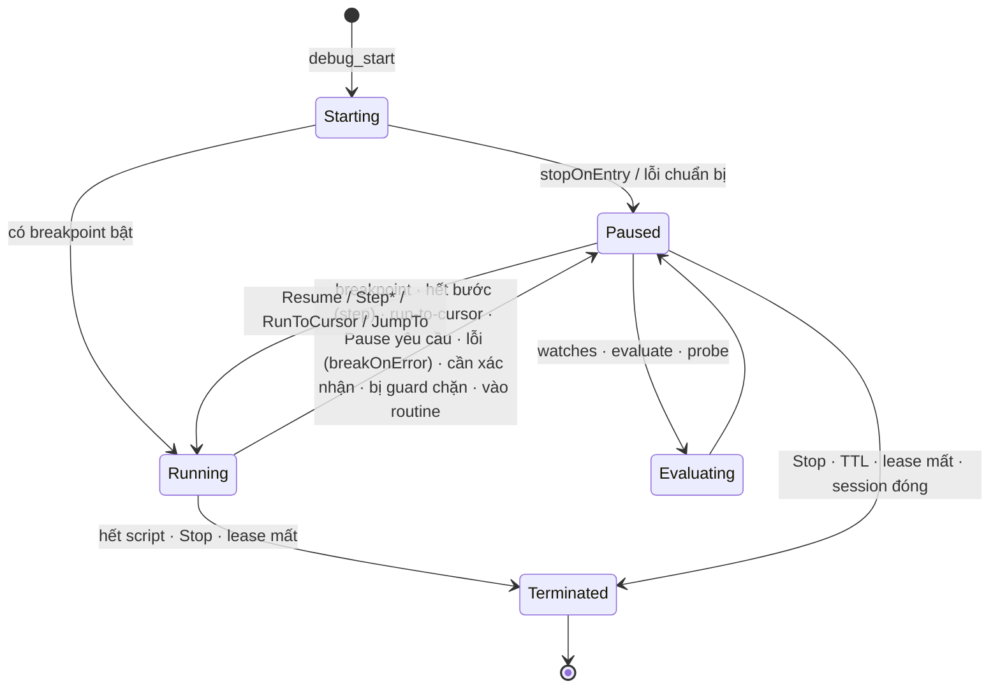
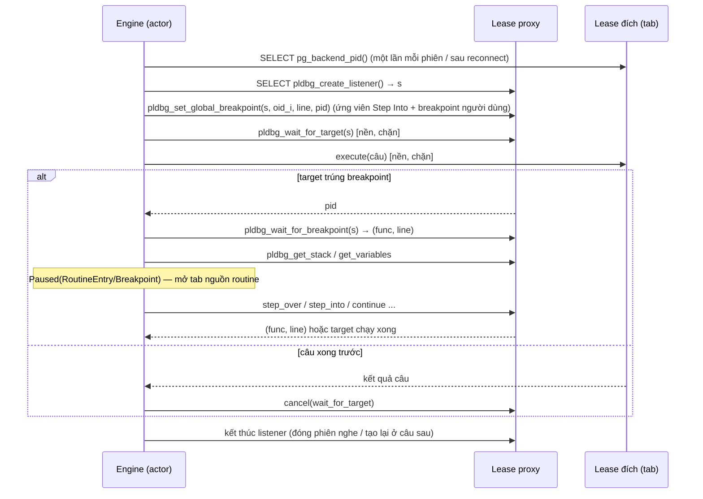

# DBStudio — Thiết kế "SQL Debugger" (script debugger + routine debugger, giao diện kiểu JetBrains)

> Trạng thái: bản thiết kế v1 (kiến trúc sư), viết trên nhánh `feature/quandh/sql_debugger` (tách từ `develop` @ `d7c96ee`). Chưa có dòng code nào; tài liệu là hợp đồng để chia gói song song.
> Nguồn đã đọc: `docs/architecture.md`, `docs/design/{phase2-8,backlog-gd9}.md`, `crates/dbstudio-core/src/{lease,lease_kit,query,script,capabilities}.rs`, `crates/drivers/*/src/lease.rs` (cách tách câu, notice PG, DBMS_OUTPUT Oracle), `crates/dbstudio-sql/src/{lib,split,classify,params,mongo_shell}.rs`, `src-tauri/src/{lease,guard,events,state,bridge}.rs`, `src-tauri/src/commands/editor.rs`, `src/features/editor/**` (`SqlEditor`, `EditorTab`, `editorStore`, `editorRunner`, `shortcuts`, `persist`), `src/lib/{ipc,mock,types,i18n}`, `docker/compose.test.yml`, `.github/workflows/ci.yml`.
> **Không tải web** khi viết. API `pldbgapi` (pldebugger), `DBMS_DEBUG` và bố cục Debug tool window của JetBrains ghi theo kiến thức sẵn có; chỗ chưa chắc đánh dấu **(cần kiểm)** và trở thành tiêu chí của gói P/O.
> Quy ước giống `phase2-8.md`: "char offset" = chỉ số ký tự Unicode (scalar); **dòng đánh số từ 1** (khớp gutter và `pldbgapi`); serde camelCase; mọi field mới `#[serde(default)]`.

## 0. Phạm vi và quyết định lớn

**Yêu cầu chủ dự án**: "bổ sung chức năng debug như các IDE của JetBrains hoặc Visual Studio: đặt breakpoint, nhảy từng bước (step over) hoặc nhảy sâu xuống dưới (step into); cần thêm một cửa sổ console tương tự các IDE này để hiển thị dữ liệu; thích cách JetBrains hiển thị nên làm theo cách đó".

| # | Quyết định | Lý do ngắn |
|---|---|---|
| D1 | **Hai tầng**: (a) *script debugger* chạy script trong editor **từng câu trên lease của tab**, cho mọi dialect; (b) *routine debugger* (Step Into vào stored procedure/function) **chỉ nơi server có API debug**: PostgreSQL qua `pldbgapi`. Oracle (`DBMS_DEBUG`) thiết kế sẵn, hiện thực ở GĐ sau sau một spike. | Script debugger dùng lại toàn bộ lease + `dbstudio-sql` nên rẻ và đồng đều; routine debugger phụ thuộc server. |
| D2 | Engine nằm ở **crate mới `crates/dbstudio-debug`** (Rust thuần + tokio, phụ thuộc `dbstudio-core` + `dbstudio-sql`), không phụ thuộc Tauri. Guard, token xác nhận, event ở `src-tauri` được **tiêm vào engine qua trait** (`StepGate`, `DebugSink`). | Giữ nguyên tắc 1–2 của `architecture.md`; test engine không cần cửa sổ; CLI dùng lại được. |
| D3 | Kiểu hợp đồng (serde) đặt ở `crates/dbstudio-core/src/debug.rs` để có fixture Rust ↔ TS như các kiểu khác; **không đổi chữ ký** command/trait cũ. | Theo quy tắc D5 của GĐ2. |
| D4 | **Đơn vị bước = một câu** theo `dbstudio_sql::analyze` với **đúng dialect của lease** (`Lease::script_dialect()` → session). Khối không bước vào được (PG `DO`, khối PL/SQL nặc danh, `BEGIN…END`/`IF`/`WHILE` T-SQL, `CREATE FUNCTION/PROCEDURE`, `BEGIN BATCH` CQL) là **một bước**. T-SQL: tách câu trong batch kèm "shim biến" (§4.5), lùi về một bước = một batch khi không an toàn. | Câu guard xét = câu driver chạy (quy tắc "splitter chung" của `architecture.md` §6). |
| D5 | Debug **dùng chính lease của tab** (giữ transaction, bảng tạm, `USE`, biến phiên). Trong phiên debug, lease bị **khoá cho debug**: `lease_execute/begin/commit/...` từ editor trả `Busy`. Routine debugger mở thêm **một lease phụ (proxy)** ẩn với frontend. | Người dùng debug đúng ngữ cảnh tab; tránh hai luồng lệnh chen nhau trên một kết nối. |
| D6 | **Guard áp cho từng bước** như editor (read-only chặn, production xác nhận câu phá huỷ bằng token một lần, gắn với văn bản câu + ngữ cảnh lúc chạy). Watches, Evaluate, điều kiện breakpoint, probe Variables chạy trong **khung chỉ đọc** (§2.7): guard ép `read_only = true` + transaction READ ONLY/savepoint rồi **rollback** tuỳ dialect. | "An toàn thực thi ở backend" (nguyên tắc 5). |
| D7 | Transaction mặc định khi debug: **`Wrap`** — nếu lease đang auto-commit và DB có `manual_transactions`, engine mở transaction trước bước đầu và **hỏi Commit/Rollback khi kết thúc (mặc định chọn Rollback)**. Cảnh báo khi transaction mở lâu lúc dừng; **TTL dừng** (mặc định 15 phút) tự huỷ phiên + rollback transaction do debug mở. | "Không để debug giữ khoá vô thời hạn". |
| D8 | Giao diện theo **JetBrains (bố cục classic)**: tool window "Debug" ở dưới trong tab editor, toolbar dọc trái (Rerun/Resume/Pause/Stop/View Breakpoints/Mute), thanh bước ngang, panel **Frames / Variables / Watches** và tab **Console**; gutter breakpoint đỏ, dòng thực thi tô xanh, **inline values** cuối dòng, hover. Keymap JetBrains mặc định (theo nền tảng), tuỳ chọn VS Code. | Yêu cầu chủ dự án. |
| D9 | Frontend nằm trong **vùng mới `src/features/debugger/**`** + `src/locales/{vi,en}/debugger.json`. Điểm nối vào vùng đang được session UI sửa **chỉ do Bước 0 làm**, tối thiểu và liệt kê đủ (§5.8). | Session khác đang tối ưu `src/features/**`. |
| D10 | IPC: command `debug_*` trả nhanh; tiến trình đi qua **event `debug://state`** (ảnh chụp trạng thái, nhỏ) và **`debug://output`** (dòng console tăng dần, có `seq` để phát hiện hụt → `debug_snapshot`). Không dùng Tauri `Channel` sống suốt phiên (dev bridge chỉ stream Channel tới khi command trả về). | Bridge `/events` đã chuyển mọi event. |
| D11 | MySQL/MariaDB/TiDB, SQL Server, CockroachDB, Mongo, Redis, Cassandra/Scylla, ClickHouse: **chỉ script debugger**; Step Into = Step Over kèm một dòng giải thích trong Console (giống JetBrains khi dòng không có lời gọi). Không mô phỏng routine MySQL ở đợt này (§4.4). | Không có API server; mô phỏng là viết lại trình thông dịch stored program — sai ngữ nghĩa, rủi ro cao. |

---

## 1. Ma trận hỗ trợ

✔ có · ◐ hạn chế/ghi chú · ✘ không · ⏳ GĐ sau

| DB | Script debugger | Transaction khi debug | Step Into routine | Đổi giá trị biến | Khung chỉ đọc (watches/evaluate) | Ghi chú |
|---|---|---|---|---|---|---|
| PostgreSQL 12–17 | ✔ | ✔ `Wrap`/`Lease` | ✔ PL/pgSQL khi có `pldbgapi` + `plugin_debugger` trong `shared_preload_libraries`; thiếu → ◐ hướng dẫn cài | ✔ biến phiên (`SET`), tham số bind, biến routine (`pldbg_deposit_value`) | ✔ `BEGIN READ ONLY … ROLLBACK` / `SAVEPOINT … ROLLBACK TO` | `DO` = một bước (Force Step Into qua hàm tạm: tuỳ chọn, §4.2.8) |
| YugabyteDB (YSQL) | ✔ | ✔ | ◐ phát hiện lúc chạy; **chưa xác minh** YB có gói pldebugger, mặc định coi là không | như PG | như PG | |
| CockroachDB | ✔ | ✔ | ✘ (có PL/pgSQL từ 23.2 nhưng không extension, không API debug) | ◐ `SET` | như PG (`SAVEPOINT` hỗ trợ) | |
| MySQL 5.7/8, MariaDB | ✔ | ✔ | ✘ không API; ⏳ phương án instrument opt-in (§4.4.3) | ✔ biến người dùng `@x`, tham số bind | ✔ `START TRANSACTION READ ONLY … ROLLBACK` / savepoint | Bảo toàn `ROW_COUNT()`/`FOUND_ROWS()` (§4.4.2) |
| TiDB | ✔ | ✔ | ✘ (không có stored routine) | ✔ `@x` | ◐ `BEGIN … ROLLBACK` (không có transaction READ ONLY) | |
| SQL Server | ✔ (shim biến T-SQL) | ✔ | ✘ T-SQL debugger đã bị bỏ khỏi SSMS 18+, không có API server công khai | ✔ biến `DECLARE` vô hướng (shim), tham số bind | ✔ `BEGIN TRAN … ROLLBACK` / `SAVE TRAN` | `PRINT`/`RAISERROR` → Console |
| Oracle | ✔ | ✔ | ⏳ `DBMS_DEBUG` (spike gói O); `DBMS_DEBUG_JDWP` xa hơn | ✔ bind `:x` | ✔ `SET TRANSACTION READ ONLY … ROLLBACK` / savepoint | `DBMS_OUTPUT` → Console (driver đã có) |
| MongoDB | ✔ | ◐ theo capabilities (replica set) | ✘ | ✘ (parser không chạy JS → không có biến script) | ◐ chỉ guard (không có transaction chỉ đọc) | |
| Redis / Valkey | ✔ backend; UI khi có chế độ script cho tab Redis (Q6) | ◐ `MULTI` do người dùng gõ | ✘; ⏳ Lua `SCRIPT DEBUG` (LDB) | ✘ | ◐ guard + cờ `write` của `COMMAND INFO`; **tạm ngưng trong `MULTI`** | |
| Cassandra / ScyllaDB | ✔ | ✘ (không transaction) | ✘ | ◐ `CONSISTENCY`/`TRACING` | ◐ chỉ guard | Trace từng bước khi `TRACING ON` |
| ClickHouse | ✔ | ✘ | ✘ | ◐ `SET` setting | ◐ guard (+ `SETTINGS readonly` theo câu nếu H xác nhận được) | |

---

## 2. Mô hình thực thi

### 2.1 Phiên debug và lease

- Một **phiên debug** (`debug_id`) gắn đúng **một lease**; tối đa 1 phiên/lease, 8 phiên/app (`Error::Busy` khi vượt).
- `debug_start` **chiếm** lease (`LeaseManager::claim_debug`): lệnh editor trên lease đó trả `Busy { message: "debugging" }` cho tới khi phiên kết thúc. Keepalive bỏ qua lease đang chạy câu như hiện nay.
- Văn bản được **chụp lúc start** (snapshot). Editor ở chế độ chỉ đọc trong phiên (Q3); Restart đọc lại văn bản hiện tại.
- Phiên kết thúc khi: chạy hết, Stop, lỗi nghiêm trọng, lease mất/`broken`, session đóng, tab đóng (frontend gọi `debug_stop` qua `onEditorTabRemoved`; `lease_close` phía backend cũng dừng phiên trước), TTL dừng.
- Routine debugger PG mở thêm **lease proxy** qua `Session::open_lease` (cùng TLS/SSH/database với lease đích), đăng ký trong `LeaseManager` (tính vào trần 32/session, đóng theo session) nhưng **không trả id cho frontend**.

### 2.2 Chương trình bước (`DebugProgram`)

Engine dựng một lần lúc start (và lúc Restart):

1. `steps = analyze(dialect, text)` trên **văn bản gốc** (chưa bind) — tham số `:x`/`$1`/`?`/`@p` là token nên tách câu không đổi khi bind; mỗi bước giữ `range` (char offset gốc), `line_start`/`line_end`, `class`, `verb`, `destructive`, `implicit_commit`.
2. Gắn **loại bước**: `Statement` · `Block { reason }` (không bước vào được) · `Meta` (`DELIMITER` MySQL, `GO` T-SQL — không chạy, không dừng) · `Skipped` (rỗng/comment).
3. Nếu người dùng chỉ chọn một vùng → chỉ các bước giao vùng đó (`DebugStartRequest.range`).
4. **Bind theo từng bước lúc chạy** (`dbstudio_sql::bind(dialect, step_text, params)`) để người dùng sửa tham số giữa chừng trong Variables; lỗi vị trí ánh xạ ngược qua `OffsetMap` + offset của bước.
5. **Văn bản gửi driver phải tách đúng một câu** bằng chính splitter của driver: `dbstudio_debug::wrap_single(dialect, step_text)` (MySQL thêm `DELIMITER` duy nhất khi câu chứa `;` cấp cao như thân `CREATE PROCEDURE`; dialect khác trả nguyên văn). Bất biến kiểm trong test: `split(dialect, wrapped).len() == 1`.
6. Phân tích trước toàn script để **đánh dấu sẵn** bước phá huỷ (icon ⚠ ở gutter) — chỉ hiển thị, không cấp token.

### 2.3 Máy trạng thái



Một tokio task (actor) sở hữu phiên, nhận lệnh qua `mpsc` như `lease_kit`. Trong `Running`, chỉ `Pause` và `Stop` được nhận (lệnh khác → `Busy`). `Stop` khi đang chạy câu = `lease.cancel(query_id)` (routine: `pldbg_abort_target`) rồi kết thúc theo `DebugEndAction`.

### 2.4 Ngữ nghĩa lệnh

| Lệnh (JetBrains) | Khung script | Khung routine (PG) |
|---|---|---|
| **Resume** F9 | Chạy các bước tới breakpoint kế (bỏ qua bước `Meta`), hết script → `Terminated(Finished)` (trừ khi `Wrap` → hỏi kết thúc) | `pldbg_continue`; routine trả về → tiếp tục script tới breakpoint kế |
| **Pause** | Đặt cờ: dừng **trước bước kế**. Câu đang chạy không bị ngắt; UI đề nghị "Huỷ câu đang chạy" (= cancel → dừng với lỗi) | ✘ (pldebugger không có ngắt bất đồng bộ) — nút mờ |
| **Stop** ⌘/Ctrl+F2 | Huỷ câu đang chạy, kết thúc theo `end` (Commit/Rollback/Keep/Ask) | `pldbg_abort_target` rồi như script |
| **Rerun** ⌘R / Ctrl+F5 | Stop (theo `end`) + start lại với văn bản hiện tại, cùng tuỳ chọn | như script |
| **Step Over** F8 | Chạy đúng bước hiện tại, dừng ở bước kế (breakpoint routine vẫn có hiệu lực — câu gọi routine có breakpoint sẽ dừng bên trong) | `pldbg_step_over`; dòng cuối → trở về script, dừng ở câu kế |
| **Step Into** F7 | PG + pldbgapi: đặt breakpoint vào các routine PL/pgSQL **mà câu gọi** (§4.2.5) rồi chạy câu; không có ứng viên / DB khác → như Step Over + ghi chú Console | `pldbg_step_into` (vào cả hàm PL/pgSQL lồng) |
| **Smart Step Into** ⇧F7 | Popup chọn một routine trong danh sách ứng viên của câu | — |
| **Force Step Into** ⌥⇧F7 | Như Step Into + **trigger function** trên bảng đích của câu, routine ở schema không nằm trong `search_path`; PG `DO` → hàm tạm (tuỳ chọn) | như Step Into |
| **Step Out** ⇧F8 | Mờ ở khung script cấp cao nhất | **Mô phỏng**: lặp `pldbg_step_over` tới khi độ sâu stack < độ sâu hiện tại (trần 10 000 bước, quá trần → `continue` có breakpoint tạm ở dòng kế của khung gọi) |
| **Run to Cursor** ⌥F9 | Chạy tới bước chứa dòng con trỏ; **dừng tại breakpoint trước đó** | breakpoint tạm tại dòng + `continue` |
| **Force Run to Cursor** ⌥⌘F9 / Ctrl+Alt+F9 | Như trên nhưng bỏ qua breakpoint | như trên, tắt breakpoint khác tạm thời |
| **Evaluate Expression** ⌥F8 | Đánh giá trên lease đích trong khung chỉ đọc | biến routine theo tên; biểu thức khác trên **proxy** với biến thay bằng literal (§4.2.6) |
| **Show Execution Point** ⌥F10 | Cuộn editor tới dòng hiện tại | mở/cuộn tab nguồn routine |
| **Jump To (Set Next Statement)** | Đặt bước kế = bước chứa dòng (bỏ qua câu bị chặn) — có xác nhận khi nhảy lùi | ✘ |

Lựa chọn khởi động: `stopOnEntry` mặc định **true khi không có breakpoint bật nào**, false khi có (Q2). `breakOnError` mặc định true: lỗi một câu → `Paused(Error)` tại câu đó; false → `Terminated(Error)`.

### 2.5 Breakpoint

- **Script breakpoint** = dòng (1-based) trong văn bản tab. Gán vào bước có `range` chứa ký tự không trắng đầu tiên của dòng; dòng trống/comment giữa hai câu **snap xuống câu kế** (như JetBrains). Nhiều breakpoint trên cùng bước gộp. `debug_set_breakpoints` trả `BreakpointStatus { id, verified, line (sau snap), message }`; dòng trong khối `Block`/`Meta` → `verified=false`, "không dừng được bên trong khối".
- **Routine breakpoint** = (routine, dòng trong `prosrc`, 1-based). Định danh bền: `oid::regprocedure::text` (vd `public.f_tax(numeric)`) + `source_hash` (sha256 của `prosrc`); hash khác lúc start → `verified=false` "mã nguồn đã đổi".
- Thuộc tính (giống hộp thoại Breakpoints của JetBrains): `enabled`, `suspend` (false = không dừng, chỉ log), `condition` (biểu thức boolean, đánh giá trong khung chỉ đọc; lỗi điều kiện → **dừng** kèm thông báo, như JetBrains), `logMessage` (chuỗi có `{expr}` → đánh giá và ghi Console), `hitCount` (dừng khi lần trúng thứ N — có nghĩa với breakpoint routine trong vòng lặp và batch `GO n`).
- **Mute breakpoints**: toggle trên toolbar, không xoá.
- Lưu: script breakpoint + watches theo tab trong `EditorTabState.debug` (store, §3.5); routine breakpoint theo kết nối trong bảng `routine_breakpoints`.
- Điều kiện theo dialect: SQL → `SELECT CASE WHEN (<cond>) THEN 1 ELSE 0 END` (Oracle thêm `FROM dual`); Mongo/Redis/CQL → điều kiện là một lệnh đọc, **đúng khi** trả ≥ 1 dòng/document hoặc reply khác `nil`/`0`/rỗng.

### 2.6 Transaction, kết thúc, TTL

`DebugTxMode`:
- `Wrap` (mặc định khi lease auto-commit và `capabilities.manual_transactions`): engine `begin()` trước bước đầu, đánh dấu transaction **thuộc debug** (`owned = true`). Câu có `implicit_commit` (DDL MySQL/Oracle) → cảnh báo vàng ở gutter và Console trước khi chạy ("câu này tự commit transaction debug").
- `Lease`: theo chế độ hiện tại của lease (auto-commit thì mỗi câu tự commit; manual thì dùng transaction của tab, `owned = false`).
- DB không transaction (CQL, ClickHouse, Redis ngoài `MULTI`) → luôn `Lease`, UI ghi "không thể hoàn tác".

`DebugEndAction` khi hết script/Stop: `Ask` (mặc định; dialog Commit/Rollback, nút mặc định Rollback) · `Rollback` · `Commit` · `Keep` (để transaction mở cho tab, TxBar hiện như thường). Chỉ áp cho transaction `owned`; transaction của tab không bao giờ bị debug tự commit/rollback, trừ TTL ở chế độ routine (bên dưới).

Chống giữ khoá:
- **Cảnh báo**: khi `Paused` và transaction mở ≥ `debugTxWarnSecs` (mặc định 60 s) → `state.transaction.warn = true` (banner vàng "Transaction mở 2 phút khi đang dừng — có thể đang giữ khoá" + nút "Rollback & dừng").
- **TTL dừng**: `Paused` không có lệnh nào trong `debugPausedTtlSecs` (mặc định 900 s, khoảng 60..=14 400, **không có giá trị tắt**) → `Terminated(Ttl)`: huỷ câu/routine đang treo (`pldbg_abort_target`), rollback transaction `owned`; transaction của tab giữ nguyên (TxBar).
- **Chốt phía server (PG)**: khi `owned`, engine đặt `SET idle_in_transaction_session_timeout = <TTL + 60 s>` trên lease lúc start và khôi phục giá trị cũ lúc kết thúc; nếu app chết, server tự cắt kết nối (Q8).
- Lease vẫn chịu `idle_ttl` 8 giờ và `pending_ttl` của `lease_kit`.

### 2.7 An toàn

**Từng bước** đi qua `StepGate::check` (hiện thực ở `src-tauri` bằng `guard::run_guard`) với: dialect của lease, văn bản bước (chưa bind) + tham số, `read_only`/`production` của kết nối, `confirm_text` theo database hiện hành của lease **tại thời điểm chạy bước**, `target_id = "lease:<id>"`, `context = "<db>/<schema>"`. Kết quả:
- `Allow` → chạy.
- `ReadOnlyViolation` → `Paused(Blocked{error})`, không chạy; người dùng chọn Jump To bước khác hoặc Stop.
- `ConfirmationRequired` → `Paused(Confirmation{request})`; frontend dùng `ConfirmDestructiveDialog` sẵn có (`src/features/safety`, chỉ import), rồi gọi lại `debug_step(action, confirm)` — token một lần, gắn văn bản + ngữ cảnh như editor.
- Lịch sử: mỗi bước chạy được ghi lịch sử như editor (redact) — `recordHistory` mặc định true; watches/probe/điều kiện **không** ghi.

**Khung chỉ đọc** (watches, Evaluate, điều kiện breakpoint, `{expr}` của log, probe Variables) — engine sinh câu bao, người dùng chỉ cung cấp biểu thức; biểu thức qua `StepGate::check_read_only` (guard với `read_only = true`, `production = false`, phải là **đúng một câu** `Read`/`Explain{writes:false}`):

| Dialect | Lease auto-commit / không transaction | Transaction đang mở | Transaction lỗi |
|---|---|---|---|
| PG, YB, Cockroach | `BEGIN READ ONLY` → biểu thức → `ROLLBACK` (3 lần `execute` riêng; bước cuối luôn chạy kể cả khi biểu thức lỗi) | `SAVEPOINT __dbg` → biểu thức → `ROLLBACK TO SAVEPOINT __dbg` → `RELEASE SAVEPOINT __dbg` (hoàn tác cả tác dụng phụ của hàm, trừ sequence) | Không đánh giá ("transaction bị huỷ — chỉ ROLLBACK") |
| MySQL, MariaDB | `START TRANSACTION READ ONLY` → … → `ROLLBACK` | `SAVEPOINT __dbg` → … → `ROLLBACK TO SAVEPOINT __dbg` | — |
| TiDB | `BEGIN` → … → `ROLLBACK` | savepoint (TiDB ≥ 6.2) | — |
| SQL Server | `BEGIN TRAN` → … → `ROLLBACK` | `SAVE TRAN __dbg` → … → `ROLLBACK TRAN __dbg` khi `XACT_STATE() = 1` | `XACT_STATE() = -1` → không đánh giá |
| Oracle | `SET TRANSACTION READ ONLY` → … → `ROLLBACK` | `SAVEPOINT dbg` → … → `ROLLBACK TO dbg` | — |
| Mongo, Redis, CQL, ClickHouse | Chỉ guard đọc (Redis: thêm kiểm cờ `write` như driver); Redis **không đánh giá khi `MULTI` đang mở** (lệnh sẽ bị xếp hàng) | — | — |

Mỗi lần đánh giá có timeout `debugWatchTimeoutMs` (mặc định 5 000 ms; quá → cancel, giá trị "⏱ quá hạn"), `max_rows` 50.

### 2.8 Variables, Watches, inline values

**Variables** là cây, nhóm cấp 1 (lazy — mở nhóm mới truy vấn, trừ nhóm đánh dấu "luôn tải"):

| Nhóm | Nguồn | Sửa được |
|---|---|---|
| `Parameters` | tham số bind của script | ✔ (áp cho các bước sau) |
| `Script variables` | MySQL `@x`, T-SQL `DECLARE @x` (shim), tên tìm bằng lexer trong script | ✔ (`SET @x = …` qua guard / shim) |
| `Session` | database/schema, user, pid/SPID, isolation, auto-commit | ✘ |
| `Settings` | PG `pg_settings WHERE source='session'`, ClickHouse `system.settings WHERE changed`, CQL consistency/tracing | ✔ PG/ClickHouse `SET` (qua guard; `read_only_defense` vẫn chặn tắt read-only) |
| `Temporary tables` | §4.x theo dialect; con: cột + số dòng (đếm khi mở) | ✘ |
| `Transaction` | `LeaseState.transaction`, `owned`, thời gian mở, savepoint debug | ✘ (nút Commit/Rollback trong menu ngữ cảnh) |
| `Last result` | số dòng/affected/thời gian của bước vừa chạy | ✘ |
| `Routine: <frame>` | `pldbg_get_variables` của khung đang chọn (tham số `A`, cục bộ `L`) | ✔ `pldbg_deposit_value` |

Các probe gom thành **một câu mỗi dialect mỗi lần dừng** khi có thể; chạy trong khung chỉ đọc; tôn trọng quy tắc "không làm hỏng trạng thái bước sau" (MySQL §4.4.2).

**Watches**: danh sách biểu thức theo tab, đánh giá lại **mỗi lần chuyển sang `Paused`** (không đánh giá giữa chừng khi Resume chạy qua nhiều bước). Kết quả: giá trị vô hướng (1 dòng × 1 cột), hoặc bảng thu gọn (≤ 50 dòng, mở rộng trong cây), hoặc lỗi (đỏ). Trong khung routine: watch là tên biến → lấy từ biến routine; còn lại đánh giá trên proxy (§4.2.6).

**Inline values** (`InlineValue { line, text, kind }`) do engine sinh sau mỗi bước, frontend vẽ cuối dòng (chữ xám nghiêng như JetBrains): dòng cuối của câu vừa chạy → `3 rows affected` / `1 row: id=5, name='a'` / `42 rows` / lỗi rút gọn; câu `SET @x = …`/`SELECT … INTO @x` → `@x = 5`; trong nguồn routine → `v_total = 120.50` ở các dòng có tên biến (khớp token định danh, chỉ dòng đã đi qua). Hover trên định danh khớp biến/tham số → tooltip giá trị đầy đủ.

### 2.9 Console

Mỗi phiên có một luồng `DebugOutput` (giới hạn 2 000 mục phía frontend, cũ bị cắt):
- `StepStart { step, line, text }` (hiện như prompt `▶ 12: UPDATE …`), các `QueryEvent` của bước (cột, dòng — **cắt ở `debugMaxRowsPerStep`**, mặc định 200 —, message), `StepEnd { end, elapsedMs }`.
- `Message { text, source }`: `notice` (PG NOTICE/WARNING), `print` (T-SQL `PRINT`/`RAISERROR` mức thấp), `dbmsOutput` (Oracle), `log` (breakpoint log), `info` (engine: "Step Into không khả dụng: …", "transaction debug đã rollback").
- `Error { error, step }`; `Evaluated { expr, result }` cho lệnh gõ ở ô nhập Console.
- Kết quả treo (`pending_result`) không giữ: engine chạy bước với `max_rows` và để bước kế tự huỷ kết quả treo; Console ghi "đã cắt ở 200 dòng".

---

## 3. Hợp đồng (Bước 0)

### 3.1 Bảng thay đổi (tương thích ngược)

| Thay đổi | Tương thích? | Chỗ phải sửa ở Bước 0 |
|---|---|---|
| Module mới `dbstudio-core::debug` (§3.2) | Thêm | `lib.rs` re-export; fixture `contract/fixtures/debug_*.json`; TS `src/lib/types/debug.ts`. |
| `Capabilities.routine_debug: bool` (driver *có thể* hỗ trợ; khả dụng thật do `debug_support`) | Thêm (serde default false) | Literal trong `planned_for` (PG, YB = true; còn lại false); TS. |
| Crate mới `crates/dbstudio-debug` (trait + stub) | Thêm | `Cargo.toml` workspace members; `src-tauri` dependency. |
| `AppSettings` thêm 6 field (§3.5) | Thêm | `settings.rs` (default, validate, `from_value_lenient`); TS `AppSettings` + `DEFAULT_SETTINGS`; mock settings. |
| `EditorTabState.debug: Option<TabDebugState>` | Thêm | Store `tabs.rs` (cột `debug_json`), TS; `persist.ts` chỉ thêm lời gọi registry `persistHooks.ts` (§5.7, §5.8). |
| Store migration **v8** | Thêm | §3.5; test `MIGRATIONS.len() == 8`. |
| `LeaseManager::claim_debug/release_debug/debug_owner` + kiểm `Busy` trong `lease_execute/fetch_more/begin/commit/rollback/set_auto_commit/set_context/explain` (lease) | Thêm hành vi khi có phiên debug | `src-tauri/src/lease.rs`, `commands/editor.rs`, `commands/plan.rs` (một dòng mỗi chỗ). `lease_close` gọi `DebugManager::stop_for_lease` trước khi đóng. |
| Command `debug_*` + event `debug://state`, `debug://output` | Thêm | `commands/debug.rs` (stub), `lib.rs` `generate_handler!`, bridge dispatch, TS wrapper, mock. |
| Không đổi chữ ký command/trait hiện có | — | — |

### 3.2 Kiểu core (`crates/dbstudio-core/src/debug.rs`)

```rust
/// Where a line lives: the editor script of the session, or the source of a routine.
#[derive(Debug, Clone, PartialEq, Eq, Hash, Serialize, Deserialize)]
#[serde(tag = "kind", rename_all = "camelCase")]
pub enum SourceRef {
    Script,
    #[serde(rename_all = "camelCase")]
    Routine { routine: RoutineRef },
}

#[derive(Debug, Clone, PartialEq, Eq, Hash, Serialize, Deserialize)]
#[serde(rename_all = "camelCase")]
pub struct RoutineRef {
    /// Stable identity: PG `oid::regprocedure::text`, e.g. `public.f_tax(numeric)`.
    pub signature: String,
    /// Server object id when known (PG oid as text); refreshed at every start.
    #[serde(default)] pub oid: Option<String>,
    /// Tree path of the routine (explorer, DDL).
    #[serde(default)] pub path: Option<ObjectPath>,
}

#[derive(Debug, Clone, PartialEq, Eq, Serialize, Deserialize)]
#[serde(rename_all = "camelCase")]
pub struct Breakpoint {
    /// Client generated id (uuid text), stable across edits.
    pub id: String,
    /// 1-based line in the source (script text or routine `prosrc`).
    pub line: u32,
    #[serde(default = "crate::script::yes")] pub enabled: bool,
    /// false = never stop (log only).
    #[serde(default = "crate::script::yes")] pub suspend: bool,
    #[serde(default)] pub condition: Option<String>,
    /// Text with `{expr}` placeholders written to the console on every hit.
    #[serde(default)] pub log_message: Option<String>,
    /// Stop on the N-th hit (1 = every hit).
    #[serde(default)] pub hit_count: Option<u32>,
}

#[derive(Debug, Clone, PartialEq, Eq, Serialize, Deserialize)]
#[serde(rename_all = "camelCase")]
pub struct RoutineBreakpoint {
    pub routine: RoutineRef,
    /// sha256 hex of the routine source when the breakpoint was set.
    #[serde(default)] pub source_hash: Option<String>,
    pub breakpoint: Breakpoint,
}

#[derive(Debug, Clone, PartialEq, Eq, Serialize, Deserialize)]
#[serde(rename_all = "camelCase")]
pub struct BreakpointStatus {
    pub id: String,
    pub verified: bool,
    /// Line after snapping to a statement (script) / executable line (routine).
    pub line: u32,
    #[serde(default)] pub message: Option<String>,
}

#[derive(Debug, Clone, Copy, Default, PartialEq, Eq, Serialize, Deserialize)]
#[serde(rename_all = "camelCase")]
pub enum DebugTxMode { #[default] Wrap, Lease }

#[derive(Debug, Clone, Copy, Default, PartialEq, Eq, Serialize, Deserialize)]
#[serde(rename_all = "camelCase")]
pub enum DebugEndAction { #[default] Ask, Rollback, Commit, Keep }

#[derive(Debug, Clone, Copy, Default, PartialEq, Eq, Serialize, Deserialize)]
#[serde(rename_all = "camelCase")]
pub enum TsqlStepUnit { #[default] Statement, Batch }

#[derive(Debug, Clone, PartialEq, Eq, Serialize, Deserialize)]
#[serde(rename_all = "camelCase")]
pub struct DebugOptions {
    /// None = true when no enabled breakpoint exists.
    #[serde(default)] pub stop_on_entry: Option<bool>,
    #[serde(default)] pub tx_mode: DebugTxMode,
    #[serde(default)] pub end_action: DebugEndAction,
    #[serde(default = "crate::script::yes")] pub break_on_error: bool,
    /// Per statement; None = settings `queryTimeoutMs`.
    #[serde(default)] pub statement_timeout_ms: Option<u64>,
    /// None = settings `debugMaxRowsPerStep`.
    #[serde(default)] pub max_rows_per_step: Option<u32>,
    /// Use the routine debugger when the server supports it.
    #[serde(default = "crate::script::yes")] pub routine: bool,
    #[serde(default)] pub tsql_step_unit: TsqlStepUnit,
    #[serde(default = "crate::script::yes")] pub record_history: bool,
}

#[derive(Debug, Clone, PartialEq, Eq, Serialize, Deserialize)]
#[serde(rename_all = "camelCase")]
pub struct WatchSpec { pub id: String, pub expr: String }

#[derive(Debug, Clone, PartialEq, Serialize, Deserialize)]
#[serde(rename_all = "camelCase")]
pub struct DebugStartRequest {
    pub lease_id: Uuid,
    /// Whole document (snapshot).
    pub text: String,
    /// Only the statements intersecting this range (selection), char offsets.
    #[serde(default)] pub range: Option<TextRange>,
    #[serde(default)] pub params: Vec<ParamValue>,
    #[serde(default)] pub breakpoints: Vec<Breakpoint>,
    #[serde(default)] pub routine_breakpoints: Vec<RoutineBreakpoint>,
    #[serde(default)] pub watches: Vec<WatchSpec>,
    #[serde(default)] pub options: DebugOptions,
    #[serde(default)] pub muted: bool,
}

#[derive(Debug, Clone, PartialEq, Eq, Serialize, Deserialize)]
#[serde(tag = "kind", rename_all = "camelCase")]
pub enum DebugAction {
    Resume, StepOver, StepInto, ForceStepInto,
    /// Smart Step Into: one routine among `DebugState.stepIntoTargets`.
    #[serde(rename_all = "camelCase")] SmartStepInto { signature: String },
    StepOut,
    #[serde(rename_all = "camelCase")] RunToCursor { source: SourceRef, line: u32, force: bool },
    #[serde(rename_all = "camelCase")] JumpTo { line: u32 },
    Pause,
}

#[derive(Debug, Clone, PartialEq, Serialize, Deserialize)]
#[serde(tag = "kind", rename_all = "camelCase")]
pub enum PauseReason {
    Entry, Step, RunToCursor, Pause, RoutineEntry,
    #[serde(rename_all = "camelCase")] Breakpoint { ids: Vec<String> },
    /// Statement failed (break on error). `error` = serialized `Error`.
    #[serde(rename_all = "camelCase")] Error { error: serde_json::Value },
    /// The guard refused the statement (read-only).
    #[serde(rename_all = "camelCase")] Blocked { error: serde_json::Value },
    #[serde(rename_all = "camelCase")] Confirmation { request: ConfirmationRequest },
    /// End of script with an owned transaction and `endAction = ask`.
    AwaitingEnd,
}

#[derive(Debug, Clone, Copy, PartialEq, Eq, Serialize, Deserialize)]
#[serde(rename_all = "camelCase")]
pub enum TerminateReason { Finished, Stopped, Error, LeaseLost, SessionClosed, Ttl }

#[derive(Debug, Clone, PartialEq, Serialize, Deserialize)]
#[serde(tag = "kind", rename_all = "camelCase")]
pub enum DebugStatus {
    Starting,
    #[serde(rename_all = "camelCase")] Running { step: u32 },
    #[serde(rename_all = "camelCase")] Paused { reason: PauseReason },
    Evaluating,
    #[serde(rename_all = "camelCase")] Terminated { reason: TerminateReason, report: Option<DebugEndReport> },
}

#[derive(Debug, Clone, PartialEq, Eq, Serialize, Deserialize)]
#[serde(rename_all = "camelCase")]
pub struct DebugPosition {
    pub source: SourceRef,
    pub line: u32,
    /// Statement range (script) in char offsets; None in routine sources.
    #[serde(default)] pub range: Option<TextRange>,
    /// Script step index / count (always the script frame's).
    pub step: u32,
    pub step_count: u32,
}

#[derive(Debug, Clone, Copy, PartialEq, Eq, Serialize, Deserialize)]
#[serde(rename_all = "camelCase")]
pub enum FrameKind { Script, Block, Routine }

#[derive(Debug, Clone, PartialEq, Eq, Serialize, Deserialize)]
#[serde(rename_all = "camelCase")]
pub struct DebugFrame {
    /// 0 = innermost.
    pub id: u32,
    pub kind: FrameKind,
    /// `f_tax(numeric):12` / `script.sql:8 — UPDATE (3/12)` / `DO block`.
    pub name: String,
    pub source: SourceRef,
    pub line: u32,
    #[serde(default)] pub language: Option<String>,   // "plpgsql"
    #[serde(default)] pub args: Option<String>,
}

#[derive(Debug, Clone, Copy, PartialEq, Eq, Serialize, Deserialize)]
#[serde(rename_all = "camelCase")]
pub enum VariableKind {
    Group, Parameter, ScriptVariable, Session, Setting, TempTable, Column,
    Transaction, Result, RoutineArgument, RoutineLocal,
}

#[derive(Debug, Clone, PartialEq, Serialize, Deserialize)]
#[serde(rename_all = "camelCase")]
pub struct DebugVariable {
    /// Opaque handle for `debug_variable_children` / `debug_set_variable`.
    pub reference: String,
    pub name: String,
    pub kind: VariableKind,
    #[serde(default)] pub value: Option<Value>,
    /// Short text for the tree (`'abc'`, `42`, `{3 rows}`); full value in `value`.
    pub display: String,
    #[serde(default)] pub type_name: Option<String>,
    #[serde(default)] pub editable: bool,
    #[serde(default)] pub has_children: bool,
    /// Value changed by the last step (shown highlighted, like JetBrains).
    #[serde(default)] pub changed: bool,
}

#[derive(Debug, Clone, PartialEq, Serialize, Deserialize)]
#[serde(tag = "kind", rename_all = "camelCase")]
pub enum EvalValue {
    #[serde(rename_all = "camelCase")] Scalar { value: Value, type_name: String },
    #[serde(rename_all = "camelCase")] Rows { result: ResultSet },
    #[serde(rename_all = "camelCase")] Error { error: serde_json::Value },
    Skipped { reason: String },   // MULTI open, failed tx, ROW_COUNT preserved...
}

#[derive(Debug, Clone, Copy, PartialEq, Eq, Serialize, Deserialize)]
#[serde(rename_all = "camelCase")]
pub enum EvalContext { Lease, Proxy, RoutineVariable }

#[derive(Debug, Clone, PartialEq, Serialize, Deserialize)]
#[serde(rename_all = "camelCase")]
pub struct EvalResult { pub value: EvalValue, pub context: EvalContext, pub elapsed_ms: u64 }

#[derive(Debug, Clone, PartialEq, Serialize, Deserialize)]
#[serde(rename_all = "camelCase")]
pub struct WatchResult { pub id: String, pub expr: String, pub result: EvalResult }

#[derive(Debug, Clone, Copy, PartialEq, Eq, Serialize, Deserialize)]
#[serde(rename_all = "camelCase")]
pub enum InlineKind { Result, Variable, Error }

#[derive(Debug, Clone, PartialEq, Eq, Serialize, Deserialize)]
#[serde(rename_all = "camelCase")]
pub struct InlineValue { pub source: SourceRef, pub line: u32, pub text: String, pub kind: InlineKind }

#[derive(Debug, Clone, PartialEq, Eq, Serialize, Deserialize)]
#[serde(rename_all = "camelCase")]
pub struct DebugTxInfo {
    pub status: TxStatus,
    /// Opened by the debugger (Wrap): end action applies.
    pub owned: bool,
    #[serde(default)] pub open_for_ms: Option<u64>,
    /// Open longer than `debugTxWarnSecs` while paused.
    pub warn: bool,
    /// Seconds before the paused TTL ends the session.
    #[serde(default)] pub ttl_left_secs: Option<u64>,
}

#[derive(Debug, Clone, PartialEq, Eq, Serialize, Deserialize)]
#[serde(rename_all = "camelCase")]
pub struct DebugSessionCaps {
    pub step_into: bool, pub step_out: bool, pub pause_running: bool,
    pub set_variable: bool, pub routine: bool, pub jump_to: bool,
}

#[derive(Debug, Clone, PartialEq, Serialize, Deserialize)]
#[serde(rename_all = "camelCase")]
pub struct DebugState {
    pub debug_id: Uuid,
    pub lease_id: Uuid,
    /// Monotonic per session; shared with `DebugOutputEvent.seq`.
    pub seq: u64,
    pub status: DebugStatus,
    #[serde(default)] pub position: Option<DebugPosition>,
    pub frames: Vec<DebugFrame>,
    pub selected_frame: u32,
    /// Top level groups (children via `debug_variable_children`).
    pub variables: Vec<DebugVariable>,
    pub watches: Vec<WatchResult>,
    pub inline_values: Vec<InlineValue>,
    pub breakpoints: Vec<BreakpointStatus>,
    pub transaction: DebugTxInfo,
    pub caps: DebugSessionCaps,
    /// Routines Smart Step Into can pick for the current statement.
    #[serde(default)] pub step_into_targets: Vec<RoutineRef>,
    pub muted: bool,
}

#[derive(Debug, Clone, PartialEq, Serialize, Deserialize)]
#[serde(tag = "kind", rename_all = "camelCase")]
pub enum DebugOutput {
    #[serde(rename_all = "camelCase")] StepStart { step: u32, line: u32, text: String },
    #[serde(rename_all = "camelCase")] Query { step: u32, event: QueryEvent },
    #[serde(rename_all = "camelCase")] StepEnd { step: u32, end: StatementEnd, truncated_at: Option<u32> },
    #[serde(rename_all = "camelCase")] Message { text: String, source: MessageSource },
    #[serde(rename_all = "camelCase")] Error { step: Option<u32>, error: serde_json::Value },
    #[serde(rename_all = "camelCase")] Evaluated { expr: String, result: EvalResult },
}

#[derive(Debug, Clone, Copy, PartialEq, Eq, Serialize, Deserialize)]
#[serde(rename_all = "camelCase")]
pub enum MessageSource { Notice, Print, DbmsOutput, Log, Info }

#[derive(Debug, Clone, PartialEq, Serialize, Deserialize)]
#[serde(rename_all = "camelCase")]
pub struct DebugOutputEvent { pub debug_id: Uuid, pub seq: u64, pub output: DebugOutput }

#[derive(Debug, Clone, Copy, PartialEq, Eq, Serialize, Deserialize)]
#[serde(rename_all = "camelCase")]
pub struct DebugEndReport { pub steps_run: u32, pub committed: bool, pub rolled_back: bool }

#[derive(Debug, Clone, PartialEq, Eq, Serialize, Deserialize)]
#[serde(tag = "kind", rename_all = "camelCase")]
pub enum RoutineDebugSupport {
    Available,
    /// Extension available on the server but not created in this database.
    #[serde(rename_all = "camelCase")] NeedsExtension { statement: String },
    /// `plugin_debugger` missing from `shared_preload_libraries` (server restart needed).
    #[serde(rename_all = "camelCase")] NeedsServerConfig { hint: String },
    #[serde(rename_all = "camelCase")] NoPermission { hint: String },
    #[serde(rename_all = "camelCase")] Unsupported { reason: String },
}

#[derive(Debug, Clone, PartialEq, Eq, Serialize, Deserialize)]
#[serde(rename_all = "camelCase")]
pub struct DebugSupport {
    pub script: bool,
    pub routine: RoutineDebugSupport,
    pub transactions: bool,
    /// Script variable syntax recognised for this dialect (`@x`, `DECLARE @x`...).
    pub script_variables: bool,
}
```

JSON mẫu: `{"kind":"paused","reason":{"kind":"breakpoint","ids":["b1"]}}`, `{"kind":"runToCursor","source":{"kind":"script"},"line":12,"force":false}`. Fixture cho mọi enum (quy tắc serde struct variant `rename_all` theo `phase2-8.md` §1.1).

### 3.3 Command IPC

Mọi command có `*_impl` stub ở Bước 0, đăng ký `generate_handler!`, dispatch dev bridge (JSON thường, không Channel), wrapper TS `src/lib/ipc/debug.ts`, mock `src/lib/mock/debug.ts`.

| Command | Chữ ký (TS) | Ghi chú |
|---|---|---|
| `debug_support` | `(leaseId) → DebugSupport` | Phát hiện rẻ (≤ 2 câu đọc), cache theo lease tới khi đổi database. |
| `debug_start` | `(request: DebugStartRequest) → DebugState` | Chiếm lease; lỗi `Busy` nếu lease đang chạy/đã có phiên; trả trạng thái đầu (`Starting`/`Paused(Entry)`). |
| `debug_step` | `(debugId, action: DebugAction, confirm?: ConfirmationGrant \| null) → DebugState` | Trả **ngay** trạng thái `Running`; kết quả qua event. `Pause` hợp lệ khi `Running`. |
| `debug_resume` | `(debugId) → DebugState` | Bí danh của `debug_step({kind:'resume'})` (theo yêu cầu đặt tên). |
| `debug_pause` | `(debugId) → DebugState` | Bí danh `debug_step({kind:'pause'})`. |
| `debug_run_to_cursor` | `(debugId, source: SourceRef, line, force) → DebugState` | Bí danh. |
| `debug_stop` | `(debugId, end?: DebugEndAction \| null) → DebugEndReport` | `null` = theo `options.endAction`; `ask` khi đang `AwaitingEnd` → lỗi `Invalid`. Idempotent. |
| `debug_restart` | `(debugId, text: string, end?: DebugEndAction \| null) → DebugState` | Stop + start, giữ breakpoints/watches/options, `debugId` **mới**. |
| `debug_evaluate` | `(debugId, expr, frame?: number \| null) → EvalResult` | Chỉ khi `Paused`; khung chỉ đọc. Kết quả cũng phát `Evaluated` vào Console nếu gọi từ ô nhập Console (`echo: true`). |
| `debug_set_breakpoints` | `(debugId, source: SourceRef, breakpoints: Breakpoint[]) → BreakpointStatus[]` | Thay toàn bộ breakpoint của nguồn (như DAP `setBreakpoints`). |
| `debug_set_muted` | `(debugId, muted: boolean) → DebugState` | |
| `debug_set_variable` | `(debugId, reference, valueText) → DebugVariable` | `editable=false` → `Invalid`; câu sinh ra qua guard. |
| `debug_variable_children` | `(debugId, reference) → DebugVariable[]` | Lazy. |
| `debug_watches_set` | `(debugId, watches: WatchSpec[]) → WatchResult[]` | Đánh giá ngay nếu đang `Paused`. |
| `debug_select_frame` | `(debugId, frame) → DebugState` | Variables/Watches theo khung (PG `pldbg_select_frame`). |
| `debug_routine_source` | `(debugId \| null, sessionId, routine: RoutineRef) → { text: string; sourceHash: string; language: string; firstLine: number }` | Dùng khi chưa có phiên (đặt breakpoint trước). |
| `debug_snapshot` | `(debugId) → DebugState` | Đồng bộ lại khi `seq` hụt. |
| `routine_breakpoints_get` / `routine_breakpoints_set` | `(connectionId) → RoutineBreakpoint[]` / `(connectionId, list) → void` | Store §3.5. |

Lỗi theo `Error` hiện có: `Busy` (lease bận/đang debug), `NotFound` (debugId lạ), `Invalid` (hành động không hợp lệ ở trạng thái hiện tại), `Unsupported` (routine trên DB không hỗ trợ), `ConfirmationRequired` **không** dùng cho debug_step (đi qua `PauseReason::Confirmation`).

### 3.4 Event

```rust
// src-tauri/src/events.rs
pub const DEBUG_STATE: &str = "debug://state";    // payload DebugState (đầy đủ, nhỏ: không chứa dòng kết quả)
pub const DEBUG_OUTPUT: &str = "debug://output";  // payload DebugOutputEvent
```
- `seq` tăng đơn điệu chung cho hai event của một phiên; frontend thấy `seq` nhảy → gọi `debug_snapshot` (Console có thể mất vài dòng — ghi "… bị lược").
- `debug://state` phát ở mỗi chuyển trạng thái + khi transaction đổi `warn`/`ttl_left_secs` (mỗi 15 s khi `Paused` có transaction).
- Kích thước: `Rows` trong `debug://output` theo lô ≤ 100 dòng, tổng ≤ `debugMaxRowsPerStep`; ô văn bản dài cắt ở 4 KB (`Value::Ext{truncatedText}` như LOB).

### 3.5 Cài đặt, store, trạng thái tab

```rust
// dbstudio-store settings.rs — AppSettings
pub debug_keymap: DebugKeymap,          // JetBrains
pub debug_tx_warn_secs: u32,            // 60; 0 = tắt cảnh báo; 10..=3600
pub debug_paused_ttl_secs: u32,         // 900; 60..=14_400 (không có giá trị tắt)
pub debug_watch_timeout_ms: u64,        // 5000; 500..=60_000
pub debug_max_rows_per_step: u32,       // 200; 10..=5000
pub debug_inline_values: bool,          // true

#[derive(Debug, Clone, Copy, Default, PartialEq, Eq, Serialize, Deserialize)]
#[serde(rename_all = "camelCase")]
pub enum DebugKeymap { #[default] JetBrains, VsCode }

// dbstudio-store tabs.rs — EditorTabState
#[serde(default)] pub debug: Option<TabDebugState>,

#[derive(Debug, Clone, Default, PartialEq, Eq, Serialize, Deserialize)]
#[serde(rename_all = "camelCase")]
pub struct TabDebugState {
    #[serde(default)] pub breakpoints: Vec<Breakpoint>,
    #[serde(default)] pub watches: Vec<WatchSpec>,
    #[serde(default)] pub muted: bool,
}
```

Migration **v8**:
```sql
ALTER TABLE editor_tabs ADD COLUMN debug_json TEXT;          -- NULL = không có
CREATE TABLE routine_breakpoints (
  id            TEXT PRIMARY KEY,           -- Breakpoint.id
  connection_id TEXT NOT NULL REFERENCES connections(id) ON DELETE CASCADE,
  signature     TEXT NOT NULL,
  source_hash   TEXT,
  body_json     TEXT NOT NULL,              -- Breakpoint (JSON)
  updated_at    TEXT NOT NULL
);
CREATE INDEX routine_breakpoints_conn ON routine_breakpoints(connection_id);
```
(Tên bảng/cột `connections` theo schema thật — Bước 0 đối chiếu `db.rs`.)

### 3.6 API engine (`crates/dbstudio-debug`)

```rust
/// Facts about the server the engine adapts to (from SessionInfo / ServerInfo.extra["flavor"]).
pub struct DialectProfile { pub kind: DbKind, pub flavor: Option<String>, pub version: Option<String>,
                            pub dialect: ScriptDialect, pub caps: Capabilities }

/// Guard of the host (src-tauri implements it with guard::run_guard / evaluate).
pub trait StepGate: Send + Sync {
    /// Bind + guard one step; returns the text to send (bound) and its offset map.
    fn check(&self, req: GateRequest<'_>) -> Result<GatedText>;
    /// Same with read_only forced, production off, exactly one Read/Explain statement.
    fn check_read_only(&self, dialect: ScriptDialect, text: &str) -> Result<GatedText>;
    /// Record a step in the query history (redacted by the host).
    fn record(&self, step: &StepRecord);
}
pub struct GateRequest<'a> { pub dialect: ScriptDialect, pub text: &'a str, pub params: &'a [ParamValue],
                              pub confirm: Option<&'a ConfirmationGrant>, pub database: Option<&'a str>,
                              pub schema: Option<&'a str> }
pub struct GatedText { pub text: String, pub map: dbstudio_sql::OffsetMap, pub analysis: ScriptAnalysis }

/// Where the engine sends state and console output (src-tauri: EventHub).
pub trait DebugSink: Send + Sync {
    fn state(&self, state: &DebugState);
    fn output(&self, event: DebugOutputEvent);
}

/// Opens the proxy connection of a routine debugger (src-tauri: Session::open_lease + LeaseManager).
#[async_trait] pub trait ProxyOpener: Send + Sync {
    async fn open_proxy(&self, database: Option<String>) -> Result<Arc<dyn Lease>>;
}

/// Dialect specific pieces of the script debugger (one impl per dialect family, in `dialect/*`).
pub trait DialectKit: Send + Sync {
    fn wrap_single(&self, step_text: &str) -> String;
    fn eval_frame(&self, tx: TxStatus) -> EvalFrame;            // §2.7
    fn condition_query(&self, cond: &str) -> String;            // §2.5
    fn probes(&self) -> Vec<Probe>;                             // §2.8 / §4
    fn script_variables(&self, program: &DebugProgram) -> Vec<ScriptVar>;
    fn set_variable_sql(&self, var: &ScriptVar, value_text: &str) -> Result<String>;
    fn preserves_counters(&self, next_step: &Step) -> bool;     // MySQL ROW_COUNT rule
}

/// Routine debugger of a server (PG pldbgapi; Oracle later).
#[async_trait] pub trait RoutineDebugger: Send {
    async fn support(&mut self, target: &dyn Lease) -> Result<RoutineDebugSupport>;
    async fn step_into_targets(&mut self, target: &dyn Lease, step: &Step, force: bool) -> Result<Vec<RoutineRef>>;
    /// Arm breakpoints (user + entry of `targets`) for the next statement on the target.
    async fn arm(&mut self, targets: &[RoutineRef], bps: &[RoutineBreakpoint]) -> Result<Vec<BreakpointStatus>>;
    /// Race: target statement finished vs routine stopped.
    async fn wait(&mut self, target_done: &mut (dyn Future<Output = ()> + Send + Unpin)) -> Result<RoutineStop>;
    async fn command(&mut self, cmd: RoutineCommand) -> Result<RoutineStop>;  // StepInto/Over/Continue/Abort
    async fn frames(&mut self) -> Result<Vec<DebugFrame>>;
    async fn select_frame(&mut self, frame: u32) -> Result<()>;
    async fn variables(&mut self) -> Result<Vec<DebugVariable>>;
    async fn set_variable(&mut self, reference: &str, value_text: &str) -> Result<DebugVariable>;
    async fn source(&mut self, routine: &RoutineRef) -> Result<RoutineSource>;
    async fn disarm(&mut self) -> Result<()>;
}

pub struct DebugEngine;   // DebugEngine::start(profile, lease, gate, sink, proxy, settings, request) -> DebugHandle
pub struct DebugHandle;   // async fn act/stop/evaluate/set_breakpoints/... (actor client)
```

Module: `program` (dựng bước, snap breakpoint, wrap), `actor` (máy trạng thái, timer TTL/cảnh báo), `eval` (khung chỉ đọc, watches, điều kiện, log), `dialect/{pg,mysql,mssql,oracle,mongo,redis,cql,clickhouse}.rs` (`DialectKit`), `tsql_shim`, `inline`, `routine/{mod,pg,oracle}.rs`.

### 3.7 `src-tauri`

- `src-tauri/src/debug.rs`: `DebugManager` (map `debug_id → DebugHandle`, `lease_id → debug_id`), `HostGate` (impl `StepGate` gọi `guard::run_guard`/`evaluate` với `state.confirm`), `EventSink` (impl `DebugSink` qua `emit_json`), `HostProxy` (impl `ProxyOpener`). Hook: `stop_for_lease` (gọi từ `lease_close`, `LeaseManager::mark_lost`), `stop_for_session` (đóng session / reconnect làm lease `broken`).
- `AppState.debug: DebugManager`.
- `commands/debug.rs`: command §3.3 (`*_impl` + `#[tauri::command]`), bridge.

### 3.8 Frontend tối thiểu ở Bước 0

- `src/lib/types/debug.ts` (mọi kiểu §3.2, §3.5), `src/lib/ipc/debug.ts` + `ipc.onEvent('debug://state' | 'debug://output')`, `src/lib/mock/debug.ts` (stub: `debug_support` → script true/routine theo kind; `debug_start` → `Paused(Entry)`, các lệnh khác trả trạng thái tĩnh), spread vào `mock` ở `src/lib/mock/index.ts`.
- `src/lib/i18n.ts`: đăng ký namespace `debugger` + file rỗng `src/locales/{vi,en}/debugger.json`.
- **Điểm nối** (§5.8) với component giữ chỗ trong `src/features/debugger/index.ts` (render `null`, extension rỗng) để mọi thứ biên dịch; gói F thay ruột mà không chạm lại file nối.
- `contract/fixtures/debug_*.json` + `src/lib/types/contract.test.ts`.

### 3.9 Docker và CI

```yaml
# docker/compose.test.yml — profile "debug" (~300 MB)
  pg16dbg:
    profiles: ['debug']
    build: { context: ./pgdebug }            # FROM postgres:16 + apt postgresql-16-pldebugger
    image: dbstudio/pg16-pldebugger:local
    environment: *pg-env
    mem_limit: 512m
    ports: ['127.0.0.1:54317:5432']
    command: ['postgres', '-c', 'shared_preload_libraries=plugin_debugger']
    healthcheck: { test: ['CMD-SHELL', 'pg_isready -U dbstudio -d dbstudio'], interval: 2s, timeout: 3s, retries: 30 }
```
`docker/pgdebug/Dockerfile`:
```dockerfile
FROM postgres:16
# Image postgres chính thức đã cấu hình kho apt.postgresql.org (PGDG).
RUN apt-get update \
 && apt-get install -y --no-install-recommends postgresql-16-pldebugger \
 && rm -rf /var/lib/apt/lists/*
COPY init/ /docker-entrypoint-initdb.d/   # 01-pldbgapi.sql: CREATE EXTENSION pldbgapi; + hàm PL/pgSQL mẫu cho IT
```
Biến môi trường IT `DBSTUDIO_IT_PGDBG_PORT=54317`. CI thêm nhóm matrix `debug`: `services: pg16dbg`, `profile: debug`, `test: cargo test -p dbstudio-debug -- pgdbg`. IT script debugger cho các DB khác chạy trong nhóm sẵn có (core/wide/analytics/newsql) theo mẫu probe-rồi-skip (G8 của backlog).

**Xong khi (Bước 0)**: `cargo fmt --check`, `cargo clippy --workspace --all-features -D warnings`, `cargo test --workspace` (fixture hợp đồng debug, migration v8 trên DB v7 thật) xanh; `pnpm lint && pnpm test && pnpm build` xanh; app chạy với mock không lỗi kiểu; `docker compose -f docker/compose.test.yml --profile debug config` hợp lệ và `docker compose … build pg16dbg` thành công. Sau mốc này đổi hợp đồng = PR riêng sửa core + TS + fixture.

---

## 4. Backend theo driver

### 4.1 PostgreSQL — script debugger

- Bước: splitter PG (dollar-quote, `BEGIN ATOMIC`); `DO`, `CREATE FUNCTION/PROCEDURE` = `Block`. psql meta-command (`\set`, `\gset`) **không** được editor hỗ trợ → không phải biến; câu đó bị guard/driver báo lỗi như hiện nay.
- Probe (một câu): `SELECT current_database(), current_schema(), current_user, pg_backend_pid(), current_setting('transaction_isolation'), txid_current_if_assigned()`; nhóm Settings: `SELECT name, setting, unit FROM pg_settings WHERE source = 'session' ORDER BY name`; bảng tạm: `SELECT c.relname, c.reltuples FROM pg_class c WHERE c.relnamespace = pg_my_temp_schema() AND c.relkind IN ('r','p')`; mở thêm: `pg_prepared_statements`, `pg_cursors`.
- Sửa biến: Settings → `SET <name> = <literal>` (qua guard); tham số bind → chỉ ở engine.
- Notice: driver xả notice sau mỗi câu (`conn.drain_notices()` trong `exec.rs`) → Console nhận sau khi câu xong (đủ cho script debugger).
- CockroachDB/YugabyteDB dùng chung `dialect/pg.rs`; Cockroach thiếu `pg_my_temp_schema()`/`txid_current_if_assigned()` → probe theo flavor (`crdb_internal`/bỏ cột).

### 4.2 PostgreSQL — routine debugger (`pldbgapi`)

#### 4.2.1 Điều kiện và phát hiện (`debug_support`)

1. `SELECT extversion FROM pg_extension WHERE extname = 'pldbgapi'` → có: tiếp bước 2; không: `SELECT 1 FROM pg_available_extensions WHERE name = 'pldbgapi'` → có: `NeedsExtension { statement: "CREATE EXTENSION pldbgapi;" }`; không: `Unsupported`.
2. `SELECT current_setting('shared_preload_libraries')` chứa `plugin_debugger` → `Available`; không → `NeedsServerConfig { hint }` (thêm vào `shared_preload_libraries`, khởi động lại server).
3. Quyền: `has_function_privilege('pldbg_create_listener()', 'EXECUTE')` và `…set_global_breakpoint…` → thiếu: `NoPermission`. (Hàm `pldbg_*` có yêu cầu superuser hay không: **(cần kiểm)** trên `pg16dbg`, ghi kết quả vào §8.)
4. CockroachDB → `Unsupported("CockroachDB has no debugger API")`; Yugabyte chạy bước 1–3 như PG.

App **không tự** `CREATE EXTENSION` (thao tác ghi cần quyền): UI hiển thị hướng dẫn + nút "Chèn câu lệnh vào editor".

#### 4.2.2 Hàm dùng (theo `pldbgapi`, cách pgAdmin 4 sử dụng)

| Hàm | Dùng cho |
|---|---|
| `pldbg_create_listener() → int` | Proxy: tạo phiên nghe (`session handle`). |
| `pldbg_set_global_breakpoint(session int, func oid, line int, targetPid int) → bool` | Đặt breakpoint **chỉ cho backend của lease đích** (`targetPid = pg_backend_pid()` của lease). `line` cho "đầu hàm": `-1`/`NULL` **(cần kiểm)**. |
| `pldbg_wait_for_target(session) → int` | Chặn tới khi target trúng breakpoint (trả pid). |
| `pldbg_wait_for_breakpoint(session) → breakpoint(func, linenumber, targetname)` | Lấy điểm dừng đầu. |
| `pldbg_step_into / pldbg_step_over / pldbg_continue (session) → breakpoint` | Bước. |
| `pldbg_set_breakpoint / pldbg_drop_breakpoint (session, func, line) → bool` | Breakpoint khi đã gắn. |
| `pldbg_get_breakpoints(session)` | Đồng bộ trạng thái. |
| `pldbg_get_stack(session) → (level, targetname, func, linenumber, args)` | Frames. |
| `pldbg_select_frame(session, frame) → breakpoint` | Chọn khung. |
| `pldbg_get_variables(session) → (name, varclass, linenumber, isunique, isconst, isnotnull, dtype, value)` | Variables (`varclass` `A` tham số, `L` cục bộ; giá trị khác **(cần kiểm)**). Kiểu: `format_type(dtype, NULL)`. |
| `pldbg_deposit_value(session, varname, linenumber, value text) → bool` | Set Value (`value` là literal hay biểu thức PL/pgSQL — **(cần kiểm)**). |
| `pldbg_get_source(session, func) → text` | Nguồn (`prosrc`). |
| `pldbg_abort_target(session)` | Stop. |
| `pldbg_oid_debug(oid)` / `plpgsql_oid_debug(oid)` | Luồng "direct" (target tự chờ debugger, báo cổng qua NOTICE `PLDBGBREAK:<port>` → `pldbg_attach_to_port`). **Không dùng**: driver PG chỉ xả notice sau khi câu xong nên không đọc được cổng kịp thời. |

#### 4.2.3 Luồng một câu có thể bước vào



- **Listener theo câu** (mặc định an toàn): tạo → đặt breakpoint → chờ → huỷ sau khi câu xong. Nếu IT chứng minh listener dùng lại được sau khi huỷ `wait_for_target`, tối ưu thành một listener/phiên (ghi §8).
- **Không bao giờ** đặt global breakpoint với `targetPid = NULL` (mọi backend của server sẽ dừng — ảnh hưởng production). Test bắt buộc.
- Cuộc đua "proxy trả về" vs "target xong": engine `select!` hai future; target xong khi đang ở khung routine (routine chạy hết) → huỷ lệnh proxy đang chờ, trở về khung script.
- Stop/TTL khi target đang dừng: `pldbg_abort_target(s)` → câu ở target lỗi (PG đặt transaction `Failed`) → kết thúc theo `end` (rollback).
- App chết khi target đang dừng: kết nối proxy đóng → backend proxy kết thúc; target nhận lỗi socket và tiếp tục/huỷ **(cần kiểm)**; chốt thêm bằng `idle_in_transaction_session_timeout` không áp (target đang trong câu) → gói P đo hành vi, nếu target treo thì đặt `statement_timeout` của target = TTL trong suốt câu được debug (khôi phục sau).

#### 4.2.4 Nguồn và số dòng

Số dòng của `pldebugger` đếm trên `prosrc` (thân giữa `$$…$$`), từ 1. Tab nguồn hiển thị **chính `prosrc`** (lấy qua `pldbg_get_source` khi đang gắn, hoặc `SELECT prosrc FROM pg_proc WHERE oid = $1` khi chưa) với tiêu đề widget (không phải văn bản) là chữ ký + ngôn ngữ — không cần ánh xạ dòng. `source_hash` = sha256(`prosrc`).

#### 4.2.5 Ứng viên Step Into

Từ token của câu (lexer `dbstudio-sql`): định danh (có thể `schema.`) đứng trước `(`, hoặc sau `CALL`. Tra:
```sql
SELECT p.oid, p.oid::regprocedure::text
FROM pg_proc p JOIN pg_language l ON l.oid = p.prolang
WHERE l.lanname = 'plpgsql' AND p.proname = ANY($1)
  AND (pg_function_is_visible(p.oid) OR p.pronamespace::regnamespace::text = ANY($2))
```
Force Step Into thêm trigger function của bảng đích (`StatementInfo.targets`): `SELECT tgfoid FROM pg_trigger WHERE tgrelid = ANY($oids) AND NOT tgisinternal` (chỉ `plpgsql`), và bỏ điều kiện `pg_function_is_visible`. Overload cùng tên: đặt breakpoint vào mọi overload (Smart Step Into cho chọn). Tối đa 32 ứng viên/câu.

#### 4.2.6 Watches/Evaluate trong khung routine

1. Biểu thức trùng tên biến (không phân biệt hoa thường, theo khung chọn) → `EvalContext::RoutineVariable`.
2. Ngược lại: thay mỗi định danh trùng biến bằng literal có kiểu (`'<value>'::<type>`), đánh giá `SELECT (<expr>)` trên **proxy** trong `BEGIN READ ONLY … ROLLBACK` → `EvalContext::Proxy`; UI ghi rõ "ngữ cảnh proxy: không thấy dữ liệu chưa commit/bảng tạm của phiên đang debug".

#### 4.2.7 Điều kiện/hit count/log cho breakpoint routine

pldebugger không có breakpoint có điều kiện → engine mô phỏng: khi trúng, đếm hit, đánh giá điều kiện theo §4.2.6; sai → `pldbg_continue` tự động (Console không ghi gì, trừ log message).

#### 4.2.8 Force Step Into vào `DO` (tuỳ chọn, mặc định tắt — Q10)

Biến `DO $$…$$` (PL/pgSQL) thành `CREATE FUNCTION pg_temp.__dbg_do_<n>() RETURNS void LANGUAGE plpgsql AS $$…$$; SELECT pg_temp.__dbg_do_<n>();` rồi debug hàm tạm; xoá hàm sau bước. Khác biệt ngữ nghĩa (transaction control `COMMIT` trong `DO` không hợp lệ trong function) → chỉ khi thân không có `COMMIT`/`ROLLBACK`.

### 4.3 CockroachDB / YugabyteDB

Script debugger như PG. Cockroach: `routine = Unsupported`; transaction `Wrap` (Cockroach có thể trả lỗi retry `40001` — Console gợi ý Rerun). Yugabyte: chạy phát hiện §4.2.1; nếu có pldbgapi thì bật routine ở trạng thái "thử nghiệm" (không có IT bắt buộc).

### 4.4 MySQL / MariaDB / TiDB

#### 4.4.1 Script debugger
- Bước theo splitter MySQL với `sql_mode` của lease (`Lease::script_dialect()`); `DELIMITER` = `Meta`; `CREATE PROCEDURE/FUNCTION/TRIGGER/EVENT` = `Block`. `wrap_single`: câu chứa `;` cấp cao → `DELIMITER $$__dbg$$\n<câu>\n$$__dbg$$` (chuỗi kết thúc chọn sao cho không xuất hiện trong câu).
- Biến script: token `@name` (không phải `@@`) trong script → `SELECT @a, @b, …` (MySQL 8 có thể dùng `performance_schema.user_variables_by_thread WHERE THREAD_ID = PS_CURRENT_THREAD_ID()` khi có quyền, để thấy cả biến không xuất hiện trong script). Sửa: `SET @x = <literal>`.
- Session: `SELECT DATABASE(), CONNECTION_ID(), @@autocommit, @@transaction_isolation` (5.7: `@@tx_isolation`; MariaDB: `@@tx_isolation`). Bảng tạm: tên từ `CREATE TEMPORARY TABLE` trong script (MySQL không liệt kê bảng tạm theo tên một cách tin cậy), kiểm tồn tại bằng `SELECT 1 FROM <t> LIMIT 0` trong khung chỉ đọc. Warning: nếu driver chưa chuyển warning thành message, engine chạy `SHOW WARNINGS` sau bước khi `@@warning_count > 0` (đọc `@@warning_count` không xoá danh sách warning).

#### 4.4.2 Bảo toàn bộ đếm phiên
`SELECT` của watches/probe đặt lại `ROW_COUNT()`, `FOUND_ROWS()`, danh sách warning. Nếu **bước kế** tham chiếu `ROW_COUNT()`, `FOUND_ROWS()`, `LAST_INSERT_ID()` (an toàn nhưng gom chung), `@@warning_count`, `@@error_count`, `SHOW WARNINGS/ERRORS`, `GET DIAGNOSTICS` → engine **hoãn** watches/probe ở lần dừng này (`EvalValue::Skipped { reason: "giữ ROW_COUNT() cho câu kế" }`). Điều kiện breakpoint của chính bước kế vẫn được đánh giá (người dùng chủ động) kèm cảnh báo.

#### 4.4.3 Vì sao không có Step Into
MySQL/MariaDB không có API debug stored program; TiDB không có stored routine. Ba phương án đã xét:
1. **Mô phỏng trong client** (dịch thân routine thành các câu chạy từng bước: biến cục bộ → `@__dbg_x`): `IF/WHILE/LOOP/CASE`, `DECLARE … HANDLER`, cursor chỉ tồn tại trong compound statement → phải viết trình thông dịch stored program phía client; sai ngữ nghĩa (handler, phạm vi biến, transaction, quyền `SQL SECURITY DEFINER`). **Loại**.
2. **Instrument trên server** (cách dbForge Studio làm): tạo schema hỗ trợ, biên dịch lại routine bản sao có chèn lời gọi ghi trạng thái + đồng bộ bằng `GET_LOCK`/`RELEASE_LOCK` giữa target và proxy. Đúng ngữ nghĩa hơn nhưng **sửa server** (tạo schema, thay routine), cần quyền `CREATE ROUTINE`/`ALTER ROUTINE`, không dùng được trên production. **Để GĐ sau**, chỉ opt-in cho môi trường `development`.
3. **Không hỗ trợ** (chọn cho đợt này): Step Into = Step Over + Console "MySQL không có API debug routine".

### 4.5 SQL Server

#### 4.5.1 Đơn vị bước và "shim biến"
`dbstudio_sql::split` trả batch (`GO [n]`), `analyze` trả câu trong batch. Biến T-SQL **sống trong một batch**, nên chạy từng câu riêng làm mất `DECLARE`. Với `tsqlStepUnit = statement` (mặc định):
- Phân tích batch: biến vô hướng `DECLARE @a int = …, @b nvarchar(50)` (lexer). Batch **lùi về một bước** (`Block{reason:"batch"}`) khi có: biến bảng `DECLARE @t TABLE`, cursor, điều khiển luồng (`IF/WHILE/BEGIN…END/TRY…CATCH/GOTO/RETURN/WAITFOR`), tham chiếu `@@ROWCOUNT`, `@@ERROR`, `SCOPE_IDENTITY()`, `@@IDENTITY`, `@@FETCH_STATUS`, `EXEC` động dùng biến OUTPUT, hoặc câu tạo đối tượng phải đứng đầu batch (`CREATE PROCEDURE/VIEW/TRIGGER/FUNCTION`).
- Ngược lại, bước k gửi: `DECLARE <các biến đã khai báo trước k>; SELECT @a = <lit>, …;` + câu k + `; SELECT @a AS [@a], …` — kết quả cuối **bị engine nuốt** (không lên Console) để cập nhật giá trị. Literal: `CAST(N'<text ISO>' AS <type>)`, nhị phân `0x…`, `NULL`; float dùng `CONVERT(varchar(64), @f, 3)` khi đọc để không mất độ chính xác.
- `GO n`: các bước của batch lặp n lần (hit count có nghĩa).
- `tsqlStepUnit = batch`: mỗi batch một bước (không shim).

#### 4.5.2 Probe
`SELECT DB_NAME(), @@SPID, @@TRANCOUNT, XACT_STATE(), (SELECT transaction_isolation_level FROM sys.dm_exec_sessions WHERE session_id = @@SPID)`; bảng tạm: tên `#x` trong script, kiểm `OBJECT_ID('tempdb..#x') IS NOT NULL`. Shim chạy probe **trong batch riêng** sau bước (không làm hỏng `@@ROWCOUNT` vì bước kế là batch khác đã được lùi nếu dùng `@@ROWCOUNT`).

#### 4.5.3 Không có Step Into
T-SQL debugger (dựa trên thành phần debug của Visual Studio, cần sysadmin + RPC/DCOM) đã bị bỏ khỏi SSMS từ bản 18; không có API server công khai để hiện thực lại. Ma trận ghi ✘, Console giải thích khi bấm Step Into.

### 4.6 Oracle

#### 4.6.1 Script debugger
Splitter Oracle (`;` cho SQL, khối PL/SQL kết thúc bằng dòng `/`, lệnh SQL*Plus tới cuối dòng — dùng `dbstudio_sql::split`, đã có test vi sai với splitter driver). Khối PL/SQL = `Block`. Lệnh SQL*Plus driver bỏ qua (`SET SERVEROUTPUT`, `DEFINE`, `PROMPT`) = `Meta` nhưng vẫn gửi nếu driver xử lý (`SET SERVEROUTPUT` bật `DBMS_OUTPUT`). `DBMS_OUTPUT` đã thành message (driver `exec.rs`) → Console `dbmsOutput`. Probe: `SELECT SYS_CONTEXT('USERENV','CURRENT_SCHEMA'), SYS_CONTEXT('USERENV','SID'), DBMS_TRANSACTION.LOCAL_TRANSACTION_ID FROM dual`; bảng tạm riêng (18c+): `USER_PRIVATE_TEMP_TABLES`. **Tiêu chí**: khối PL/SQL gửi một mình (không kèm dòng `/`) chạy đúng qua lease Oracle — kiểm trong IT.

#### 4.6.2 Routine debugger — thiết kế cho GĐ sau
- **`DBMS_DEBUG`** (hai phiên, giống pldebugger): target `DBMS_DEBUG.INITIALIZE()` (trả debug session id) + `DBMS_DEBUG.DEBUG_ON`; proxy `DBMS_DEBUG.ATTACH_SESSION(id)`, `SYNCHRONIZE(runtime_info, info_requested)`, `SET_BREAKPOINT(program_info, line, bp#)`, `CONTINUE(runtime_info, break_flags, info_requested)` với `break_next_line` (Step Over), `break_any_call` (Step Into), `break_any_return` (Step Out — có sẵn, không phải mô phỏng), `abort_execution` (Stop); `GET_VALUE`/`SET_VALUE`, `PRINT_BACKTRACE`, `SHOW_SOURCE`; kết thúc `DETACH_SESSION` + `DEBUG_OFF`. Gọi bằng khối PL/SQL nặc danh với bind OUT qua ODPI-C (lease Oracle chạy API đồng bộ trên thread riêng — target và proxy là hai lease, mỗi lease một thread nên lời gọi chặn không khoá nhau).
- Điều kiện: quyền `DEBUG CONNECT SESSION` + `DEBUG ANY PROCEDURE` (hoặc là owner), đơn vị phải biên dịch kèm thông tin debug (`ALTER … COMPILE DEBUG` hoặc `PLSQL_OPTIMIZE_LEVEL`/`plsql_debug`) — **đổi trạng thái đối tượng trên server** → app không tự làm, chỉ hướng dẫn.
- `DBMS_DEBUG` đã bị Oracle đánh dấu deprecated (khuyến nghị `DBMS_DEBUG_JDWP`), vẫn có ở 19c/21c; trạng thái ở 23ai **(cần kiểm trên `oraclefree`)**.
- **`DBMS_DEBUG_JDWP`**: server nối ngược về một JDWP listener phía client (`CONNECT_TCP(host, port)`) → app phải hiện thực một phần giao thức JDWP, cần ACL mạng (`DBMS_NETWORK_ACL_ADMIN`, privilege `jdwp`) và **reverse tunnel** khi đi qua SSH. Quá lớn cho đợt này.
- Kết luận: gói **O** là spike (§6): xác minh `DBMS_DEBUG` trên `oraclefree`, nguyên mẫu attach + một Step Over + `GET_VALUE` trong IT, đề xuất go/no-go; `routine/oracle.rs` giữ stub `Unsupported`.

### 4.7 MongoDB
Bước theo `mongo_shell` (`;`/xuống dòng ngoài ngoặc); `use <db>` cập nhật ngữ cảnh. Không có biến script (parser không chạy JavaScript). Variables: database hiện hành, trạng thái transaction của `ClientSession` (khi `manual_transactions`). Watches: lệnh đọc (`find`, `countDocuments`, `aggregate` không `$out/$merge`) qua guard đọc; Console hiện document dạng EJSON thu gọn.

### 4.8 Redis / Valkey
Mỗi dòng một bước. Engine theo dõi `MULTI`/`EXEC`/`DISCARD`/`WATCH` bằng lexer: trong `MULTI` các bước trả `QUEUED`, Variables "MULTI: n lệnh xếp hàng", watches/probe **tạm ngưng**. Variables: db (`LeaseState.database`), `CLIENT INFO` (Redis ≥ 6.2: `db`, `multi`, `watch`, `resp`). Watches: lệnh đọc (cờ `write` = từ chối như driver). **UI**: tab Redis hiện là console (không có `SqlEditor`) → bật UI khi có chế độ script cho Redis (Q6); engine + mock + IT làm ngay. ⏳ Lua: `SCRIPT DEBUG YES` (LDB, chế độ fork, thay đổi bị huỷ) trên một kết nối riêng — ứng viên routine debugger GĐ sau; không dùng `SYNC` (chặn cả server).

### 4.9 Cassandra / ScyllaDB
Bước theo splitter CQL (lệnh kiểu cqlsh tới cuối dòng, `BEGIN BATCH … APPLY BATCH` = `Block`). Không transaction → `Lease`, UI "không hoàn tác được". Variables: keyspace, consistency, serial consistency, tracing, page size. Khi `TRACING ON`, sau mỗi bước Console thêm tóm tắt trace (driver đã có `get_tracing_info`).

### 4.10 ClickHouse
Bước theo splitter ClickHouse. Không transaction. Variables: database, `SELECT name, value FROM system.settings WHERE changed`, bảng tạm `SELECT name FROM system.tables WHERE is_temporary`, `session_id`. Sửa Settings bằng `SET`. Watches: guard đọc; gói D kiểm thêm khả năng gắn `SETTINGS readonly = 2` vào câu watch (nếu server cho phép đặt `readonly` theo câu) — có thì bật, không thì chỉ guard.

---

## 5. Frontend

### 5.1 Bố cục tool window (theo JetBrains, bố cục classic)

```
┌─ Editor (gutter: ● breakpoint đỏ · ◆ có điều kiện · ○ đã tắt · ⚠ câu phá huỷ · ➜ dòng thực thi) ──────────┐
│  7 │   SELECT * FROM orders WHERE id = :id;                       -- 1 row: id=5, total=120.50      │
│● 8 │➜  UPDATE orders SET total = total * 1.1 WHERE id = :id;      (dòng tô xanh)                     │
│  9 │   SELECT f_tax(:id);                                                                             │
├─ [Kết quả] [Debug: query.sql ×] ──────────────────────────────────────────────────────────────────────┤
│ ⟳ │ [Debugger] [Console]   ⤓ │ ↷ F8 │ ↓ F7 │ ⇊ ⌥⇧F7 │ ↑ ⇧F8 │ ⇥ ⌥F9 │ ⊞ ⌥F8 │   Dừng ở dòng 8 (câu 3/12) │
│ ▶ │ Frames ───────────────┬ Variables ─────────────────────────────┬ Watches ─────────────────────────│
│ ⏸ │ ➜ f_tax(numeric):12  │ [ Evaluate expression (⏎) / add watch (⇧⏎) ] │ + − ✎                       │
│ ■ │   query.sql:9 (3/12) │ ▾ Parameters   id = 5                    │ count(*) from orders = 42      │
│ ⦿ │                       │ ▾ Session      db = app, pid = 4711      │ total = 132.00 (đổi)           │
│ ⊘ │                       │ ▸ Temporary tables (2)                   │                                 │
│ ⚙ │                       │ ▾ Transaction  active · 1m23s ⚠ (debug)  │                                 │
├───┴───────────────────────┴──────────────────────────────────────────┴─────────────────────────────────┤
│ ⚠ Transaction mở 1 phút 23 giây khi đang dừng — có thể đang giữ khoá. [Rollback & dừng] [Tiếp tục]    │
└────────────────────────────────────────────────────────────────────────────────────────────────────────┘
```

- **Toolbar dọc trái** (trên → dưới, như JetBrains classic): Rerun, Resume, Pause, Stop, View Breakpoints, Mute Breakpoints, Settings (menu: keymap, inline values, "Watches trong Variables", end action mặc định).
- **Thanh bước ngang** trên vùng Debugger: Show Execution Point, Step Over, Step Into, Force Step Into, Step Out, Run to Cursor, Evaluate Expression; nút mờ theo `state.caps`; tooltip có phím tắt theo keymap đang chọn.
- **Tab "Debugger"**: ba panel chia được (react-resizable-panels): Frames | Variables | Watches. Tuỳ chọn "Hiện watches trong Variables" (mặc định của JetBrains bản mới) — mặc định **tắt** (panel Watches riêng theo yêu cầu).
- **Tab "Console"**: luồng §2.9 + ô nhập ở dưới (prompt `›`, lịch sử ↑/↓, Enter đánh giá trong khung chỉ đọc; Shift+Enter xuống dòng).
- Thanh trạng thái tool window: vị trí, thời gian bước cuối, chế độ transaction, `ttlLeftSecs` khi < 2 phút.
- Nhiều phiên (nhiều tab editor) → mỗi tab có tool window riêng (tool window thuộc tab).

### 5.2 Phím tắt

| Hành động | JetBrains (Windows/Linux) | JetBrains (macOS) | VS Code |
|---|---|---|---|
| Debug (start) | Shift+F9 | ⌃D | F5 (khi chưa có phiên) |
| Resume | F9 | ⌥⌘R | F5 |
| Pause | — | — | F6 (chỉ khi có phiên; lấn `focusResults`) |
| Stop | Ctrl+F2 | ⌘F2 | Shift+F5 |
| Rerun | Ctrl+F5 | ⌘R | Ctrl+Shift+F5 / ⇧⌘F5 |
| Step Over | F8 | F8 | F10 |
| Step Into | F7 | F7 | F11 |
| Smart Step Into | Shift+F7 | ⇧F7 | — |
| Force Step Into | Alt+Shift+F7 | ⌥⇧F7 | — |
| Step Out | Shift+F8 | ⇧F8 | Shift+F11 |
| Run to Cursor | Alt+F9 | ⌥F9 | — (menu) |
| Force Run to Cursor | Ctrl+Alt+F9 | ⌥⌘F9 | — |
| Evaluate Expression | Alt+F8 | ⌥F8 | — (ô nhập Console) |
| Show Execution Point | Alt+F10 | ⌥F10 | — |
| Toggle Line Breakpoint | Ctrl+F8 | ⌘F8 | F9 |
| View Breakpoints | Ctrl+Shift+F8 | ⇧⌘F8 | — |

Bảng phím ở `src/features/debugger/keymap.ts` (không sửa `editor/shortcuts.ts`): keymap CM6 trong editor khi có phiên (ưu tiên cao hơn keymap editor) + listener toàn cục khi focus ở tool window. Phím chỉ hoạt động khi tab có phiên debug (trừ Debug start và Toggle Breakpoint). macOS: phím F cần `fn` nếu hệ thống chưa bật "dùng F1, F2… như phím chuẩn" — ghi trong ShortcutsDialog (gói F bổ sung nhóm "Debug" qua hook đăng ký nếu có, xem §5.8).

### 5.3 Panel

- **Frames**: danh sách khung (trong cùng ở trên), icon theo `FrameKind`, chọn khung → `debug_select_frame`, Variables/Watches/inline đổi theo. Khung `Block` hiện "(không bước vào được)".
- **Variables**: cây ảo hoá đơn giản (nhóm lazy), cột tên · giá trị · kiểu (kiểu xám như JetBrains `{numeric}`), giá trị đổi so với lần dừng trước tô màu; menu ngữ cảnh: Set Value (F2, chỉ `editable`), Copy Value, Copy Name, Add to Watches, Inspect (dialog xem đầy đủ, dùng trình xem ô sẵn có nếu import được mà không sửa). Ô "Evaluate expression / add watch" ở đầu panel (như JetBrains).
- **Watches**: + (Insert), − (Delete), sửa tại chỗ (F2/double-click), kéo thả thứ tự; giá trị lỗi đỏ; `Skipped` xám kèm lý do; kết quả nhiều dòng mở rộng thành bảng con.
- **Console**: mục theo §2.9; kết quả mỗi bước là **lưới thu gọn** (`MiniGrid` riêng của debugger, ≤ 200 dòng, cột co giãn, copy TSV), mặc định thu gọn còn 5 dòng + "Mở rộng"; lọc theo loại (Kết quả/Message/Lỗi/Log); nút "Xoá console".

### 5.4 Tích hợp editor (CM6, `src/features/debugger/cm/**`)

- `breakpointGutter`: `gutter()` riêng bên trái số dòng; click = bật/tắt; Alt+click = tắt tạm (○); chuột phải = popover kiểu JetBrains (Enabled, Suspend, Condition [ô CM6 nhỏ có highlight], Log message, Hit count, "More (⇧⌘F8)"). Trạng thái là `StateField<RangeSet<BreakpointMarker>>` **ánh xạ qua thay đổi văn bản** (`RangeSet.map`) khi không debug; đồng bộ xuống `debugStore` (debounce) và store tab.
- `executionLine`: `Decoration.line` cho dòng hiện tại (nền xanh nhạt, mũi tên ➜ trong gutter), dòng có breakpoint nền đỏ nhạt; phân biệt dòng dừng do lỗi (nền đỏ đậm).
- `inlineValues`: `Decoration.widget({ side: 1 })` cuối dòng, chữ xám nghiêng; tắt theo `debugInlineValues`.
- `hover`: `hoverTooltip` cho định danh khớp biến/tham số/watch; nội dung là giá trị đầy đủ + kiểu.
- `readOnlyWhileDebugging`: `EditorState.readOnly` + banner nhỏ "Đang debug — dừng để sửa" (Q3).
- Offset: backend dùng char offset/dòng; frontend chuyển bằng `src/lib/text.ts` (`charToUtf16Offset`/`utf16ToCharOffset`) — dòng thì không cần chuyển.
- Tất cả gói trong một hàm `debuggerExtensions(tabStateId): Extension[]` đưa vào `SqlEditor` qua prop mới (§5.8).

### 5.5 Hộp thoại

- **Evaluate Expression** (⌥F8): ô biểu thức CM6 (dialect của tab, autocomplete dùng lại `createCompletionSource` bằng import), nút Evaluate, kết quả dạng cây/lưới, "Add to Watches", lịch sử biểu thức; mặc định điền vùng chọn hoặc định danh dưới con trỏ (như JetBrains).
- **Breakpoints** (⇧⌘F8 / Ctrl+Shift+F8): trái = cây nhóm "Script — <tab>", "Routine — <kết nối>" có checkbox; phải = chi tiết (Enabled, Suspend, Condition, Log message "Evaluate and log", Hit count, nguồn + dòng, "Remove"); có "Remove all", "Mute".
- **Kết thúc transaction** (khi `AwaitingEnd`/Stop với `Ask`): "Commit" / "Rollback" (mặc định) / "Giữ mở cho tab".
- **Xác nhận câu phá huỷ**: dùng `ConfirmDestructiveDialog` của `src/features/safety` (import).
- **Routine chưa sẵn sàng**: hướng dẫn theo `RoutineDebugSupport` + "Chèn câu lệnh vào editor".

### 5.6 Tab nguồn routine (`debugSource`)

Tab kind mới, hiển thị `prosrc` chỉ đọc (CM6 + cùng gutter/exec line/inline/hover), tiêu đề `f_tax(numeric) [debug]`. Mở tự động khi dừng trong routine (tái dùng nếu đã mở), hoặc từ tool window "Mở routine…" (chọn từ danh sách routine của schema hiện hành) để đặt breakpoint trước khi chạy. Breakpoint lưu qua `routine_breakpoints_set`. (Menu "Debug…" trong cây explorer: để sau, cần điểm nối trong `src/features/explorer` — Q11.)

### 5.7 Trạng thái frontend

- `debugStore` (zustand, `src/features/debugger/debugStore.ts`): theo `tabStateId` → `{ debugId, state, outputs (ring 2000), lastSeq }`; breakpoint/watches theo tab; routine breakpoint theo `connectionId`.
- `debugClient.ts`: wrapper lệnh, nghe `debug://state`/`debug://output`, lọc theo `debugId`, phát hiện hụt `seq` → `debug_snapshot`.
- Lưu breakpoint/watches của tab: ghi qua `editor_tabs_set` và đọc lại từ `EditorTabState.debug` khi khôi phục. Để gói F không phải sửa `persist.ts`, Bước 0 tạo registry `src/features/editor/persistHooks.ts` (`debugStateOf(tabId)` khi thu thập, `applyDebugState(tabId, state)` khi khôi phục; mặc định rỗng) và gọi nó ở `persist.ts` (1–2 dòng); debugger đăng ký vào registry.
- Đóng tab: debugger đăng ký `onEditorTabRemoved` để gọi `debug_stop(end = rollback)` (chỉ ảnh hưởng transaction `owned`; `Ask` không hỏi được khi tab đã đóng → mặc định Rollback, ghi Console/Toast).
- Lease bận: nút Run của tab nhận `Busy` từ backend khi đang debug; `DebugBottomHost` hiển thị banner "Đang debug" phía trên kết quả; không sửa `editorRunner`.

### 5.8 Điểm nối và vùng file

Vùng độc quyền của gói F: `src/features/debugger/**`, `src/locales/{vi,en}/debugger.json`.

Điểm nối (chỉ **Bước 0** sửa, báo session UI trước khi merge):

| File (vùng UI) | Thay đổi | Cỡ |
|---|---|---|
| `src/features/editor/SqlEditor.tsx` | Prop `extraExtensions?: Extension[]` đặt trong một `Compartment`, `reconfigure` khi đổi | ~12 dòng |
| `src/features/editor/EditorTab.tsx` | (a) `<DebugButton tabStateId sessionId connectionId mode />` cạnh nút Run/Cancel; (b) `extraExtensions={debuggerExtensions(id)}`; (c) bọc `ResultsPanel` bằng `<DebugBottomHost tabStateId={id}>…</DebugBottomHost>` | ~10 dòng |
| `src/features/editor/persistHooks.ts` (mới) + 1 dòng trong `persist.ts` | registry `debugStateOf` / `applyDebugState` khi khôi phục | ~15 dòng |
| `src/stores/tabs.ts` | `TabKind` thêm `debugSource` + payload `{ sessionId, signature }` | ~6 dòng |
| `src/app/tabRegistry.tsx` | đăng ký lazy `DebugSourceTab` | ~3 dòng |
| `src/lib/i18n.ts` | namespace `debugger` | ~4 dòng |

Mọi thứ khác (toolbar, tool window, gutter, dialog, keymap, Console, tab nguồn) nằm trong `src/features/debugger/**`. Gói F **chỉ import** (không sửa) từ `src/features/{editor,safety,data}` và `src/components/ui`. Nhóm phím "Debug" trong `ShortcutsDialog`: để session UI thêm sau (Q12).

### 5.9 i18n, a11y

Chuỗi trong `debugger.json` (vi/en đủ khoá; test so khoá như namespace khác). Toolbar là `role="toolbar"` có điều hướng phím mũi tên; Frames/Variables/Watches `role="tree"`/`treegrid`; gutter breakpoint có `aria-label` "Breakpoint dòng 8"; thông báo dừng đọc qua `aria-live="polite"` ("Dừng ở dòng 8, breakpoint").

---

## 6. Kế hoạch chia gói song song

### 6.1 Bước 0 — Hợp đồng debug (1 agent Sonnet, review Opus)

Nhánh `feature/quandh/debug-contract` → merge `develop` trước mọi gói. Phạm vi §3 (toàn bộ) + §5.8 (điểm nối với component giữ chỗ). Tiêu chí: mục "Xong khi" ở §3.9.

### 6.2 Các gói

Mỗi gói một worktree `.claude/worktrees/<goi>`, nhánh `feature/quandh/<goi>` từ `develop` mới nhất. Cột "File" là vùng **độc quyền**.

| Gói | Phạm vi | File độc quyền | Phụ thuộc | Tiêu chí xong (kiểm chứng được) |
|---|---|---|---|---|
| **D. Engine script debugger** | §2 toàn bộ, §4.1, 4.3 (script), 4.4, 4.5, 4.6.1, 4.7–4.10 | `crates/dbstudio-debug/**` **trừ** `src/routine/{pg,oracle}.rs` | Bước 0 | (1) Unit với lease giả (theo mẫu `Fake` của `lease_kit`) + gate giả: máy trạng thái (mọi chuyển §2.3), Step Over/Run to Cursor/Force/Resume/Pause/Stop/Restart/JumpTo, breakpoint snap/điều kiện/log/hit count/mute, TTL + cảnh báo (tokio time paused), `Wrap` + 4 end action, khung chỉ đọc theo dialect (chuỗi câu sinh ra snapshot), `wrap_single` bất biến `split().len()==1` (proptest 8 dialect), shim T-SQL (snapshot + các ca lùi về batch), quy tắc ROW_COUNT MySQL, Redis `MULTI` tạm ngưng watches. (2) IT probe-rồi-skip: script 10 câu có breakpoint/watch/temp table trên `pg16`, `mysql8`, `mariadb`, `mssql2022` (shim), `mongo7`, `redis7`, `scylla`, `clickhouse26`, `cockroach`, `tidb`, `oraclefree` (khối PL/SQL không kèm `/`); watch có tác dụng phụ (`INSERT` trong hàm PG) **bị hoàn tác**. `cargo clippy -D warnings` xanh. |
| **T. Tauri glue** | §3.7: `DebugManager`, `HostGate`, sink event, proxy opener, khoá lease, hook đóng lease/session/reconnect, command §3.3, dev bridge, `routine_breakpoints_*` | `src-tauri/src/debug.rs`, `src-tauri/src/commands/debug.rs`, phần debug trong `src-tauri/src/bridge.rs` (khối route riêng), `crates/dbstudio-store/src/debug.rs` | Bước 0; D (API thật, có thể bắt đầu với stub) | Test command với driver giả: guard từng bước (read-only → `Blocked`; production → `Confirmation` → token đúng chạy, token sai/hết hạn bị từ chối, token không dùng lại được), editor `lease_execute` trả `Busy` khi đang debug, `lease_close`/đóng session/lease `broken` → `Terminated(LeaseLost/SessionClosed)`, event `seq` đơn điệu, lịch sử ghi bước (redact) không ghi watch; bridge `POST /ipc/debug_*` + `/events` nhận `debug://*`; store khứ hồi `routine_breakpoints`. |
| **P. PG routine debugger** | §4.2 toàn bộ (+ 4.3 phát hiện Yugabyte) | `crates/dbstudio-debug/src/routine/pg.rs`, `docker/pgdebug/**`, block service `pg16dbg` trong compose | Bước 0; D (actor gọi `RoutineDebugger`) cho IT đầu-cuối | IT trên `pg16dbg`: phát hiện `Available`; trên `pg16` → `NeedsExtension`/`NeedsServerConfig`; `cockroach` → `Unsupported`. Kịch bản: Step Into `SELECT f_outer(1)` → dừng dòng đầu `f_outer`; Step Into vào `f_inner` lồng; Frames 2 khung + khung script; Variables có tham số/cục bộ đúng kiểu; Set Value (`pldbg_deposit_value`) đổi kết quả cuối; Step Out mô phỏng về `f_outer`; breakpoint người dùng trúng khi Step Over câu gọi; điều kiện `i = 3` trong vòng lặp dừng đúng lần; Force Step Into dừng trong trigger function; Stop khi đang dừng → target lỗi, transaction rollback, **backend khác không bị ảnh hưởng** (phiên PG thứ ba gọi cùng hàm không dừng — chứng minh `targetPid`); TTL huỷ phiên. Ghi lại các điểm **(cần kiểm)** §4.2 vào §8. |
| **O. Oracle spike** | §4.6.2 | `crates/dbstudio-debug/src/routine/oracle.rs` (stub + nguyên mẫu sau feature `oracle-debug-spike`), `crates/dbstudio-debug/tests/it_oracle_debug.rs` | Bước 0 | IT trên `oraclefree`: kiểm `DBMS_DEBUG` có/không ở 23ai, quyền cần, attach + một `CONTINUE(break_next_line)` + `GET_VALUE` thành công (hoặc lý do thất bại); mục "Oracle" trong §8 có đề xuất go/no-go + ước lượng. Không có UI. |
| **F. Frontend debugger** | §5 toàn bộ (trừ điểm nối đã làm ở Bước 0) | `src/features/debugger/**`, `src/locales/{vi,en}/debugger.json` | Bước 0 (mock stub); chạy thật cần T | Vitest + Testing Library với mock: gutter bật/tắt/popover + ánh xạ khi gõ; Debug → `Paused(Entry)` → F8/F7/⌥F9/F9/⌘F2 theo cả hai keymap; Frames/Variables (lazy, Set Value)/Watches (thêm/xoá/sửa) cập nhật theo event; Console hiển thị message/kết quả/lỗi, ô nhập đánh giá; dialog Breakpoints/Evaluate/kết thúc transaction/xác nhận phá huỷ; banner TTL; editor chỉ đọc khi debug; tab `debugSource` mở khi dừng trong routine; khoá i18n vi/en khớp; `pnpm lint && pnpm test && pnpm build` xanh; **không** có file ngoài vùng trong diff. |
| **E. Test e2e** | Kịch bản đầu-cuối mock + dev bridge | `src/lib/mock/debug.ts` (mô phỏng đầy đủ: tách câu đơn giản, breakpoint, routine giả cho kind `postgres`, watches, confirm), `src/test/debugger/**` (vitest tích hợp `EditorTab` + debugger), `scripts/e2e/debug-bridge.mjs`, `src-tauri/src/debug_e2e_tests.rs` | Bước 0; F, T, P cho phần thật | (1) Vitest e2e trên mock: 6 kịch bản (script PG có breakpoint + watch; production cần xác nhận; read-only bị chặn + JumpTo; Step Into routine giả 2 khung; Stop rollback; TTL). (2) Rust e2e qua `*_impl` với driver giả: cùng 6 kịch bản phía backend. (3) `node scripts/e2e/debug-bridge.mjs` (app chạy `dev-bridge` + `pg16dbg`): start → breakpoint → step into routine → set value → stop, kiểm thứ tự event NDJSON; hướng dẫn chạy ghi đầu file. |
| **Z. Dọn & tài liệu** (sau cùng) | Cập nhật `architecture.md` (mục debugger), `roadmap.md`, `requirements.md` (mã yêu cầu mới DEBUG-xx), §8 tài liệu này | phần còn lại | mọi gói | Docs khớp code; CI nhóm `debug` xanh. |

Ghi chú vùng:
- `crates/dbstudio-core/**`, `crates/dbstudio-debug/src/lib.rs` (khai báo trait/module), `src/lib/{types,ipc}/debug.ts`, `contract/fixtures/debug_*` đóng băng sau Bước 0.
- `src-tauri/src/{lib,state,events,lease}.rs`, `commands/{editor,plan}.rs` chỉ Bước 0 sửa (phần debug).
- `docker/compose.test.yml`, `.github/workflows/ci.yml`: Bước 0 viết; P chỉ chỉnh block `pg16dbg`.
- Gói F không sửa `src/lib/mock/debug.ts` (thuộc E); F dùng mock stub của Bước 0 tới khi E merge.

### 6.3 Thứ tự và đồng bộ

```
Bước 0 (hợp đồng + điểm nối + compose) ──► merge develop
   ├─ D (engine) ──┬─► T (glue thật) ──► E (Rust e2e, bridge)
   │               └─► P (IT đầu-cuối)           │
   ├─ P (pldbgapi, IT độc lập với RoutineDebugger) ┘
   ├─ F (UI trên mock stub) ──► E (vitest e2e)
   └─ O (spike, độc lập)
Sau cùng: Z
```
Thứ tự merge khuyến nghị: Bước 0 → D → T → P → F → E → O → Z. Mỗi merge chạy `cargo test --workspace`, `cargo clippy --all-features -D warnings`, `pnpm lint && pnpm test && pnpm build`.

### 6.4 Brief chung cho agent gói

- `export PATH="$HOME/.rustup/toolchains/stable-aarch64-apple-darwin/bin:$HOME/.cargo/bin:$PATH"` (cargo không có trên PATH máy này).
- Bật service bằng profile (`--profile debug` cho `pg16dbg`), tắt sau khi xong; không bật cùng MSSQL/Oracle (VM Docker ~8 GB).
- Không sửa file ngoài vùng; cần đổi hợp đồng → báo kiến trúc sư, PR riêng.
- Gói frontend: không sửa `src/features/**` ngoài `src/features/debugger/**`, không sửa `src/app/**`, `src/stores/**`, locale khác.

---

## 7. Rủi ro & quyết định cần chủ dự án

### 7.1 Cần quyết (kèm mặc định để không bị chặn)

| # | Câu hỏi | Mặc định đề xuất |
|---|---|---|
| Q1 | Debug dùng lease của tab hay mở lease riêng? | Lease của tab (D5), khoá lệnh editor trên lease trong phiên. |
| Q2 | Bấm Debug khi chưa có breakpoint? | Dừng ở câu đầu (`stopOnEntry` tự động); có breakpoint thì chạy tới breakpoint. |
| Q3 | Cho sửa văn bản khi đang debug? | Không (editor chỉ đọc, banner); Rerun đọc văn bản mới. |
| Q4 | Transaction mặc định khi debug | `Wrap` + hỏi khi kết thúc, nút mặc định **Rollback**; đổi được trong Settings của tool window. |
| Q5 | TTL khi dừng | Cảnh báo sau 60 s có transaction; TTL 15 phút huỷ phiên + rollback transaction do debug mở; không có giá trị "tắt" (tối đa 4 giờ). |
| Q6 | Redis: tab hiện là console, không có editor | Engine + mock + IT hỗ trợ ngay; UI bật khi có chế độ script cho tab Redis (việc của session UI). |
| Q7 | MySQL/MariaDB Step Into | Không hỗ trợ đợt này; phương án instrument (kiểu dbForge) để GĐ sau, chỉ opt-in cho môi trường development. |
| Q8 | PG: đặt `idle_in_transaction_session_timeout` trên lease khi debug mở transaction? | Có (TTL + 60 s), khôi phục khi kết thúc. |
| Q9 | Oracle routine debugger | Spike `DBMS_DEBUG` ở đợt này (gói O), hiện thực ở GĐ sau nếu go; JDWP không làm. |
| Q10 | Force Step Into vào `DO` (biến thành hàm `pg_temp`) | Có nhưng **tắt mặc định** (tuỳ chọn trong Settings tool window). |
| Q11 | Menu "Debug…" trong cây explorer cho function/procedure | Để sau (cần điểm nối trong `src/features/explorer`); đợt này mở routine từ tool window hoặc khi dừng. |
| Q12 | Nhóm phím Debug trong `ShortcutsDialog` | Session UI thêm khi rảnh; keymap debugger tự hiện tooltip phím. |
| Q13 | T-SQL bước theo câu với shim biến hay theo batch? | Theo câu (shim) với lùi về batch khi không an toàn; tuỳ chọn `batch`. |
| Q14 | Watches trong panel riêng hay gộp vào Variables (mặc định JetBrains mới)? | Panel riêng (theo yêu cầu), có công tắc gộp. |
| Q15 | Watches/Evaluate có cho câu ghi không? | Không — chỉ đọc + rollback (D6). |

### 7.2 Rủi ro kỹ thuật

| # | Rủi ro | Hướng xử lý |
|---|---|---|
| R1 | Điểm nối chạm file của session UI đang sửa (`EditorTab.tsx`, `SqlEditor.tsx`, `tabs.ts`, `tabRegistry.tsx`, `persist.ts`) | Chỉ Bước 0 sửa, tổng < 50 dòng, merge sớm, báo session UI rebase; mọi thứ khác trong `src/features/debugger/**`. |
| R2 | Chạy từng câu khác ngữ nghĩa chạy cả script (biến batch T-SQL, `@@ROWCOUNT`, `ROW_COUNT()`) | Shim + lùi về batch (T-SQL); hoãn watch/probe khi câu kế cần bộ đếm (MySQL); test vi sai "debug hết script = chạy script" trên kết quả cuối ở D. |
| R3 | Watch gọi hàm có tác dụng phụ | Khung chỉ đọc + rollback/savepoint (D6); DB không transaction chỉ có guard → UI ghi "không hoàn tác được" cạnh Watches trên Mongo/Redis/CQL/ClickHouse. |
| R4 | PG: lỗi trong watch làm transaction `Failed` | Savepoint quanh mọi đánh giá khi có transaction; transaction đã `Failed` → không đánh giá. |
| R5 | pldebugger: hành vi chưa chắc (dòng "đầu hàm" của global breakpoint, listener dùng lại sau cancel, target khi proxy chết, quyền superuser, `deposit_value` là literal hay biểu thức) | Gói P kiểm trên `pg16dbg`, ghi §8; thiết kế mặc định an toàn: listener theo câu, luôn có `targetPid`, TTL + `statement_timeout` dự phòng. |
| R6 | Global breakpoint đặt nhầm `targetPid NULL` làm dừng mọi phiên production | Hàm dựng câu không nhận `Option`; test bắt buộc ở P; review code. |
| R7 | Cloud PG (RDS/Azure/Cloud SQL…) thường không cho `plugin_debugger` | Phát hiện lúc chạy → `NeedsServerConfig`/`Unsupported` với hướng dẫn; script debugger vẫn chạy. |
| R8 | Debug giữ khoá lâu (dừng trong routine hoặc giữa transaction) | Cảnh báo, TTL, chốt phía server (PG), Stop luôn huỷ được (`pldbg_abort_target`/cancel). |
| R9 | Event nhiều khi script dài chạy Resume | Không phát Variables/Watches giữa chừng; `debug://state` chỉ khi chuyển trạng thái; dòng kết quả cắt 200/bước. |
| R10 | Offset Unicode giữa backend (char) và CM6 (UTF-16) | Contract dùng dòng + char offset; frontend chuyển bằng `src/lib/text.ts`; test với emoji/tiếng Việt tổ hợp. |
| R11 | Shim T-SQL: literal mất chính xác (float, datetime2, sql_variant) | Đọc qua `CONVERT(..., style)`; kiểu không hỗ trợ (`sql_variant`, CLR, `xml` lớn) → lùi về batch. |
| R12 | Oracle `DBMS_DEBUG` deprecated/không có ở 23ai | Spike trước khi đầu tư; JDWP ghi rõ chi phí. |
| R13 | Khối PL/SQL gửi một mình (không kèm `/`) qua lease Oracle | Tiêu chí IT ở D; nếu cần, `wrap_single` Oracle thêm dòng `/`. |
| R14 | Keymap F-key trên macOS, F11 trùng "Show Desktop", F6 VS Code trùng `focusResults` | Ghi chú trong UI; F6 chỉ lấn khi tab có phiên debug; cho đổi keymap. |

---

## 8. Khác biệt khi triển khai

> Gói P, O, Z điền sau khi hiện thực: kết quả các điểm **(cần kiểm)** của §4.2 (dòng đầu hàm, listener dùng lại, quyền, `deposit_value`, target khi proxy chết), đề xuất go/no-go Oracle, mọi chỗ code khác thiết kế.

---

## Phụ lục A — Tham chiếu hành vi JetBrains dùng làm chuẩn

- Debug tool window: mỗi phiên một tab; bố cục classic có toolbar dọc (Rerun, Resume Program, Pause Program, Stop, View Breakpoints, Mute Breakpoints) và toolbar bước ngang (Show Execution Point, Step Over, Step Into, Force Step Into, Step Out, Run to Cursor, Evaluate Expression); tab Debugger (Frames, Variables, Watches) và Console.
- Inline debugging: giá trị biến hiện cuối dòng trong editor khi dừng, giá trị đổi được tô màu.
- Evaluate Expression: dialog, mặc định lấy vùng chọn/định danh dưới con trỏ, "Add to Watches".
- Breakpoint: chấm đỏ ở gutter; chuột phải mở popover (Enabled, Suspend, Condition); dialog Breakpoints có "Evaluate and log", "Pass count".
- Step Into trên dòng không có lời gọi = Step Over; Smart Step Into cho chọn lời gọi; Run to Cursor dừng ở breakpoint trước, Force Run to Cursor thì không.

## Phụ lục B — API server tham chiếu

| Server | Thành phần | Hàm chính |
|---|---|---|
| PostgreSQL | extension `pldbgapi` + thư viện `plugin_debugger` (`shared_preload_libraries`), gói apt PGDG `postgresql-<ver>-pldebugger`; pgAdmin 4 dùng API này | §4.2.2 |
| Oracle | `DBMS_DEBUG` (deprecated), `DBMS_DEBUG_JDWP` | §4.6.2 |
| SQL Server | (không có — T-SQL debugger bị bỏ khỏi SSMS 18+) | — |
| MySQL/MariaDB/TiDB | (không có) | — |
| Redis | `SCRIPT DEBUG YES\|SYNC\|NO` (Lua LDB) — GĐ sau | — |
