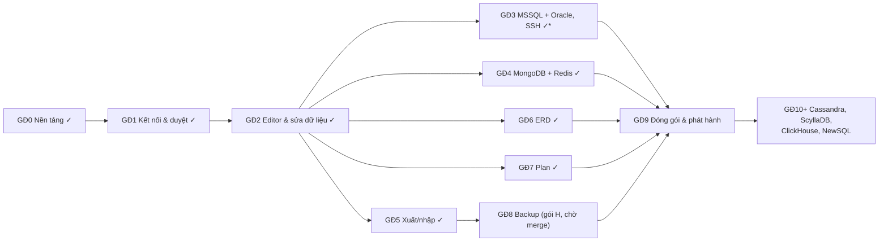

# DBStudio — Lộ trình

> Trạng thái: v0.3 — GĐ0–GĐ1 xong; GĐ2–GĐ7 đã hiện thực trên nhánh `feature/quandh/phase2_complete` (còn phần chưa kiểm chứng, ghi ở từng giai đoạn); GĐ8 (backup) đang hoàn thiện ở nhánh riêng, mục GĐ8 **sẽ cập nhật sau khi merge**. Mã yêu cầu theo [requirements.md](requirements.md) (cột Trạng thái); kiến trúc theo [architecture.md](architecture.md); hợp đồng GĐ2–GĐ8 theo [design/phase2-8.md](design/phase2-8.md).

## 1. Cách làm việc

- Nhánh tích hợp: `develop`. Mỗi giai đoạn (hoặc gói việc trong giai đoạn) làm trong một git worktree tại `.claude/worktrees/<ten-viec>`, nhánh `feature/quandh/<ten_viec>`, tách từ `develop` mới nhất. GĐ2–GĐ8 chia thành Bước 0 (dựng khung hợp đồng) + 12 gói A–L chạy song song (design §7), gộp vào `feature/quandh/phase2_complete`.
- Một giai đoạn **xong** khi: mọi yêu cầu **Must** trong phạm vi đã hiện thực, tiêu chí hoàn thành kiểm chứng được, CI xanh trên 3 OS, tài liệu được cập nhật. Yêu cầu Should/Could chưa làm được ghi lại và chuyển sang giai đoạn sau.
- Với mỗi giai đoạn có driver mới: integration test với DB thật (Docker) là một phần của tiêu chí hoàn thành.
- Quy ước trạng thái tiêu chí: `[x]` = đã kiểm chứng bằng test tự động (unit hoặc integration với Docker, chạy cục bộ trên macOS); `[ ]` kèm ghi chú = còn thiếu hoặc chưa kiểm chứng.

## 2. Vì sao thứ tự này

1. **Kiểm chứng kiến trúc driver sớm trên 2 DB dễ nhất** (PostgreSQL, MySQL).
2. **Query editor + sửa dữ liệu là lõi dùng hằng ngày**; export, ERD, plan, backup dựng trên nền thực thi query + metadata đã ổn định.
3. **MSSQL + Oracle trước NoSQL** vì cùng mô hình quan hệ; SSH tunnel đi cùng.
4. **MongoDB + Redis** cần view riêng (document, key-value).
5. **Export → ERD → Plan → Backup**: export là nền cho backup logic (sinh DDL + stream dữ liệu).
6. **Đóng gói/phát hành** khi tính năng đủ; driver mở rộng chỉ là thêm crate.

\* Oracle: integration test với DB thật chưa chạy.

**Trạng thái kiểm chứng chung của GĐ2–GĐ8**: unit test + integration test với Docker (PG 12/16, MySQL 5.7/8, MariaDB 10.4/10.6, SQL Server 2022, MongoDB 4.4/7, Redis 6.2/7.4, Valkey 8, sshd) + Vitest, clippy/fmt sạch — tất cả **chạy cục bộ trên macOS**. Chưa kiểm chứng: giao diện trong cửa sổ Tauri thật (tray, autostart, thông báo OS, xuất PNG/PDF trên WebView), Windows/Linux, NTLM thật, Azure SQL, Oracle IT với DB thật (chờ RAM Docker), CI trên GitHub.

---

## GĐ0 — Nền tảng *(xong; còn chờ kiểm chứng trên Windows/Linux và CI GitHub)*

Workspace, `dbstudio-core` (trait `Driver`/`Session`, `Value`, `Capabilities`...), khung giao diện (sidebar, tab, status bar), theme, vi/en, Tauri capabilities tối thiểu + CSP, CI 3 OS.

- [ ] `pnpm tauri dev` chạy trên macOS, Windows, Linux. — *Đạt trên macOS; Windows/Linux chưa build lần nào.*
- [x] Đổi ngôn ngữ/theme có hiệu lực ngay và giữ sau khi khởi động lại.
- [x] `cargo test --workspace` pass, `dbstudio-core` không phụ thuộc `tauri`.
- [ ] CI xanh trên 3 OS. — *Workflow có đủ bước nhưng chưa chạy trên GitHub (chưa có remote).*

---

## GĐ1 — Kết nối & duyệt dữ liệu (PostgreSQL + MySQL) *(xong)*

Driver PG/MySQL, `dbstudio-store` (SQLite + keychain), kết nối TLS, cây đối tượng, lưới chỉ đọc, log xoay vòng. Đợt hoàn thiện tồn đọng (commit `a06ebba`, `6dd3987`) đã làm: tìm đối tượng phía server (BROWSE-06), kéo thả profile/nhóm (CONN-02), trang cài đặt (mức log, trần lưới, hiển thị `timestamptz`, mở thư mục log), lưu giá trị ô ra file (DATA-07), ẩn/ghim/đổi thứ tự cột (DATA-12), che mật khẩu trong log + test quét mật khẩu + test keychain thật (tuỳ chọn), dev bridge, integration test MySQL 5.7 và MariaDB 10.4.

Còn lại từ GĐ1 (chuyển vào mục "Tồn đọng" bên dưới): benchmark lưới 1 triệu dòng trên 3 webview, CI GitHub, Windows/Linux.

---

## GĐ2 — Query editor & sửa dữ liệu *(đã hiện thực)*

Gói A (dbstudio-sql), B (editor backend: `lease_kit`, lease PG/MySQL, guard, lịch sử), C (editor frontend), D (sửa dữ liệu).

- [x] Autocomplete gợi ý cột theo alias (`SELECT u.| FROM users u`) — Vitest.
- [x] Script 3 câu → 3 tab kết quả, số dòng ảnh hưởng, NOTICE PostgreSQL — IT PG/MySQL/MariaDB.
- [x] `pg_sleep(60)` / `SLEEP(60)` huỷ < 2 s và server xác nhận — IT.
- [x] Lỗi cú pháp đánh dấu đúng dòng/cột (kể cả ký tự ngoài BMP trước vị trí) — Vitest.
- [x] Manual commit: kết nối khác không thấy UPDATE chưa commit, rollback hoàn tác, đóng lease khi transaction mở → rolled back; đóng tab hỏi xác nhận — IT + Vitest.
- [x] Read-only từ chối INSERT/UPDATE/DELETE/DDL ở backend (test gọi command trực tiếp).
- [x] Production: `DELETE FROM t` (không WHERE), `DROP TABLE` → `confirmationRequired`; token sai/hết hạn/dùng lại, gõ sai tên DB bị từ chối.
- [x] Sửa 3 ô + thêm 1 + xoá 1 → preview SQL → commit một transaction; lỗi ở thay đổi thứ 2 → rollback toàn bộ — IT PG/MySQL (MSSQL, Oracle có code tương đương).
- [x] Bảng không PK/unique: lưới chỉ đọc kèm lý do.
- [x] Lịch sử query còn sau khi mở lại store.
- [ ] Kiểm tay trong cửa sổ Tauri với DB thật. — *Mới kiểm qua mock IPC/dev bridge trong trình duyệt.*

Chưa làm trong phạm vi: font editor, giới hạn dòng editor và timeout query trên trang Cài đặt (APP-05, QUERY-12, CONN-12 — đã có trong `AppSettings`), tự kết nối lại (CONN-12), command palette (APP-08, Could), sinh SELECT/INSERT mẫu và mở DDL trong editor (BROWSE-05/07).

---

## GĐ3 — MSSQL + Oracle, SSH tunnel *(đã hiện thực; Oracle chưa có IT với DB thật)*

Gói I (MSSQL + bản vá tiberius), J (Oracle), A (SSH).

- [x] SQL Server 2022 (Docker): kết nối TLS, cây, dữ liệu, chạy + huỷ query, sửa dữ liệu, explain, schema model, DDL chạy lại được, bulk — IT `mssql2022`.
- [ ] Oracle Free (Docker): cùng tiêu chí. — *Code đủ (kết nối, cây, dữ liệu, lease, sửa, explain, DDL, schema model) và có bộ IT trong `oracle-it`, nhưng chưa chạy được với DB thật (cần ~3 GB RAM cho Docker).*
- [x] MSSQL: nhiều result set + `PRINT`; `GO n` chạy đúng từng batch.
- [x] Oracle: block `BEGIN ... END;`, `CREATE PROCEDURE ... /` không bị tách sai — unit test + test vi sai với `dbstudio-sql`.
- [x] Thiếu Instant Client: driver `unavailable` kèm chẩn đoán, không crash.
- [x] SSH tunnel tới PG/MySQL/MSSQL sau bastion bằng mật khẩu và key có passphrase; host key lạ → `sshHostKey` — IT `sshd`.
- [ ] Integration test MSSQL + Oracle trong CI. — *Job `integration` có cả `oracle-it`, chưa chạy trên GitHub.*
- [ ] NTLM với domain thật, Integrated (Windows), Azure SQL. — *Chưa kiểm; Azure AD chưa hỗ trợ.*

Quyết định đóng gói Oracle: không đóng gói Instant Client, nạp lúc chạy (design Q1).

---

## GĐ4 — MongoDB + Redis *(đã hiện thực)*

Gói K (MongoDB + document UI, `connection_parse_uri`), L (Redis + key-value UI, cây phân trang).

- [x] MongoDB 4.4 và 7: duyệt database/collection/index, document tree/JSON/bảng, sửa/thêm/xoá; `ObjectId`, `Decimal128`, `Date`, `Int64` khứ hồi đúng — IT.
- [x] `find` có filter/projection/sort, `aggregate` nhiều stage — IT.
- [x] Redis 6/7.4 và Valkey 8: duyệt bằng `SCAN` (KEYS bị vô hiệu trên `redis6`), đủ 6 kiểu xem/sửa, TTL — IT (bài 1 triệu khoá khi `DBSTUDIO_IT_BIG=1`).
- [x] Console Redis: lịch sử, gợi ý lệnh; `FLUSHDB` trên production cần xác nhận; read-only chặn lệnh ghi.
- [x] Tính năng không áp dụng tự ẩn theo `Capabilities`.
- [x] CONN-13: dán URI `mongodb://`, `mongodb+srv://`, `redis://` (cả `postgres`, `mysql`, `sqlserver`, `oracle`).
- [ ] Integration test MongoDB + Redis trong CI. — *Chưa chạy trên GitHub.*

---

## GĐ5 — Xuất/nhập schema & dữ liệu *(đã hiện thực)*

Gói G (`dbstudio-export`, `JobManager`, `PathGrants`, wizard, trung tâm job). Import được làm theo mặc định đề xuất (requirements §6 câu 1).

- [x] PG/MySQL: "cả hai" ra SQL → chạy lại vào DB trống → số bảng/dòng/checksum khớp — IT.
- [x] XLSX mỗi bảng một sheet + data dictionary, tách sheet khi vượt giới hạn (test với giới hạn hạ).
- [x] CSV nhiều bảng → `.zip`, UTF-8 BOM.
- [x] JSON array / NDJSON + `schema.json`.
- [x] Huỷ giữa chừng không để lại file (file tạm + đổi tên); bảng lớn chạy stream (`DBSTUDIO_IT_BIG=1`).
- [x] Xuất từ kết quả query (đúng một câu) cho mọi định dạng.
- [x] Import CSV có mapping cột vào PG/MySQL, lỗi báo kèm số dòng.
- [ ] Ma trận MSSQL/Oracle/Mongo/Redis. — *MSSQL/Oracle/Mongo export dùng chung engine (stream qua lease); chưa có IT export riêng cho các DB này. Redis export (`Keys`) và làm phẳng Mongo cho CSV/XLSX chưa làm.*

---

## GĐ6 — ERD *(đã hiện thực)*

Gói F (`schema_model` + `generate_ddl` PG/MySQL; MSSQL/Oracle/Mongo do gói I/J/K), ERD tab.

- [x] Schema mẫu Pagila (PG) / Sakila (MySQL): đủ bảng, PK, FK, bản số crow's foot đúng — IT.
- [x] `generate_ddl` toàn DB chạy lại vào DB trống tạo đủ đối tượng (FK ở PostData) — IT.
- [x] "Bảng X + liên quan N bậc" (1–3 bậc).
- [x] Lưu/mở lại giữ vị trí; bảng/cột đã đổi được đánh dấu; xung đột phiên bản layout được phát hiện.
- [ ] Auto layout 100 bảng < 3 s đo trên app thật. — *Layout chạy trong Web Worker (elk); chưa đo trên WebView Tauri.*
- [ ] Xuất PNG/SVG/PDF trên WebView của app. — *Có test sinh file trong jsdom; chưa kiểm trên WKWebView/WebView2/WebKitGTK (rủi ro R7).*

---

## GĐ7 — Phân tích query dạng sơ đồ *(đã hiện thực)*

Gói E (`dbstudio-plan`, explain PG/MySQL, plan tab); explain MSSQL/Oracle/Mongo do gói I/J/K.

- [x] Fixture cho 8 định dạng (PG JSON, MySQL JSON v1/v2/tree, MariaDB JSON, SHOWPLAN XML, Oracle plan rows, Mongo explain) parse thành cây chuẩn hoá — unit test.
- [x] Sơ đồ hiển thị cost, rows ước tính/thực tế, thời gian; nhánh nóng tô đậm.
- [x] Cảnh báo full scan bảng lớn, ước lượng lệch ≥ 10×, spill, nested loop nhiều dòng.
- [x] Chọn node đồng bộ sơ đồ / bảng / raw — Vitest.
- [x] `EXPLAIN ANALYZE UPDATE` trong transaction rollback, dữ liệu không đổi (IT PG); MySQL ANALYZE câu ghi → `unsupported`.
- [x] So sánh 2 plan (PLAN-06); lưu/mở `.dbplan.json`. Lịch sử plan (phần còn lại của PLAN-07) chưa làm.

---

## GĐ8 — Backup/Restore + lịch tự động *(gói H — chờ merge)*

> Trên nhánh này `dbstudio-backup`, `dbstudio-cli`, scheduler/tray/background mới là khung hợp đồng. Gói H (container `.dbsbak`, mã hoá, engine logic dùng `generate_ddl` + export engine, tool native, scheduler, retention, CLI, tray, autostart, single-instance, thông báo OS, UI) đang hoàn thiện ở nhánh riêng. Mục này **sẽ cập nhật sau khi merge**.

Tiêu chí (giữ nguyên, chưa đánh giá):
- [ ] Backup tích hợp rồi restore vào database trống: số bảng, số dòng, checksum khớp — cho từng DB đã hỗ trợ.
- [ ] Tool native có trong PATH: backup + restore qua tool thành công; không có: UI báo và gợi ý engine tích hợp.
- [ ] Nén zstd/gzip và mã hoá: sai passphrase không restore được; checksum phát hiện file bị sửa.
- [ ] Lịch `*/5 * * * *` chạy đúng giờ khi cửa sổ đóng (app ở tray); "giữ 3 bản" xoá bản cũ đúng.
- [ ] Tắt app qua một lần chạy, mở lại → chạy bù đúng một lần (nếu cấu hình).
- [ ] Thông báo OS khi thành công/thất bại; nhật ký ghi đủ thời lượng, kích thước, lỗi.
- [ ] Autostart bật/tắt được trên cả 3 OS.
- [ ] Restore vào kết nối production bắt buộc xác nhận bổ sung.

---

## Tồn đọng (sau GĐ2–GĐ8)

**Kiểm chứng (không cần code mới):**
1. Chạy integration test Oracle với DB thật (`docker/oracle-it/run-tests.sh`, cần ~3 GB RAM cho Docker) và sửa lỗi phát sinh.
2. Kiểm tay trong cửa sổ Tauri thật trên macOS với DB Docker: editor/lease/transaction, sửa dữ liệu, document/key view, plan, ERD (xuất PNG/PDF), export/import, SSH (hộp thoại host key); sau khi merge gói H: tray, close-to-tray, autostart, thông báo OS.
3. Đẩy repo lên remote, cho CI (3 OS + `integration`) chạy xanh.
4. Build và chạy trên Windows, Linux; benchmark lưới 1 triệu dòng trên WKWebView, WebView2, WebKitGTK → chốt TanStack Virtual hay canvas grid.
5. MSSQL: NTLM với domain thật; quyết định Azure AD (requirements §6 câu 6).

**Code còn thiếu / cần sửa:**
- MySQL `ANSI_QUOTES` chưa được lexer mô hình hoá (`"x"` luôn là chuỗi).
- Import CSV chưa nhận `null_text` tuỳ chỉnh (chỉ ô rỗng không ngoặc là NULL), nên CSV export với `null_text` khác rỗng không khứ hồi được.
- Export Mongo ra CSV/XLSX chưa làm phẳng document (`flatten_fields` có trong spec nhưng engine chưa đọc).
- Export nguồn `Keys` (Redis → JSON) chưa hiện thực (engine trả `Unsupported("export_keys")`), wizard chưa có nguồn Redis.
- `KeyChange` cho list (`ListSet`, `ListRemoveAt`) chưa mang giá trị kỳ vọng: phần tử ở index đã bị client khác đổi vẫn bị ghi/xoá.
- `dbstudio-core::Error` chưa có biến thể `Invalid` cho đầu vào không hợp lệ (đang dùng `Other`/`Query`).
- Lưu danh sách thư mục export gần đây để dọn file tạm mồ côi (`.dbstudio-tmp-*`) khi khởi động app; hiện chỉ dọn khi có export kế tiếp vào cùng thư mục.
- Xem trước import khi kết nối MariaDB chưa mở session: dialect suy từ `DbKind` nên coi là MySQL (`mariadb: false`).
- Lease keepalive: lease nhàn rỗi bị đóng sau `idle_ttl` (8 giờ) và kết nối có thể bị server/NAT cắt trước đó; chưa có ping định kỳ.
- `DocumentTable` (bảng phẳng của document view) chỉ ảo hoá hàng, chưa ảo hoá cột (tối đa 200 cột phẳng).
- Trang Cài đặt: thêm font editor, `editorMaxRows`, `queryTimeoutMs`, `historyEnabled`, hành vi đóng cửa sổ (APP-05).
- Tự kết nối lại khi mất kết nối (CONN-12); nhãn môi trường tuỳ chỉnh (CONN-03).
- Menu ngữ cảnh: sinh SELECT/INSERT mẫu, mở DDL trong editor (BROWSE-05/07); ERD: tuỳ chọn hiện comment (ERD-07), đánh dấu quan hệ suy luận của Mongo (ERD-08); lịch sử plan (PLAN-07).
- Import vào MongoDB/Redis; `Skip` khi import vào Oracle.
- Oracle: chưa có UI chọn thư mục Instant Client (setting `oracle_client` chỉ đọc lúc khởi động; hiện dùng `DBSTUDIO_ORACLE_CLIENT_LIB_DIR`).
- Command palette (APP-08, Could).

**Giữ mở, chưa gắn giai đoạn:** phân trang keyset thay OFFSET; hạn chế TLS của `mysql_async` và R6 (MySQL/MongoDB/Redis qua SSH với `verify-full`); chế độ TLS mặc định (requirements §6 câu 8); Redis Cluster/Sentinel; phương án Oracle thuần Rust (`oracle-rs`).

---

## GĐ9+ — Tiếp theo

### GĐ9 — Đóng gói & phát hành

**Phạm vi:** NFR-PLAT-01, NFR-PLAT-02, APP-06; installer Windows (MSI/NSIS), macOS (DMG), Linux (deb, rpm, AppImage); ký Windows, ký + notarize macOS; CI release + manifest updater; chốt tên/identifier (requirements §6 câu 7); hướng dẫn cài Oracle Instant Client.

- [ ] Push tag `vX.Y.Z` → CI tạo đủ installer cho 3 OS và bản phát hành nháp.
- [ ] Cài trên máy sạch Windows 10/11, macOS 12+ (Intel + Apple Silicon), Ubuntu 22.04 & Fedora: app chạy được, không cảnh báo chưa ký.
- [ ] Bản cũ tự cập nhật lên bản mới; chữ ký cập nhật sai bị từ chối.
- [ ] Dữ liệu cục bộ và keychain còn nguyên sau khi cập nhật.
- [ ] Khởi động < 2 giây (NFR-PERF-01) trên bản release.

### GĐ10+ — Cassandra, ScyllaDB, ClickHouse, NewSQL

Mở rộng theo yêu cầu gốc bằng cách thêm crate driver, không sửa kiến trúc:
- `drivers/cassandra` (crate `scylla`, dùng chung cho Cassandra 4+ và ScyllaDB 5+): keyspace/table/MV, CQL editor, paging, tracing cho PLAN.
- `drivers/clickhouse` (HTTP): database/table/engine, SQL, `EXPLAIN PLAN/PIPELINE`.
- NewSQL qua driver sẵn có: CockroachDB, YugabyteDB (driver PostgreSQL), TiDB (driver MySQL) — nhận diện qua `server_info`, chỉnh `Capabilities` và truy vấn metadata.
- Mỗi DB mới cần: `ScriptDialect`/classifier trong `dbstudio-sql` (CQL), plan parser trong `dbstudio-plan` nếu có, IT bằng Docker; áp các nhóm CONN, BROWSE, DATA, QUERY, PLAN, ERD, EXPORT, BACKUP theo ma trận requirements §4.

Tiêu chí (mỗi DB): driver mới chỉ thêm crate + đăng ký + view chuyên biệt nếu cần (sửa trait core thì ghi lý do trong `architecture.md`); đạt tiêu chí tương đương GĐ1–GĐ2 trong phạm vi ma trận; IT bằng Docker trong CI.

---

## 3. Bảng truy vết yêu cầu → giai đoạn

| Nhóm | GĐ | Trạng thái (chi tiết: requirements, cột Trạng thái) |
|---|---|---|
| CONN-01..05, 07..09 | GĐ1 (+GĐ3, GĐ4 cho DB mới) | Xong; CONN-03 thiếu nhãn tuỳ chỉnh |
| CONN-06 | GĐ3 | Xong (giới hạn R6) |
| CONN-10..12 | GĐ2 | CONN-10/11 xong; CONN-12 một phần (không tự kết nối lại) |
| CONN-13 | GĐ4 | Xong |
| BROWSE-01..08 | GĐ1, GĐ4 | Xong trừ phần editor của BROWSE-05/07 |
| DATA-01..12 | GĐ1, GĐ2, GĐ4 | Xong |
| QUERY-01..16 | GĐ2–GĐ4 | Xong; QUERY-12 thiếu ô cài đặt |
| PLAN-01..07 | GĐ7 | Xong trừ lịch sử plan |
| ERD-01..08 | GĐ6 | Xong; ERD-07/08 một phần |
| EXPORT-01..10, IMPORT-01..03 | GĐ5 | Xong cho SQL DB; Mongo flatten, Redis export, import NoSQL chưa |
| BACKUP-01..15 | GĐ8 | Chờ gói H |
| APP-01..05, 07, 09 | GĐ0–GĐ5 | Xong; APP-05 một phần |
| APP-06 | GĐ9 | Chưa |
| APP-08 | — | Chưa (Could) |
| NFR-PLAT-01/02, NFR-PERF-01 | GĐ9 | Chưa kiểm |
| NFR khác | Mọi GĐ | Xem requirements §3 |
