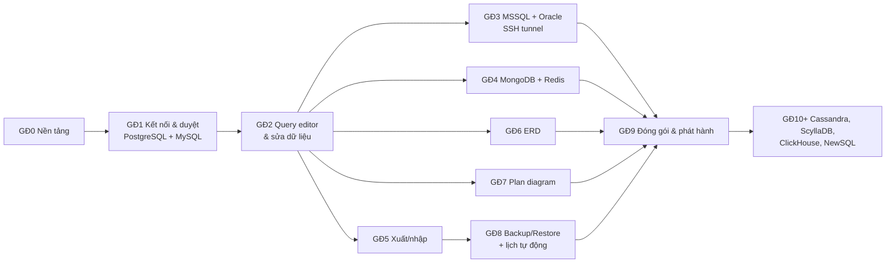

# DBStudio — Lộ trình

> Trạng thái: bản nháp v0.1. Mã yêu cầu theo [requirements.md](requirements.md); thiết kế theo [architecture.md](architecture.md).

## 1. Cách làm việc

- Nhánh tích hợp: `develop`. Mỗi giai đoạn (hoặc hạng mục lớn trong giai đoạn) làm trong một git worktree tại `.claude/worktrees/<ten-viec>`, nhánh `feature/quandh/<ten_viec>`, tách từ `develop` mới nhất.
- Một giai đoạn **xong** khi: mọi yêu cầu **Must** trong phạm vi đã hiện thực, toàn bộ tiêu chí hoàn thành dưới đây kiểm chứng được, CI xanh trên 3 OS, tài liệu (`docs/`) được cập nhật nếu thiết kế thay đổi. Yêu cầu Should/Could chưa làm được ghi lại và chuyển sang giai đoạn sau.
- Với mỗi giai đoạn có driver mới: integration test với DB thật (Docker) là một phần của tiêu chí hoàn thành.

## 2. Vì sao thứ tự này

1. **Kiểm chứng kiến trúc driver sớm trên 2 DB dễ nhất** (PostgreSQL, MySQL): driver thuần Rust, dễ chạy bằng Docker, phổ biến nhất. Nếu trait `Driver`/`Session`, `Value`, stream qua Channel có vấn đề, sửa khi mới có 2 driver rẻ hơn nhiều so với 6.
2. **Query editor + sửa dữ liệu là lõi dùng hằng ngày**; mọi tính năng nâng cao (export, ERD, plan, backup) dựng trên nền thực thi query + metadata đã ổn định.
3. **MSSQL + Oracle trước NoSQL** vì cùng mô hình quan hệ → tái dùng gần như toàn bộ UI; đồng thời sớm xử lý rủi ro đóng gói Oracle. SSH tunnel đi cùng vì môi trường doanh nghiệp dùng nhiều.
4. **MongoDB + Redis** cần view riêng (document, key-value) → làm sau khi UI quan hệ ổn định để biết rõ phần nào dùng chung.
5. **Export → ERD → Plan → Backup**: export là nền cho backup logic (cùng sinh DDL + stream dữ liệu); ERD và plan độc lập, giá trị cao, rủi ro thấp; backup tự động cần tray/autostart/scheduler nên để gần khâu đóng gói.
6. **Đóng gói/phát hành** khi tính năng đủ; driver mở rộng (GĐ10+) chỉ là thêm crate theo kiến trúc đã kiểm chứng.

Thứ tự mặc định là tuần tự GĐ0 → GĐ10; các nhánh song song trong sơ đồ chỉ ra giai đoạn nào có thể làm đồng thời nếu có nhiều agent.

---

## GĐ0 — Nền tảng *(đang làm)*

**Mục tiêu:** repo chạy được trên 3 OS với khung giao diện trống, crate core định nghĩa hợp đồng driver, CI hoạt động.

**Phạm vi:**
- Cargo workspace: `src-tauri/`, `crates/dbstudio-core/`.
- `dbstudio-core`: `DbKind`, `Capabilities`, `DriverDescriptor`, `ConnectionConfig`, trait `Driver`, `Session`, `Value`, `ResultSet`, `ResultSink`, `DriverRegistry`, `Error` (NFR-EXT-01). Có một driver giả (mock) trong test để chứng minh trait dùng được.
- Frontend: Vite + React 19 + TS strict + Tailwind v4 + Zustand + TanStack Query + i18next.
- Khung giao diện: sidebar, vùng tab, status bar (APP-03); theme sáng/tối/hệ thống (APP-02); vi/en (APP-01); đổi ngôn ngữ và theme ngay trên status bar (APP-05 một phần — trang cài đặt đầy đủ làm dần từ GĐ1).
- Log ra console bằng `tracing` (log file xoay vòng APP-07 chuyển sang GĐ1, khi có thư mục dữ liệu app); Tauri capabilities tối thiểu + CSP (NFR-SEC-04).
- Command mẫu (`app_info`, `list_drivers`) đi qua wrapper `src/lib/ipc.ts`; kiểu TS viết tay ở `src/lib/types.ts` (architecture §14).
- CI: build + lint + test trên Windows/macOS/Linux (NFR-QUAL-02); kiểm tra khoá dịch (NFR-QUAL-03).

**Ngoài phạm vi:** driver thật, SQLite store, kết nối DB.

**Tiêu chí hoàn thành:**
- [ ] `pnpm tauri dev` mở cửa sổ có sidebar/tab/status bar trên macOS, Windows, Linux.
- [ ] Đổi ngôn ngữ vi ↔ en và theme sáng ↔ tối có hiệu lực ngay, giữ sau khi khởi động lại.
- [ ] `cargo test --workspace` pass, gồm test driver mock: connect → execute → nhận lô dòng qua `ResultSink` → cancel.
- [ ] Frontend gọi `list_drivers` và hiển thị danh sách 9 hệ quản trị kèm trạng thái/giai đoạn dự kiến, qua wrapper IPC có kiểu.
- [ ] `dbstudio-core` không phụ thuộc `tauri` (kiểm bằng `cargo tree -p dbstudio-core`).
- [ ] CI xanh trên cả 3 OS: `cargo fmt --check`, `cargo clippy -D warnings`, `cargo test`, ESLint, `tsc --noEmit`, Vitest.

**Phụ thuộc:** không.

---

## GĐ1 — Kết nối & duyệt dữ liệu (PostgreSQL + MySQL)

**Mục tiêu:** kết nối an toàn tới PostgreSQL và MySQL, duyệt cây đối tượng, xem dữ liệu bảng ở chế độ chỉ đọc.

**Phạm vi:**
- Crate `drivers/postgres` (`tokio-postgres`), `drivers/mysql` (`mysql_async`), `dbstudio-store` (SQLite + migration, NFR-REL-02).
- Kết nối: CONN-01, CONN-02, CONN-03, CONN-04, CONN-05, CONN-07, CONN-08, CONN-09.
- Duyệt: BROWSE-01, BROWSE-02, BROWSE-05, BROWSE-06, BROWSE-07, BROWSE-08.
- Dữ liệu (chỉ đọc): DATA-01, DATA-02, DATA-07 (chế độ xem), DATA-09; DATA-12 (Could).
- Stream kết quả qua Channel (NFR-PERF-02); UI ẩn/hiện theo `Capabilities` (NFR-EXT-02).
- Log file xoay vòng, không ghi secret (APP-07).
- Benchmark lưới 1 triệu dòng trên 3 webview → chốt TanStack Virtual hay canvas grid (NFR-PERF-03).

**Ngoài phạm vi:** query editor, sửa dữ liệu, SSH tunnel.

**Tiêu chí hoàn thành:**
- [ ] Tạo profile PostgreSQL 12 và 16, MySQL 5.7 và 8, MariaDB 10.4+ (Docker), test connection hiển thị phiên bản server.
- [ ] Kết nối TLS `verify-full` với CA tự ký thành công; sai CA báo lỗi `Tls` rõ ràng.
- [ ] Mật khẩu nằm trong keychain; `grep` mật khẩu trong thư mục dữ liệu app và file log không có kết quả; file export profile không có secret.
- [ ] Cây hiển thị đủ nhóm đối tượng BROWSE-02 cho cả 2 DB; xem DDL table/view/function đúng.
- [ ] Mở bảng 1 triệu dòng: dòng đầu hiển thị < 1 giây trên localhost, cuộn mượt, lọc + sắp xếp chạy phía server.
- [ ] Giá trị `bigint` 9007199254740993, `numeric(38,10)`, `timestamptz` hiển thị đúng từng chữ số/múi giờ.
- [ ] Integration test cho cả 2 driver chạy trong CI (Linux, Docker).
- [ ] Kết quả benchmark lưới và quyết định grid được ghi vào `docs/architecture.md`.

**Phụ thuộc:** GĐ0.

---

## GĐ2 — Query editor & sửa dữ liệu

**Mục tiêu:** viết, chạy, huỷ query thoải mái; sửa dữ liệu an toàn trên lưới.

**Phạm vi:**
- Editor: QUERY-01 → QUERY-13, QUERY-16.
- Sửa dữ liệu: DATA-03, DATA-04, DATA-05, DATA-06, DATA-07 (chế độ sửa), DATA-08.
- An toàn: CONN-10, CONN-11, CONN-12; NFR-SEC-03; NFR-REL-01.
- Phím tắt APP-04; command palette APP-08 (Could); NFR-PERF-04.

**Ngoài phạm vi:** EXPLAIN/plan (GĐ7), editor MQL/Redis (GĐ4).

**Tiêu chí hoàn thành:**
- [ ] Autocomplete gợi ý cột đúng theo alias (`SELECT u.| FROM users u`) trên PostgreSQL và MySQL.
- [ ] Script 3 câu lệnh (SELECT, UPDATE, SELECT) cho 3 tab kết quả, kèm số dòng ảnh hưởng; NOTICE PostgreSQL hiển thị.
- [ ] `SELECT pg_sleep(60)` / `SELECT SLEEP(60)` huỷ được trong < 2 giây và server xác nhận query đã dừng.
- [ ] Lỗi cú pháp đánh dấu đúng dòng/cột trong editor.
- [ ] Manual commit: sau UPDATE chưa commit, kết nối khác không thấy thay đổi; rollback hoàn tác; đóng tab cảnh báo transaction mở.
- [ ] Kết nối read-only từ chối `INSERT/UPDATE/DELETE/DDL` ở backend (test gọi command trực tiếp, không qua UI).
- [ ] Kết nối prod: `DELETE FROM t` (không WHERE) và `DROP TABLE` bắt buộc qua hộp thoại xác nhận gõ tên database.
- [ ] Sửa 3 ô, thêm 1 dòng, xoá 1 dòng → xem trước SQL → commit trong một transaction; lỗi ở câu thứ 2 → rollback toàn bộ.
- [ ] Bảng không có PK/unique: lưới chỉ đọc kèm lý do.
- [ ] Lịch sử query lưu và tìm được sau khi khởi động lại app.

**Phụ thuộc:** GĐ1.

---

## GĐ3 — MSSQL + Oracle, SSH tunnel

**Mục tiêu:** đưa toàn bộ tính năng GĐ1–GĐ2 lên MSSQL và Oracle; hỗ trợ SSH tunnel cho mọi driver.

**Phạm vi:**
- Crate `drivers/mssql` (`tiberius`), `drivers/oracle` (`oracle` hoặc phương án thay thế đã đánh giá).
- Áp dụng BROWSE-01/02/05/06/07/08, DATA-01..09, QUERY-01..13 cho 2 DB mới (dialect T-SQL, PL/SQL; tách batch `GO`; block PL/SQL).
- CONN-06 (SSH tunnel: mật khẩu, private key + passphrase, ssh-agent) cho mọi driver hiện có.
- Đánh giá & quyết định đóng gói Oracle Instant Client (câu hỏi mở / rủi ro trong requirements §6).

**Ngoài phạm vi:** Windows Integrated Auth cho MSSQL (chờ trả lời câu hỏi mở 6).

**Tiêu chí hoàn thành:**
- [ ] SQL Server 2016+ (hoặc 2019/2022 Docker) và Oracle Free (Docker): kết nối, duyệt cây, xem dữ liệu, chạy và huỷ query, sửa dữ liệu đạt các tiêu chí tương ứng GĐ1–GĐ2.
- [ ] MSSQL: nhiều result set + thông điệp `PRINT`; script có `GO` chạy đúng từng batch.
- [ ] Oracle: chạy block `BEGIN ... END;` và tạo procedure không bị tách sai câu lệnh.
- [ ] Thiếu Instant Client: app không crash, driver Oracle báo trạng thái không khả dụng kèm hướng dẫn.
- [ ] SSH tunnel tới PostgreSQL/MySQL/MSSQL sau bastion (container `openssh-server`) kết nối được bằng cả mật khẩu và key có passphrase.
- [ ] Integration test MSSQL + Oracle trong CI.

**Phụ thuộc:** GĐ2.

---

## GĐ4 — MongoDB + Redis

**Mục tiêu:** hỗ trợ document store và key-value store với giao diện chuyên biệt.

**Phạm vi:**
- Crate `drivers/mongodb`, `drivers/redis`.
- BROWSE-03, BROWSE-04, DATA-10, DATA-11, QUERY-14, QUERY-15; CONN-01..12 áp dụng cho 2 DB (TLS, SSH, read-only, xác nhận lệnh phá huỷ Redis/MongoDB).
- CONN-13 (Đề xuất, Could): dán URI `mongodb://`, `mongodb+srv://`, `redis://`.

**Ngoài phạm vi:** Redis Cluster/Sentinel (Should, giai đoạn sau), suy luận schema MongoDB (ERD-08).

**Tiêu chí hoàn thành:**
- [ ] MongoDB 4.4 và 7 (Docker): duyệt database/collection/index, xem document tree/JSON/bảng, sửa/thêm/xoá document; `ObjectId`, `Decimal128`, `Date` hiển thị và lưu đúng.
- [ ] Chạy `find` có filter/projection/sort và `aggregate` pipeline nhiều stage, kết quả phân trang.
- [ ] Redis 6+ và Valkey: duyệt 1 triệu key bằng `SCAN` không block server; xem/sửa đủ 6 kiểu; đặt/xoá TTL.
- [ ] Console Redis: lịch sử, gợi ý lệnh; `FLUSHDB` trên kết nối prod bắt buộc xác nhận; kết nối read-only chặn lệnh ghi.
- [ ] Menu/tính năng không áp dụng (ERD, DDL, transaction thủ công) tự ẩn theo `Capabilities`.
- [ ] Integration test MongoDB + Redis trong CI.

**Phụ thuộc:** GĐ2.

---

## GĐ5 — Xuất/nhập schema & dữ liệu

**Mục tiêu:** xuất schema/data/cả hai ra SQL, XLSX, CSV, JSON; nhập dữ liệu nếu được xác nhận.

**Phạm vi:**
- Crate `dbstudio-export`.
- EXPORT-01 → EXPORT-10; APP-09 (trung tâm tác vụ nền).
- IMPORT-01 → IMPORT-03 **chỉ khi chủ dự án xác nhận** (requirements §6, câu hỏi 1).

**Ngoài phạm vi:** export Cassandra/ClickHouse (theo GĐ10+), đích cloud.

**Tiêu chí hoàn thành:**
- [ ] Với mỗi DB đã hỗ trợ: xuất "cả hai" ra SQL rồi chạy lại vào database trống cùng loại → số bảng, số dòng, checksum dữ liệu khớp nguồn.
- [ ] XLSX: mỗi bảng một sheet, có sheet data dictionary; bảng > 1.048.576 dòng tự tách sheet.
- [ ] CSV nhiều bảng gom `.zip`; mở bằng Excel với UTF-8 BOM không lỗi tiếng Việt.
- [ ] JSON array và NDJSON; schema JSON mô tả đủ cột/kiểu/khoá/index.
- [ ] Xuất bảng 10 triệu dòng: bộ nhớ tiến trình không tăng tuyến tính theo số dòng; có tiến độ; huỷ giữa chừng không để lại file hỏng (xoá file tạm).
- [ ] Xuất từ kết quả query hoạt động cho mọi định dạng.
- [ ] (Nếu IMPORT trong phạm vi) Nhập CSV 1 triệu dòng có mapping cột vào PostgreSQL/MySQL, lỗi dòng được báo kèm số dòng.

**Phụ thuộc:** GĐ2 (tối thiểu); áp dụng cho MSSQL/Oracle/MongoDB/Redis khi GĐ3–GĐ4 đã xong.

---

## GĐ6 — ERD

**Mục tiêu:** sơ đồ quan hệ thực thể từ schema có sẵn.

**Phạm vi:** ERD-01 → ERD-07; ERD-08 (Could, chỉ khi GĐ4 xong).

**Ngoài phạm vi:** forward-engineering (sinh DDL từ ERD).

**Tiêu chí hoàn thành:**
- [ ] Schema mẫu (vd. Sakila/Pagila, AdventureWorks nếu có MSSQL) hiển thị đủ bảng, PK, FK với ký hiệu crow's foot đúng bản số.
- [ ] Auto layout 100 bảng trong < 3 giây, không chồng lấn; kéo thả/zoom mượt.
- [ ] "Bảng X + liên quan 1 bậc" chọn đúng tập bảng.
- [ ] Lưu và mở lại giữ nguyên vị trí; bảng bị xoá khỏi schema được đánh dấu.
- [ ] Xuất PNG, SVG, PDF đọc được, chữ không vỡ ở cả theme sáng/tối.

**Phụ thuộc:** GĐ1 (metadata); hưởng lợi từ GĐ3 cho MSSQL/Oracle.

---

## GĐ7 — Phân tích query dạng sơ đồ

**Mục tiêu:** biến EXPLAIN của từng DB thành sơ đồ trực quan, chỉ ra chỗ tốn kém.

**Phạm vi:** crate `dbstudio-plan`; PLAN-01 → PLAN-05; PLAN-06, PLAN-07 (Could). Parser cho mọi DB đã hỗ trợ tại thời điểm làm (PostgreSQL, MySQL, MSSQL, Oracle, MongoDB).

**Ngoài phạm vi:** gợi ý index tự động; ClickHouse/Cassandra (GĐ10+).

**Tiêu chí hoàn thành:**
- [ ] Mỗi DB: ít nhất 5 file plan mẫu (fixture) parse thành cây chuẩn hoá, có unit test.
- [ ] Sơ đồ hiển thị cost, rows ước tính vs thực tế, thời gian; nhánh tốn kém nhất được tô đậm.
- [ ] Query cố ý không có index trên bảng lớn sinh cảnh báo full scan; ước lượng lệch ≥ 10× sinh cảnh báo.
- [ ] Chọn node ở sơ đồ đồng bộ với dạng bảng và raw.
- [ ] EXPLAIN ANALYZE cho `UPDATE` chạy trong transaction được rollback, dữ liệu không đổi (có test).

**Phụ thuộc:** GĐ2; bao phủ đủ DB khi GĐ3–GĐ4 đã xong.

---

## GĐ8 — Backup/Restore + lịch tự động

**Mục tiêu:** sao lưu/khôi phục thủ công và tự động, chạy nền qua tray.

**Phạm vi:** crate `dbstudio-backup`; BACKUP-01 → BACKUP-14; BACKUP-15 (CLI, Could); đích local (BACKUP-09 Must), S3/SFTP chỉ khi được xác nhận (câu hỏi 2).

**Ngoài phạm vi:** service/daemon độc lập ngoài app (chờ câu hỏi 3), backup incremental/PITR.

**Tiêu chí hoàn thành:**
- [ ] Backup tích hợp rồi restore vào database trống: số bảng, số dòng, checksum khớp — cho từng DB đã hỗ trợ.
- [ ] Tool native: khi có `pg_dump`/`mysqldump`/`mongodump` trong PATH, backup + restore qua tool thành công; khi không có, UI báo và gợi ý engine tích hợp.
- [ ] Nén zstd/gzip và mã hoá: file mã hoá không restore được khi sai passphrase; checksum phát hiện file bị sửa.
- [ ] Lịch `*/5 * * * *` chạy đúng giờ khi cửa sổ đóng (app ở tray); chính sách "giữ 3 bản" xoá bản cũ đúng.
- [ ] Tắt app qua một lần chạy, mở lại → chạy bù đúng một lần (nếu cấu hình chạy bù).
- [ ] Thông báo OS khi thành công/thất bại; nhật ký ghi đủ thời lượng, kích thước, lỗi.
- [ ] Autostart bật/tắt được trên cả 3 OS.
- [ ] Restore vào kết nối prod bắt buộc xác nhận bổ sung.

**Phụ thuộc:** GĐ5 (sinh DDL + stream dữ liệu dùng chung).

---

## GĐ9 — Đóng gói & phát hành

**Mục tiêu:** bản cài đặt ký số, tự cập nhật, phát hành qua CI.

**Phạm vi:** NFR-PLAT-01, NFR-PLAT-02, APP-06; installer Windows (MSI/NSIS), macOS (DMG, universal hoặc 2 bản), Linux (deb, rpm, AppImage); ký Windows, ký + notarize macOS; CI release tạo artifact + manifest updater; chốt tên/identifier sản phẩm (câu hỏi 7).

**Ngoài phạm vi:** cửa hàng ứng dụng (Microsoft Store, Mac App Store, Flathub) — trừ khi được yêu cầu.

**Tiêu chí hoàn thành:**
- [ ] Push tag `vX.Y.Z` → CI tạo đủ installer cho 3 OS và bản phát hành nháp.
- [ ] Cài trên máy sạch Windows 10/11, macOS 12+ (Intel + Apple Silicon), Ubuntu 22.04 & Fedora: không cảnh báo chưa ký (Windows SmartScreen có thể cần thời gian tích luỹ uy tín), app chạy được.
- [ ] Bản cũ tự phát hiện và cập nhật lên bản mới; chữ ký cập nhật sai bị từ chối.
- [ ] Dữ liệu cục bộ và mật khẩu keychain còn nguyên sau khi cập nhật.
- [ ] Khởi động < 2 giây (NFR-PERF-01) đo trên bản release.

**Phụ thuộc:** GĐ3, GĐ4, GĐ6, GĐ7, GĐ8 (có thể phát hành sớm bản beta sau GĐ2 nếu cần).

---

## GĐ10+ — Cassandra, ScyllaDB, ClickHouse, NewSQL

**Mục tiêu:** mở rộng hệ quản trị bằng cách thêm crate driver, không sửa kiến trúc.

**Phạm vi:**
- `drivers/cassandra` (crate `scylla`, dùng chung cho Cassandra 4+ và ScyllaDB 5+): keyspace/table/MV, CQL editor, paging, tracing cho PLAN.
- `drivers/clickhouse` (HTTP): database/table/engine, SQL, `EXPLAIN PLAN/PIPELINE`.
- NewSQL qua driver sẵn có: CockroachDB, YugabyteDB (driver PostgreSQL), TiDB (driver MySQL) — nhận diện qua `server_info`, chỉnh `Capabilities` và truy vấn metadata khác biệt.
- Áp dụng các nhóm CONN, BROWSE, DATA, QUERY, PLAN, ERD, EXPORT, BACKUP theo ma trận requirements §4.

**Tiêu chí hoàn thành (mỗi DB):**
- [ ] Driver mới chỉ thêm crate + đăng ký trong registry + view chuyên biệt nếu cần; không sửa trait core (nếu phải sửa → ghi lý do trong `docs/architecture.md`).
- [ ] Đạt các tiêu chí kết nối/duyệt/xem/chạy query tương đương GĐ1–GĐ2 trong phạm vi ma trận tính năng.
- [ ] Integration test bằng Docker trong CI.

**Phụ thuộc:** GĐ9 (hoặc GĐ2 nếu cần sớm).

---

## 3. Bảng truy vết yêu cầu → giai đoạn

| Nhóm | GĐ chính | Ghi chú |
|---|---|---|
| CONN-01..05, 07..09 | GĐ1 | Mở rộng cho DB mới ở GĐ3, GĐ4 |
| CONN-06 | GĐ3 | |
| CONN-10..12 | GĐ2 | |
| CONN-13 *(Đề xuất)* | GĐ4 | Could |
| BROWSE-01, 02, 05..08 | GĐ1 | |
| BROWSE-03, 04 | GĐ4 | |
| DATA-01, 02, 07 (xem), 09, 12 | GĐ1 | |
| DATA-03..06, 07 (sửa), 08 | GĐ2 | |
| DATA-10, 11 | GĐ4 | |
| QUERY-01..13, 16 | GĐ2 | Dialect MSSQL/Oracle ở GĐ3 |
| QUERY-14, 15 | GĐ4 | |
| EXPORT-01..10 | GĐ5 | |
| IMPORT-01..03 *(Đề xuất)* | GĐ5 | Chờ xác nhận |
| ERD-01..07 | GĐ6 | ERD-08 cần GĐ4 |
| PLAN-01..07 | GĐ7 | ClickHouse/Cassandra ở GĐ10+ |
| BACKUP-01..15 | GĐ8 | |
| APP-01, 02, 03, 05 (một phần) | GĐ0 | APP-05 bổ sung dần theo giai đoạn |
| APP-07 | GĐ1 | GĐ0 mới log ra console |
| APP-04, 08 | GĐ2 | |
| APP-09 | GĐ5 | Dùng lại ở GĐ8 |
| APP-06 | GĐ9 | |
| NFR-EXT-01, NFR-SEC-04, NFR-QUAL-02, 03 | GĐ0 | Duy trì suốt dự án |
| NFR-PERF-02, 03, NFR-EXT-02, NFR-REL-02, NFR-SEC-01, 02 | GĐ1 | NFR-SEC-02 (SSH) hoàn tất ở GĐ3 |
| NFR-PERF-04, NFR-SEC-03, NFR-REL-01 | GĐ2 | |
| NFR-SEC-06 | GĐ8 | Mã hoá backup |
| NFR-PLAT-01, 02, NFR-PERF-01 | GĐ9 | Kiểm thử liên tục từ GĐ0 qua CI |
| NFR-SEC-05, NFR-QUAL-01 | Mọi GĐ | |
