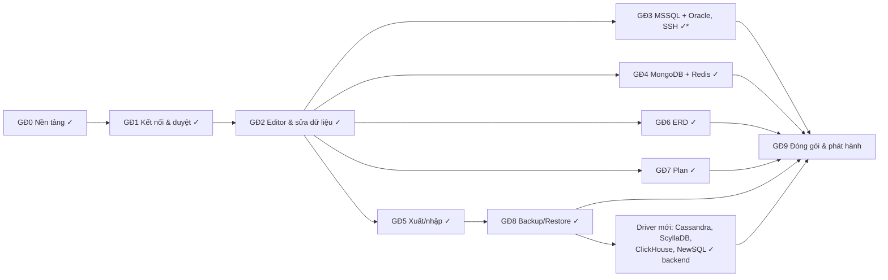

# DBStudio — Lộ trình

> Trạng thái: v0.4 — GĐ0–GĐ1 xong; GĐ2–GĐ8 đã hiện thực (còn phần chưa kiểm chứng, ghi ở từng giai đoạn); đợt **tồn đọng + GĐ9 driver mới** (trừ Oracle) xong **phần backend** trên nhánh `feature/quandh/backlog` theo [design/backlog-gd9.md](design/backlog-gd9.md) — phần UI tách thành mục "Việc UI để lại". Mã yêu cầu theo [requirements.md](requirements.md) (cột Trạng thái); kiến trúc theo [architecture.md](architecture.md); hợp đồng GĐ2–GĐ8 theo [design/phase2-8.md](design/phase2-8.md).

## 1. Cách làm việc

- Nhánh tích hợp: `develop`. Mỗi giai đoạn (hoặc gói việc trong giai đoạn) làm trong một git worktree tại `.claude/worktrees/<ten-viec>`, nhánh `feature/quandh/<ten_viec>`, tách từ `develop` mới nhất. GĐ2–GĐ8 chia thành Bước 0 (dựng khung hợp đồng) + 12 gói A–L chạy song song (design §7), gộp vào `feature/quandh/phase2_complete`.
- Một giai đoạn **xong** khi: mọi yêu cầu **Must** trong phạm vi đã hiện thực, tiêu chí hoàn thành kiểm chứng được, CI xanh trên 3 OS, tài liệu được cập nhật. Yêu cầu Should/Could chưa làm được ghi lại và chuyển sang giai đoạn sau.
- Với mỗi giai đoạn có driver mới: integration test với DB thật (Docker) là một phần của tiêu chí hoàn thành.
- Quy ước trạng thái tiêu chí: `[x]` = đã kiểm chứng bằng test tự động (unit hoặc integration với Docker, chạy cục bộ trên macOS); `[ ]` kèm ghi chú = còn thiếu hoặc chưa kiểm chứng.

## 2. Vì sao thứ tự này

1. **Kiểm chứng kiến trúc driver sớm trên 2 DB dễ nhất** (PostgreSQL, MySQL).
2. **Query editor + sửa dữ liệu là lõi dùng hằng ngày**; export, ERD, plan, backup dựng trên nền thực thi query + metadata đã ổn định.
3. **MSSQL + Oracle trước NoSQL** vì cùng mô hình quan hệ; SSH tunnel đi cùng.
4. **MongoDB + Redis** cần view riêng (document, key-value).
5. **Export → ERD → Plan → Backup**: export là nền cho backup logic (sinh DDL + stream dữ liệu).
6. **Đóng gói/phát hành** khi tính năng đủ; driver mở rộng chỉ là thêm crate.

\* Oracle: integration test với DB thật chưa chạy. Driver mới được làm trước đóng gói (đợt tồn đọng + GĐ9), chỉ phần backend.

**Trạng thái kiểm chứng chung (GĐ2–GĐ8 + đợt tồn đọng)**: unit test + integration test với Docker (PG 12/16, MySQL 5.7/8, MariaDB 10.4/10.6, SQL Server 2022, MongoDB 4.4/7, Redis 6.2/7.4, Valkey 8, sshd; ScyllaDB 2026.1, Cassandra 5, ClickHouse 26.3, CockroachDB 25.4, TiDB 8.5, YugabyteDB 2025.2 cho export/backup; backup/restore với mọi hệ trừ Oracle) + Vitest, clippy/fmt sạch — tất cả **chạy cục bộ trên macOS**. Chưa kiểm chứng: giao diện trong cửa sổ Tauri thật, phần backend đợt tồn đọng chưa có UI, Windows/Linux, NTLM thật, Azure SQL, Oracle IT với DB thật (chờ RAM Docker), ClickHouse 23.8, CI trên GitHub.

---

## GĐ0 — Nền tảng *(xong; còn chờ kiểm chứng trên Windows/Linux và CI GitHub)*

Workspace, `dbstudio-core` (trait `Driver`/`Session`, `Value`, `Capabilities`...), khung giao diện (sidebar, tab, status bar), theme, vi/en, Tauri capabilities tối thiểu + CSP, CI 3 OS.

- [ ] `pnpm tauri dev` chạy trên macOS, Windows, Linux. — *Đạt trên macOS; Windows/Linux chưa build lần nào.*
- [x] Đổi ngôn ngữ/theme có hiệu lực ngay và giữ sau khi khởi động lại.
- [x] `cargo test --workspace` pass, `dbstudio-core` không phụ thuộc `tauri`.
- [ ] CI xanh trên 3 OS. — *Workflow có đủ bước nhưng chưa chạy trên GitHub (chưa có remote).*

---

## GĐ1 — Kết nối & duyệt dữ liệu (PostgreSQL + MySQL) *(xong)*

Driver PG/MySQL, `dbstudio-store` (SQLite + keychain), kết nối TLS, cây đối tượng, lưới chỉ đọc, log xoay vòng. Đợt hoàn thiện tồn đọng (commit `a06ebba`, `6dd3987`) đã làm: tìm đối tượng phía server (BROWSE-06), kéo thả profile/nhóm (CONN-02), trang cài đặt (mức log, trần lưới, hiển thị `timestamptz`, mở thư mục log), lưu giá trị ô ra file (DATA-07), ẩn/ghim/đổi thứ tự cột (DATA-12), che mật khẩu trong log + test quét mật khẩu + test keychain thật (tuỳ chọn), dev bridge, integration test MySQL 5.7 và MariaDB 10.4.

Còn lại từ GĐ1 (chuyển vào mục "Tồn đọng" bên dưới): benchmark lưới 1 triệu dòng trên 3 webview, CI GitHub, Windows/Linux.

---

## GĐ2 — Query editor & sửa dữ liệu *(đã hiện thực)*

Gói A (dbstudio-sql), B (editor backend: `lease_kit`, lease PG/MySQL, guard, lịch sử), C (editor frontend), D (sửa dữ liệu).

- [x] Autocomplete gợi ý cột theo alias (`SELECT u.| FROM users u`) — Vitest.
- [x] Script 3 câu → 3 tab kết quả, số dòng ảnh hưởng, NOTICE PostgreSQL — IT PG/MySQL/MariaDB.
- [x] `pg_sleep(60)` / `SLEEP(60)` huỷ < 2 s và server xác nhận — IT.
- [x] Lỗi cú pháp đánh dấu đúng dòng/cột (kể cả ký tự ngoài BMP trước vị trí) — Vitest.
- [x] Manual commit: kết nối khác không thấy UPDATE chưa commit, rollback hoàn tác, đóng lease khi transaction mở → rolled back; đóng tab hỏi xác nhận — IT + Vitest.
- [x] Read-only từ chối INSERT/UPDATE/DELETE/DDL ở backend (test gọi command trực tiếp).
- [x] Production: `DELETE FROM t` (không WHERE), `DROP TABLE` → `confirmationRequired`; token sai/hết hạn/dùng lại, gõ sai tên DB bị từ chối.
- [x] Sửa 3 ô + thêm 1 + xoá 1 → preview SQL → commit một transaction; lỗi ở thay đổi thứ 2 → rollback toàn bộ — IT PG/MySQL (MSSQL, Oracle có code tương đương).
- [x] Bảng không PK/unique: lưới chỉ đọc kèm lý do.
- [x] Lịch sử query còn sau khi mở lại store.
- [ ] Kiểm tay trong cửa sổ Tauri với DB thật. — *Mới kiểm qua mock IPC/dev bridge trong trình duyệt.*

Chưa làm trong phạm vi GĐ2 (backend đã làm ở đợt tồn đọng, UI còn lại): font editor, giới hạn dòng editor và timeout query trên trang Cài đặt (APP-05, QUERY-12), tự kết nối lại (CONN-12), sinh SELECT/INSERT mẫu và mở DDL trong editor (BROWSE-05/07); command palette (APP-08, Could) chưa làm.

---

## GĐ3 — MSSQL + Oracle, SSH tunnel *(đã hiện thực; Oracle chưa có IT với DB thật)*

Gói I (MSSQL + bản vá tiberius), J (Oracle), A (SSH).

- [x] SQL Server 2022 (Docker): kết nối TLS, cây, dữ liệu, chạy + huỷ query, sửa dữ liệu, explain, schema model, DDL chạy lại được, bulk — IT `mssql2022`.
- [ ] Oracle Free (Docker): cùng tiêu chí. — *Code đủ (kết nối, cây, dữ liệu, lease, sửa, explain, DDL, schema model) và có bộ IT trong `oracle-it`, nhưng chưa chạy được với DB thật (cần ~3 GB RAM cho Docker).*
- [x] MSSQL: nhiều result set + `PRINT`; `GO n` chạy đúng từng batch.
- [x] Oracle: block `BEGIN ... END;`, `CREATE PROCEDURE ... /` không bị tách sai — unit test + test vi sai với `dbstudio-sql`.
- [x] Thiếu Instant Client: driver `unavailable` kèm chẩn đoán, không crash.
- [x] SSH tunnel tới PG/MySQL/MSSQL sau bastion bằng mật khẩu và key có passphrase; host key lạ → `sshHostKey` — IT `sshd`.
- [ ] Integration test MSSQL + Oracle trong CI. — *Job `integration` có cả `oracle-it`, chưa chạy trên GitHub.*
- [ ] NTLM với domain thật, Integrated (Windows), Azure SQL. — *Chưa kiểm; Azure AD chưa hỗ trợ.*

Quyết định đóng gói Oracle: không đóng gói Instant Client, nạp lúc chạy (design Q1).

---

## GĐ4 — MongoDB + Redis *(đã hiện thực)*

Gói K (MongoDB + document UI, `connection_parse_uri`), L (Redis + key-value UI, cây phân trang).

- [x] MongoDB 4.4 và 7: duyệt database/collection/index, document tree/JSON/bảng, sửa/thêm/xoá; `ObjectId`, `Decimal128`, `Date`, `Int64` khứ hồi đúng — IT.
- [x] `find` có filter/projection/sort, `aggregate` nhiều stage — IT.
- [x] Redis 6/7.4 và Valkey 8: duyệt bằng `SCAN` (KEYS bị vô hiệu trên `redis6`), đủ 6 kiểu xem/sửa, TTL — IT (bài 1 triệu khoá khi `DBSTUDIO_IT_BIG=1`).
- [x] Console Redis: lịch sử, gợi ý lệnh; `FLUSHDB` trên production cần xác nhận; read-only chặn lệnh ghi.
- [x] Tính năng không áp dụng tự ẩn theo `Capabilities`.
- [x] CONN-13: dán URI `mongodb://`, `mongodb+srv://`, `redis://` (cả `postgres`, `mysql`, `sqlserver`, `oracle`).
- [ ] Integration test MongoDB + Redis trong CI. — *Chưa chạy trên GitHub.*

---

## GĐ5 — Xuất/nhập schema & dữ liệu *(đã hiện thực)*

Gói G (`dbstudio-export`, `JobManager`, `PathGrants`, wizard, trung tâm job). Import được làm theo mặc định đề xuất (requirements §6 câu 1).

- [x] PG/MySQL: "cả hai" ra SQL → chạy lại vào DB trống → số bảng/dòng/checksum khớp — IT.
- [x] XLSX mỗi bảng một sheet + data dictionary, tách sheet khi vượt giới hạn (test với giới hạn hạ).
- [x] CSV nhiều bảng → `.zip`, UTF-8 BOM.
- [x] JSON array / NDJSON + `schema.json`.
- [x] Huỷ giữa chừng không để lại file (file tạm + đổi tên); bảng lớn chạy stream (`DBSTUDIO_IT_BIG=1`).
- [x] Xuất từ kết quả query (đúng một câu) cho mọi định dạng.
- [x] Import CSV có mapping cột vào PG/MySQL, lỗi báo kèm số dòng.
- [ ] Ma trận MSSQL/Oracle/Mongo/Redis. — *Đợt tồn đọng: IT Mongo/Redis (export Keys, làm phẳng, import Mongo/Redis), khứ hồi giá trị lớn, ma trận 6 DB mới (`it_newdb`); MSSQL qua IT backup; Oracle chưa có IT.*

---

## GĐ6 — ERD *(đã hiện thực)*

Gói F (`schema_model` + `generate_ddl` PG/MySQL; MSSQL/Oracle/Mongo do gói I/J/K), ERD tab.

- [x] Schema mẫu Pagila (PG) / Sakila (MySQL): đủ bảng, PK, FK, bản số crow's foot đúng — IT.
- [x] `generate_ddl` toàn DB chạy lại vào DB trống tạo đủ đối tượng (FK ở PostData) — IT.
- [x] "Bảng X + liên quan N bậc" (1–3 bậc).
- [x] Lưu/mở lại giữ vị trí; bảng/cột đã đổi được đánh dấu; xung đột phiên bản layout được phát hiện.
- [ ] Auto layout 100 bảng < 3 s đo trên app thật. — *Layout chạy trong Web Worker (elk); chưa đo trên WebView Tauri.*
- [ ] Xuất PNG/SVG/PDF trên WebView của app. — *Có test sinh file trong jsdom; chưa kiểm trên WKWebView/WebView2/WebKitGTK (rủi ro R7).*

---

## GĐ7 — Phân tích query dạng sơ đồ *(đã hiện thực)*

Gói E (`dbstudio-plan`, explain PG/MySQL, plan tab); explain MSSQL/Oracle/Mongo do gói I/J/K.

- [x] Fixture cho 8 định dạng (PG JSON, MySQL JSON v1/v2/tree, MariaDB JSON, SHOWPLAN XML, Oracle plan rows, Mongo explain) parse thành cây chuẩn hoá — unit test.
- [x] Sơ đồ hiển thị cost, rows ước tính/thực tế, thời gian; nhánh nóng tô đậm.
- [x] Cảnh báo full scan bảng lớn, ước lượng lệch ≥ 10×, spill, nested loop nhiều dòng.
- [x] Chọn node đồng bộ sơ đồ / bảng / raw — Vitest.
- [x] `EXPLAIN ANALYZE UPDATE` trong transaction rollback, dữ liệu không đổi (IT PG); MySQL ANALYZE câu ghi → `unsupported`.
- [x] So sánh 2 plan (PLAN-06); lưu/mở `.dbplan.json`. Lịch sử plan (PLAN-07): backend xong ở đợt tồn đọng, panel UI chưa.

---

## GĐ8 — Backup/Restore + lịch tự động *(đã hiện thực; GUI nền chưa kiểm tay)*

Gói H: `dbstudio-backup` (container `.dbsbak`, mã hoá, engine logic = `generate_ddl` + export engine, tool native, retention, scheduler), `dbstudio-cli`, tray/autostart/single-instance/thông báo OS, UI tab Backup. Chi tiết: architecture §12.

- [x] Backup tích hợp rồi restore vào database trống: số dòng/dữ liệu khớp — IT PG 12/16, MySQL 8, MariaDB (gồm identity, partition, DB lớn không bị cắt, qua SSH tunnel); đợt tồn đọng thêm MSSQL 2022, MongoDB 7/4.4, Redis 7/Valkey 8 và 6 DB mới. *Oracle chưa test.*
- [x] Tool native: `pg_dump`/`mysqldump` backup + restore thành công (IT qua shim chạy tool trong container); không có tool → `problem` hiển thị. *Đợt tồn đọng: MSSQL `BACKUP DATABASE`, ClickHouse/CockroachDB `BACKUP` phía server, `mysqldump` TiDB, `ysql_dump` có IT; Oracle Data Pump chưa có.*
- [x] Nén zstd/gzip và mã hoá: sai passphrase / file bị sửa / bị cắt → `integrity` — unit test.
- [x] Lịch `*/5 * * * *` đúng giờ, chạy bù đúng một lần, retention "giữ N" xoá đúng file và giữ bản mới nhất — unit test với đồng hồ giả.
- [ ] Lịch chạy khi cửa sổ đã đóng (app ở tray). — *Code có (close-to-tray, scheduler trong tiến trình); chưa kiểm tay.*
- [ ] Thông báo OS khi thành công/thất bại. — *Code có, nội dung vi/en theo ngôn ngữ (đợt tồn đọng); chưa kiểm tay.* Nhật ký `backup_runs` ghi thời lượng, kích thước, lỗi — có test.
- [ ] Autostart bật/tắt được trên cả 3 OS. — *Code có (`--background`); chưa kiểm trên OS nào.*
- [x] Restore vào kết nối production (hoặc `clean`) bắt buộc gõ tên database; CLI cần `--yes --confirm-text` và database đích chỉ rõ.
- [x] CLI `backup --job` dùng chung khoá file với app (job đang chạy → mã thoát 3).

---

## Tồn đọng (sau GĐ2–GĐ8) — đợt tồn đọng + GĐ9 *(backend xong)*

Thiết kế và chia gói: [design/backlog-gd9.md](design/backlog-gd9.md) (khác biệt khi triển khai ở §9 của tài liệu đó). Đợt này **không làm UI** (một session khác đang sửa frontend); phần UI ghi ở "Việc UI để lại".

**Code đã làm (backend, có test tự động):**
- [x] MySQL `ANSI_QUOTES` trong lexer/guard (+ `/*T!` TiDB, `BATCH ON`); dialect theo từng lease (`Lease::script_dialect`).
- [x] Import CSV nhận `null_text` (khứ hồi với export).
- [x] Export Mongo CSV/XLSX làm phẳng (`flatten_fields`, ô EJSON mặc định); export nguồn `Keys` Redis → JSON/NDJSON.
- [x] Import vào MongoDB (CSV/XLSX/JSON, `$document`, Skip/Update) và Redis (`KeyRecord`, `KeyChange::Put`).
- [x] `KeyChange` list có `expected`; sửa document Mongo có `expected` (phát hiện sửa đồng thời).
- [x] `Error::Invalid` và quét `Error::Other` cho đầu vào sai.
- [x] Dọn file tạm export mồ côi khi khởi động (`export.recentDirs`).
- [x] Preview import dùng dialect đã nhớ của kết nối (MariaDB), báo `dialectGuessed`.
- [x] Lease keepalive; tự kết nối lại (CONN-12) giữ `sessionId`, mở lại lease nhàn rỗi, `lease_reopen`, event `session://state` — IT mất mạng giả lập PG/MySQL.
- [x] Nhãn môi trường tuỳ chỉnh (CONN-03), setting mới (font, cỡ chữ, `autoReconnect`, `keepaliveSecs`, lịch sử plan, `language`) có validate, cờ `dirty` của tab, migration v7.
- [x] `script_generate` (SELECT/INSERT/UPDATE/DELETE mẫu, 8 dialect); lịch sử plan (PLAN-07); `DriverDiagnostics.checks`; URI scheme mới; đổi tên thư mục saved query không trùng.
- [x] PG: lease đổi database (kết nối mới / `SET database` trên Cockroach).
- [x] MSSQL: đọc LOB của query tự do theo `maxLobBytes` (bản vá tiberius 5); export/backup đọc đủ LOB.
- [x] Backup logical MongoDB/Redis; restore một phần backup logical (marker có nonce, `formatVersion` 3, CLI `--object`); IT backup/restore MSSQL/Mongo/Redis; thông báo OS vi/en.
- [x] R6 (kiểm tên host TLS qua SSH) cho MySQL, Redis, MongoDB (SOCKS5, cả replica set), Cassandra/ScyllaDB, ClickHouse.
- [x] Test tunnel MSSQL tự bỏ qua khi thiếu container (`DBSTUDIO_IT_STRICT=1` để bắt buộc).

**Kiểm chứng còn lại (không cần code mới):**
1. Chạy integration test Oracle với DB thật (`docker/oracle-it/run-tests.sh`, cần ~3 GB RAM cho Docker) và sửa lỗi phát sinh.
2. Kiểm tay trong cửa sổ Tauri thật trên macOS với DB Docker: editor/lease/transaction, sửa dữ liệu, document/key view, plan, ERD (xuất PNG/PDF), export/import, SSH (hộp thoại host key), backup/restore + lịch, tray, close-to-tray, autostart, single-instance, thông báo OS.
3. Đẩy repo lên remote, cho CI (3 OS + `integration` theo nhóm `core`/`wide`/`analytics`/`newsql` + `integration-extra`) chạy xanh. Lưu ý: lệnh nhóm `newsql` trong `ci.yml` lọc `-- cockroach`/`-- tidb` theo tên test, trong khi đa số test flavor PG mang hậu tố `_crdb`/`_yb` — nên chạy theo file (`--test it_flavor`, `--test it_tidb`).
4. Build và chạy trên Windows, Linux; benchmark lưới 1 triệu dòng trên WKWebView, WebView2, WebKitGTK → chốt TanStack Virtual hay canvas grid.
5. MSSQL: NTLM với domain thật; quyết định Azure AD (requirements §6 câu 6).
6. Driver mới: profile `extra` (ClickHouse 23.8 — chưa kiểm; Cassandra 4.1, ScyllaDB 6.2), bộ `it_flavor` với YugabyteDB (profile `heavy`), R6 ClickHouse/Cassandra qua `sshd` thật.

### Việc UI để lại

Backend/command đã sẵn; chỉ còn giao diện (chi tiết dữ liệu/command ở backlog-gd9.md §7):

| Tính năng | Việc UI | Dữ liệu/command sẵn có |
|---|---|---|
| Cài đặt (APP-05) | Font, cỡ chữ editor, `editorMaxRows`, `queryTimeoutMs`, `historyEnabled`, `autoReconnect`, `keepaliveSecs`, lịch sử plan, ngôn ngữ (đồng bộ i18n → `settings_set{language}`), hành vi đóng cửa sổ + autostart (chuyển từ tab Backup); xử lý lỗi `invalid` của `settings_set` (trước đây kẹp giá trị) | `settings_get/set`, `background_get/set` |
| CONN-03 | Ô nhãn môi trường tuỳ chỉnh; hiển thị nhãn + màu ở cây/tab/status bar | `environmentLabel`, `color` |
| CONN-12 | Banner mất/đang kết nối lại, hộp thoại mở lại lease có transaction, ô nhập mật khẩu khi `session_reconnect` cần | `session://state`, `session_reconnect`, `lease_reopen` |
| BROWSE-05/07 | Menu "Sinh SELECT/INSERT/UPDATE/DELETE", "Mở DDL trong editor" | `script_generate`, `object_ddl` |
| PLAN-07 | Panel lịch sử plan, mở lại thành plan tab | `plan_history_*` |
| ERD-07/08 | Công tắc hiện comment, nét đứt cho quan hệ suy luận | `includeComments`, `Relation.inferred` |
| Export | Nguồn Redis keys (pattern, database); chọn trường làm phẳng Mongo | `ExportSource::Keys`, `flattenFields`, `ejsonCells` |
| Import | Đích Mongo/Redis, `PutMode`, ô "Chuỗi NULL" (`nullText`), ghi chú "dialect đoán" | `ImportTarget::{Existing,Keys}`, `nullText`, `dialectGuessed` |
| Sửa dữ liệu | Gửi `expected` (list Redis — `ListRemoveAt` theo index giảm dần —, document Mongo), hiển thị xung đột; hiển thị `Editability.notes` (LWT, upsert, mutation); lưới ẩn tổng số khi `exactCount=false`, ẩn sort khi `tableSort=false` | `expected`, `notes`, `Capabilities` |
| Backup | Engine logical Mongo/Redis trong form job; chọn đối tượng khi restore; tool native mới | `backup_inspect.objects`, `NativeTool` mới |
| Chẩn đoán driver | Danh sách check | `DriverDiagnostics.checks` |
| Driver mới | Kind mới trong dialog kết nối (icon, tên i18n, field: Cassandra `localDc`/`consistency`/`lwtEdits`/`singleNode`, ClickHouse HTTPS/nén/`editing`, Cockroach `cluster`); highlight + formatter CQL/ClickHouse; icon `Dictionary`, `FOLDER_KEYS` `dictionaries`/`aggregates` + i18n; mẫu dán URI mới; badge "read-only chỉ ở ứng dụng" cho TiDB (`readOnlyEnforcement`) | descriptor, `ScriptDialect`, `ObjectKind`, `ServerInfo.extra` |
| R6 | Bỏ cảnh báo R6 (MySQL/MongoDB/Redis qua SSH) trong dialog kết nối | — |
| Editor/tab | Đổi tên thư mục saved query; chấm "chưa lưu" + hỏi khi đóng theo cờ `dirty`; i18n lý do `write`/`keywordScan` | `saved_folder_save`, `EditorTabState.dirty`, `DestructiveReason` |
| Từ trước (thuần UI) | Command palette (APP-08); `DocumentTable` ảo hoá cột; đếm ngược hạn token xác nhận (`expiresInMs`); chọn nhiều dòng trong lưới; close-to-tray/autostart trong trang Cài đặt | — |

### Tồn đọng mới

**Code còn thiếu / cần sửa:**
- Oracle (loại khỏi đợt này): IT với DB thật, Data Pump (`expdp`/`impdp`), UI chọn Instant Client, `Skip` khi import Oracle, `DriverDiagnostics` của Oracle (`nativeClient`, `clientVersion`).
- Redact chưa che đối số `s3(...)` của ClickHouse (khoá truy cập).
- `PlanRule` mới: `FinalOnLargeTable` (ClickHouse `FINAL`), `Tombstones` và `SlowRequest` (CQL trace) — hiện chỉ là `warnings` ở node.
- `Editability` chưa có trạng thái "insert-only" rõ ràng (ClickHouse `editing=insertOnly`, bảng `Replacing/Collapsing…MergeTree` đang là `editable=true` + `key_columns=[]`).
- `RestoreOutcome` chưa có `warnings` (cảnh báo restore một phần đi qua log job).
- MSSQL: test codepage (collation không UTF-8) của tiberius chưa viết.
- Cassandra: `Require` không dùng `ca_cert_path`; `FirstNodeOnly` chọn node đầu tiên; bulk dùng literal thay prepared statement.
- ClickHouse `FixedString` có NUL đệm: khứ hồi qua CSV/JSON chưa bảo đảm.

**Kiểm chứng / hạ tầng:** GUI native trong cửa sổ Tauri; CI trên GitHub; Windows/Linux; MSSQL NTLM với domain thật; ClickHouse 23.8 và R6 ClickHouse/Cassandra qua `sshd`; test MongoDB `wrong_password_is_an_authentication_error` thỉnh thoảng chậm (server selection 10 s).

**Giữ mở, chưa gắn giai đoạn:** phân trang keyset thay OFFSET; hạn chế TLS của `mysql_async` (`verify-ca` = `verify-full`, `webpki-roots`); chế độ TLS mặc định (requirements §6 câu 8); Redis Cluster/Sentinel; phương án Oracle thuần Rust (`oracle-rs`); Cassandra qua SSH nhiều node.

---

## GĐ9+ — Tiếp theo

### GĐ9 — Đóng gói & phát hành

**Phạm vi:** NFR-PLAT-01, NFR-PLAT-02, APP-06; installer Windows (MSI/NSIS), macOS (DMG), Linux (deb, rpm, AppImage); ký Windows, ký + notarize macOS; CI release + manifest updater; chốt tên/identifier (requirements §6 câu 7); hướng dẫn cài Oracle Instant Client.

- [ ] Push tag `vX.Y.Z` → CI tạo đủ installer cho 3 OS và bản phát hành nháp.
- [ ] Cài trên máy sạch Windows 10/11, macOS 12+ (Intel + Apple Silicon), Ubuntu 22.04 & Fedora: app chạy được, không cảnh báo chưa ký.
- [ ] Bản cũ tự cập nhật lên bản mới; chữ ký cập nhật sai bị từ chối.
- [ ] Dữ liệu cục bộ và keychain còn nguyên sau khi cập nhật.
- [ ] Khởi động < 2 giây (NFR-PERF-01) trên bản release.

### Driver mới — Cassandra, ScyllaDB, ClickHouse, NewSQL *(backend xong trong đợt tồn đọng + GĐ9; UI chưa)*

Làm trước đóng gói, theo [design/backlog-gd9.md](design/backlog-gd9.md) §3. Chỉ thêm crate/flavor; core chỉ thêm method có mặc định (`Session::capabilities()`, `scan_keys()`, `Lease::script_dialect()` — lý do ở architecture §4–§5).

- [x] `drivers/cassandra` (`scylla` 1.10, hai `Driver`): cây `system_schema`, CQL (lệnh cqlsh trong driver), phân trang, lease theo keyspace, sửa dữ liệu LWT, DDL (`DESCRIBE`), tracing → `CqlTrace`, export/import, backup logical — IT `scylla` 2026.1 (+ TLS), `cassandra5`.
- [x] `drivers/clickhouse` (HTTP + RowBinary): cây (+ dictionary), kiểu chính xác, huỷ `KILL QUERY`, read-only `readonly=2`, lease HTTP session, sửa MergeTree (mutation, `count() = 1`), `EXPLAIN` JSON, bulk RowBinary, backup logical + `BACKUP` phía server — IT `clickhouse26`. *ClickHouse 23.8 chưa kiểm.*
- [x] CockroachDB, YugabyteDB (flavor PG), TiDB (flavor MySQL): tự nhận diện qua `version()`, capabilities theo server, EXPLAIN riêng (Cockroach text, TiDB row), DDL, export/backup + tool native — IT `cockroach`, `tidb`; YugabyteDB có IT export/backup, bộ `it_flavor` chưa có báo cáo chạy xanh.
- [x] `dbstudio-sql`: dialect CQL, ClickHouse (≥ 100 ca phân loại mỗi dialect, fuzz không panic); `dbstudio-plan`: 4 parser mới kèm fixture chụp từ server.
- [ ] UI: kind mới trong dialog kết nối, highlight/formatter CQL/ClickHouse, field riêng, badge read-only TiDB (mục "Việc UI để lại").
- [ ] IT trong CI (matrix nhóm `wide`/`analytics`/`newsql`, `heavy`/`extra` hằng tuần). — *Chưa chạy trên GitHub.*

---

## 3. Bảng truy vết yêu cầu → giai đoạn

| Nhóm | GĐ | Trạng thái (chi tiết: requirements, cột Trạng thái) |
|---|---|---|
| CONN-01..05, 07..09 | GĐ1 (+GĐ3, GĐ4, đợt tồn đọng cho DB mới) | Xong; CONN-03 nhãn tuỳ chỉnh backend xong, UI chưa; dialog chưa có 6 kind mới |
| CONN-06 | GĐ3 | Xong; R6 đã giải quyết (đợt tồn đọng) |
| CONN-10..12 | GĐ2 | CONN-10/11 xong (TiDB read-only chỉ ở ứng dụng); CONN-12 backend xong, UI chưa |
| CONN-13 | GĐ4 | Xong |
| BROWSE-01..08 | GĐ1, GĐ4 | Xong; BROWSE-05/07 backend (`script_generate`) xong, menu UI chưa |
| DATA-01..12 | GĐ1, GĐ2, GĐ4 | Xong |
| QUERY-01..16 | GĐ2–GĐ4 | Xong; QUERY-12 thiếu ô cài đặt; QUERY-02 chưa highlight CQL/ClickHouse |
| PLAN-01..07 | GĐ7 | Xong (12 định dạng); PLAN-07 lịch sử plan backend xong, UI chưa |
| ERD-01..08 | GĐ6 | Xong; ERD-07/08 một phần |
| EXPORT-01..10, IMPORT-01..03 | GĐ5 | Xong; Mongo flatten, Redis export, import Mongo/Redis backend xong, wizard chưa |
| BACKUP-01..15 | GĐ8 | Xong (IT mọi hệ trừ Oracle); BACKUP-03 một phần (Data Pump chưa); restore một phần backend xong, UI chưa |
| APP-01..05, 07, 09 | GĐ0–GĐ5 | Xong; APP-05 một phần (backend setting xong, trang Cài đặt chưa) |
| APP-06 | GĐ9 | Chưa |
| APP-08 | — | Chưa (Could) |
| NFR-PLAT-01/02, NFR-PERF-01 | GĐ9 | Chưa kiểm |
| NFR khác | Mọi GĐ | Xem requirements §3 |
